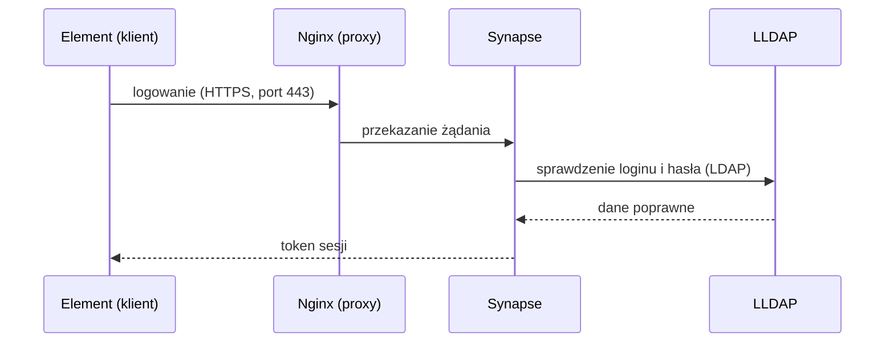
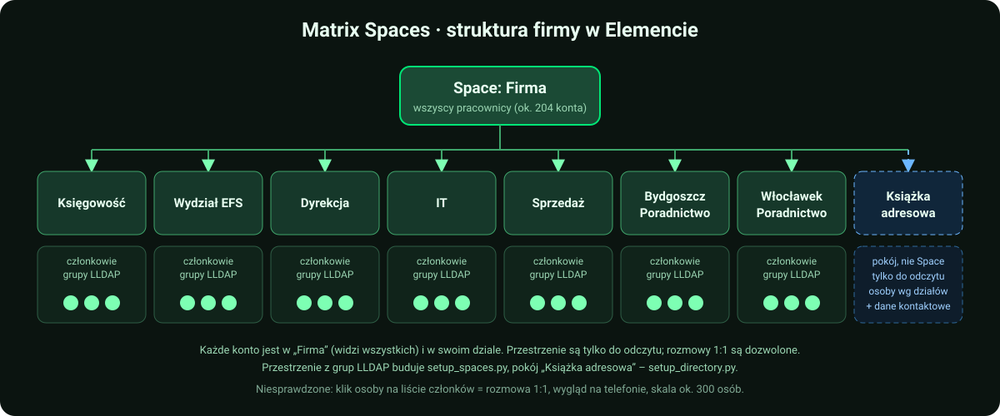

<p align="center">
  
</p>

# Matrix PoC – komunikator firmowy (matrix.local)

Proof of Concept zamkniętego komunikatora firmowego opartego na Matrix:

- **Synapse** – serwer Matrix (federacja wyłączona),
- **LLDAP** – lekki serwer katalogowy symulujący Active Directory; logowanie kontami z LDAP,
- **Coturn** – STUN/TURN dla rozmów audio/wideo 1:1 (WebRTC),
- **Nginx** – reverse proxy z SSL,
- **PostgreSQL** – baza Synapse,
- **Synapse Admin** – webowy panel administracyjny (konta, pokoje, przestrzenie), dostępny tylko z VM / przez tunel SSH
  (patrz [Synapse Admin](docs/administrowanie.md#synapse-admin--panel-www-do-administrowania-serwerem)),
- **Matrix Spaces** – struktura firmy w Elemencie: przestrzeń „Firma” (wszyscy pracownicy) i podprzestrzenie-działy
  (budowane skryptem z grup LLDAP; patrz [Książka adresowa dla całej firmy](#książka-adresowa-dla-całej-firmy)),
- **Pokój „Książka adresowa”** – lista pracowników z działami jako wiadomości w pokoju tylko do odczytu, podpiętym pod
  przestrzeń „Firma” (patrz [Etap 2](#etap-2)),
- **Tailscale** – prywatna sieć, która symuluje izolowaną sieć firmową między lokalizacjami.

Instrukcja jest napisana tak, żeby dało się ją odtworzyć od zera – krok po kroku, z komendami do wklejenia.
Domena testowa to `matrix.local`, reverse proxy to Nginx.

> **Status:** to środowisko testowe (PoC), nie produkcyjne. Przed wdrożeniem przejdź listę kontrolną
> w sekcji [Przed wdrożeniem produkcyjnym](#przed-wdrożeniem-produkcyjnym).
>
> Zwijane ramki **🏭 Produkcja** (w całym dokumencie) zbierają, co trzeba zmienić przy wdrożeniu
> produkcyjnym – na PoC możesz je pominąć. Szukaj po 🏭.
>
> Oznaczenia: ✅ = sprawdzone w praktyce na PoC, ⚠️ = niesprawdzone albo sprawdzone tylko częściowo.

---

## Architektura

<p align="center">
  
</p>

Jak wygląda logowanie (uproszczony schemat):



---

## Spis treści

**Mapa etapów: [co uruchomić po zmianie](#mapa-etapów-i-co-uruchomić-po-zmianie)**

**Część 1 – Przygotowanie środowiska** ([opis](#czesc-1))

0. [Oznaczenia i zasady](#0-oznaczenia-i-zasady)
1. [Połącz się z VM](#krok-1--połącz-się-z-vm)
2. [Docker i Docker Compose](#krok-2--docker-i-docker-compose)
3. [Tailscale na serwerze](#krok-3--tailscale-na-serwerze)
4. [Pliki projektu na serwerze](#krok-4--pliki-projektu-na-serwerze)
5. [Sekrety i pliki lokalne](#krok-5--sekrety-i-pliki-lokalne)
6. [Certyfikaty (PKI)](#krok-6--certyfikaty-pki)
7. [Uruchomienie usług](#krok-7--uruchomienie-usług)
8. [Konta w LLDAP](#krok-8--konta-w-lldap)
9. [Klienci: Windows i Android](#krok-9--klienci)
    - [Komputer w innej lokalizacji (u kolegi)](#93-komputer-w-innej-lokalizacji-u-kolegi)
10. [Testy](#krok-10--testy)
    - [Drugie konto w Elemencie bez zamykania pierwszego](#drugie-konto-w-elemencie-bez-zamykania-pierwszego-przydatne-w-testach)

**Część 2 – Konta i książka adresowa** ([opis](#czesc-2)): Przygotowanie, Etap 0 (konto administratora), Etap 1 (konta w Synapse),
Etap 2 (książka adresowa: Spaces, pokój, dane dodatkowe), Etap 3 (bieżąca praca)

11. [Konta i książka adresowa](#czesc-2)
12. [Etap 3: bieżąca praca (administrowanie)](#administrowanie-synapse) – podręcznik, skrypty automatyzujące i przydatne komendy: [docs/administrowanie.md](docs/administrowanie.md)
13. [Przed wdrożeniem produkcyjnym](#przed-wdrożeniem-produkcyjnym) – [docs/produkcja.md](docs/produkcja.md)
14. [Rozwiązywanie problemów](#rozwiązywanie-problemów) – [docs/rozwiazywanie-problemow.md](docs/rozwiazywanie-problemow.md)
15. [Znane ograniczenia](#znane-ograniczenia-poc) – [docs/produkcja.md](docs/produkcja.md)
16. [Wygląd Element Desktop (opcjonalnie)](#wyglad-element-desktop) – [docs/wyglad-element.md](docs/wyglad-element.md)

<p align="center">
  
</p>

---

## Mapa etapów i co uruchomić po zmianie

Instrukcja ma **dwie części**:

- **Część 1 – Przygotowanie środowiska** (kroki 1–10): VM, Docker, Tailscale, certyfikaty, uruchomienie usług, LLDAP, klienci.
- **Część 2 – Konta i książka adresowa** (etapy 0–3): na działającym już komunikatorze budujesz konta, strukturę firmy
  i książkę adresową, a potem prowadzisz bieżącą pracę.

Dane płyną **w jedną stronę**: LLDAP (w firmie: Active Directory) → konta w Synapse → przestrzenie Spaces → książka adresowa.
Zmiany robisz **zawsze na początku łańcucha** i uruchamiasz skrypty po kolei od tego miejsca do końca. Ręczne poprawki
w Elemencie albo w panelu Synapse Admin (nazwy, członkostwo) nadpisze następne uruchomienie skryptu.


| Część / etap | Co | Czym | Gdzie |
|---|---|---|---|
| **Część 1** | VM, Docker, Tailscale, certyfikaty, 6 kontenerów, LLDAP, klienci | kroki 1–10 (ręcznie) | [Część 1](#czesc-1) |
| **Przygotowanie** | wyszukiwanie wszystkich użytkowników (A); konta i grupy-działy w LLDAP (w firmie: AD; w PoC testowa masa, B0) | `homeserver.yaml`; `seed_test_employees.py` | [Przygotowanie](#przygotowanie-jednorazowo) |
| **Etap 0** | Konto administratora Synapse | jedno polecenie SQL (raz) | [Etap 0](#etap-0) |
| **Etap 1** | Konta w Synapse z nazwą „Imię Nazwisko – Dział” | `provision_synapse_users.py` | [Etap 1](#etap-1) |
| **Etap 2** | Książka adresowa: 2.1 Spaces, 2.2 pokój z wiadomościami, 2.3 dane dodatkowe | `setup_spaces.py`, `setup_directory.py`, `directory_extra.csv` | [Etap 2](#etap-2) |
| **Etap 3** | Bieżąca praca: usuwanie pokoi, konta, panel, logi, kopie | Admin API, Synapse Admin, komendy | [Etap 3](#administrowanie-synapse) |

### Zmieniłem X – co uruchomić

Wszystkie skrypty: 🪟 **PC**, `cd scripts`, `venv\Scripts\activate`, najpierw `--dry-run`. Każdy loguje administratora Synapse,
więc **nie puszczaj ich pod rząd bez przerw** (HTTP 429, ok. 4 min – [Rozwiązywanie problemów](#rozwiązywanie-problemów), pkt 4).

| Co zmieniasz | Gdzie | Uruchom po kolei |
|---|---|---|
| **Nowy pracownik** | LLDAP: konto + grupa-dział | `provision_synapse_users.py` → `setup_spaces.py` → `setup_directory.py` |
| **Konto bez działu** (np. `a.nowak`, `j.kowalski`) albo zła nazwa/dział | LLDAP: dodaj do grupy-działu (lub popraw imię i nazwisko) | `provision_synapse_users.py` → `setup_spaces.py` → `setup_directory.py` |
| **Przeniesienie do innego działu** | LLDAP: zmień grupę | `provision_synapse_users.py` → `setup_spaces.py --prune` → `setup_directory.py` |
| **Odejście pracownika** | LLDAP: usuń/zablokuj; Synapse: dezaktywuj konto (panel lub Admin API) | `setup_spaces.py --prune` → `setup_directory.py` (nieaktywne konta znikają z listy) |
| **Nowy dział** | LLDAP: nowa grupa; nowa pozycja w `DEPARTMENTS` w `provision_synapse_users.py` (bez niej dział nie trafi do nazwy wyświetlanej); `SPACE_TREE` w `setup_spaces.py` (nowe stałe `id`) | `provision_synapse_users.py` → `setup_spaces.py` → `setup_directory.py --rebuild` (kolejność alfabetyczna) |
| **Telefon, pokój, piętro, stanowisko** | `scripts/directory_extra.csv` (nowe osoby: `setup_directory.py --write-extra-template`) | tylko `setup_directory.py` |
| **Ukryć konto techniczne w książce** | `DIRECTORY_EXCLUDE` w `.env` albo `--exclude login1,login2` | tylko `setup_directory.py` |
| **Nazwa lub temat pokoju książki** | `DIRECTORY_ROOM_NAME`, `DIRECTORY_ROOM_TOPIC` w `.env` | tylko `setup_directory.py` |
| **Nazwa przestrzeni „Firma”** | `SPACES_ROOT_NAME` w `.env` | tylko `setup_spaces.py` |
| **Hasło użytkownika** | tylko LLDAP (logowanie idzie przez LDAP) | nic z powyższych |

Zasada kciuka: zmiana **kto i w jakim dziale** zaczyna się w LLDAP i przechodzi przez wszystkie skrypty; zmiana **danych
kontaktowych** dotyczy tylko `setup_directory.py`.

---

## Zawartość repozytorium

```
docker-compose.yml                  6 usług: proxy, synapse, postgres, coturn, lldap, synapse-admin
.env.example                        wzór sekretów i ustawień (skopiuj do .env i ustaw własne wartości)
docker/synapse/Dockerfile           Synapse + moduł matrix-synapse-ldap3
synapse/homeserver.yaml.example     wzór konfiguracji Synapse (federacja wyłączona, Postgres, LDAP, Coturn)
synapse/matrix.local.log.config     konfiguracja logowania Synapse
nginx/conf.d/matrix.conf.example    wzór konfiguracji reverse proxy z SSL (+ blok panelu Synapse Admin na porcie 8080)
pki/generate-pki.sh, pki/v3.ext     Root CA + certyfikat serwera dla matrix.local
scripts/seed_test_employees.py      Przygotowanie B0: testowe konta i grupy-działy w LLDAP (też --reassign)
scripts/provision_synapse_users.py  Etap 1: zakładanie kont w Synapse z nazwą „Imię Nazwisko – Dział”
scripts/setup_spaces.py             Etap 2.1: drzewo Spaces (Firma + działy) z grup LLDAP, tylko do odczytu
scripts/setup_directory.py          Etap 2.2: książka adresowa jako wiadomości w pokoju tylko do odczytu (⚠️ pokój próbny OK, pełny przebieg niesprawdzony)
scripts/test_directory_message.py   zakończony eksperyment z układem wiadomości (zwijane <details> vs nagłówki; --measure = rozmiar)
scripts/directory_extra.csv         (tworzony lokalnie, w repo go nie ma) stanowisko/telefon/pokój/piętro dla książki adresowej
scripts/setup_main_room.py          biblioteka wspólna (klasa Synapse itd.) używana przez setup_spaces.py i setup_directory.py;
                                    NIE uruchamiać jako skryptu (pokoje wycofane)
scripts/requirements.txt            zależności Pythona dla skryptów (requests)
Matrix.md                           pierwotny plan testów
docs/img/*.svg                      grafiki do README (baner, architektura, mapa kroków, drzewo Spaces); wariant1/2 – archiwalne, nieużywane
docs/administrowanie.md             Etap 3: konto admina, Admin API, kopie, logi, panel Synapse Admin, skrypty, komendy
docs/rozwiazywanie-problemow.md     problemy 1-10 z diagnozą
docs/produkcja.md                   lista kontrolna przed produkcją, ramki 🏭, znane ograniczenia PoC
docs/wyglad-element.md              motywy i logo Element Desktop (opcjonalnie)
docs/klienci-dodatkowe.md           Android i komputer w innej lokalizacji (opcjonalnie)
docs/szkic-coturn-webrtc.md         szkic konfiguracji Coturn/WebRTC
element-layout/                     config.json, logo i motywy Element Desktop (opcjonalnie)
```

Prawdziwe pliki z hasłami, certyfikaty i klucze tworzysz u siebie na podstawie wzorów `*.example` (krok 5 i 6).

---

<a id="czesc-1"></a>
# CZĘŚĆ 1 – Przygotowanie środowiska

Kroki 1–10: od pustej VM do działającego komunikatora (Synapse, LLDAP, Coturn, Nginx, Postgres, panel Synapse Admin), do którego
logujesz się z Elementa kontem z LLDAP. Gdy to działa, przechodzisz do [Części 2](#czesc-2).

## 0. Oznaczenia i zasady

**Gdzie wpisujesz komendy** (przy każdym bloku jest znacznik):

| Znacznik | Gdzie | Jak wygląda |
|---|---|---|
| 🪟 **PC** | PowerShell na komputerze z Windows | `PS C:\Users\...>` |
| 🐧 **VM** | terminal na serwerze Ubuntu (przez SSH) | `uzytkownik@serwer:/opt/matrix$` |

**Wartości do podstawienia** (w komendach występują w nawiasach ostrych `<...>`):

| Placeholder | Co wpisać |
|---|---|
| `<IP_VM>` | adres VM w sieci lokalnej |
| `<UZYTKOWNIK>` | użytkownik Linuksa na VM |
| `<IP_TAILSCALE>` | adres Tailscale serwera (`tailscale ip -4` na VM) |
| `<PELNA-NAZWA-TS>` | pełna nazwa serwera w Tailscale, np. `matrix-test.nazwa-tailnetu.ts.net` (panel Tailscale albo `tailscale status`) |

**Najważniejsze zasady:**

1. **Nigdy nie wpisuj znaku `$` na początku komendy.** W dokumentacji `$` oznacza tylko „tu jest wiersz poleceń".
   Wpisanie `$bash ...` kończy się błędem `Permission denied`.
2. Komendy wklejaj **po jednej** i czytaj wynik, zanim pójdziesz dalej.
3. Wielkość liter ma znaczenie na Linuksie (`Matrix` ≠ `matrix`).
4. Jak coś nie działa – **nie kombinuj dalej**, zajrzyj do [Rozwiązywania problemów](#rozwiązywanie-problemów)
   i do logów (`docker compose logs`).
5. Domena testowa to `matrix.local`. Nie jest nigdzie zarejestrowana – komputery rozwiązują ją przez wpis
   w pliku `hosts` (krok 9).

**Wymagania:** VM z Debianem 12 lub Ubuntu 24.04 (min. 4 GB RAM, 2 vCPU – dla testu wystarczy; dla ok. 300
użytkowników rozmiar niesprawdzony), konto w Tailscale, komputery klienckie z Windows lub telefon z Androidem.

### Checklista postępu (Część 1)

Odhaczaj w swojej kopii na bieżąco; każdy krok ma na końcu własne sprawdzenie.

- [ ] [Krok 1 – Połącz się z VM](#krok-1--połącz-się-z-vm)
- [ ] [Krok 2 – Docker i Docker Compose](#krok-2--docker-i-docker-compose)
- [ ] [Krok 3 – Tailscale na serwerze](#krok-3--tailscale-na-serwerze)
- [ ] [Krok 4 – Pliki projektu na serwerze](#krok-4--pliki-projektu-na-serwerze)
- [ ] [Krok 5 – Sekrety i pliki lokalne](#krok-5--sekrety-i-pliki-lokalne)
- [ ] [Krok 6 – Certyfikaty (PKI)](#krok-6--certyfikaty-pki)
- [ ] [Krok 7 – Uruchomienie usług](#krok-7--uruchomienie-usług)
- [ ] [Krok 8 – Konta w LLDAP](#krok-8--konta-w-lldap)
- [ ] [Krok 9 – Klienci](#krok-9--klienci)
- [ ] [Krok 10 – Testy](#krok-10--testy)

Potem [Część 2](#czesc-2): Przygotowanie, Etap 0 (konto admina), Etap 1 (konta w Synapse), Etap 2 (książka adresowa).

---

## Krok 1 – Połącz się z VM

🪟 **PC**, PowerShell:

```powershell
ssh <UZYTKOWNIK>@<IP_VM>
```

Wpisz hasło (przy wpisywaniu nic się nie wyświetla – to normalne). Gotowe, gdy widzisz znak zachęty
na serwerze. Od teraz wszystko oznaczone 🐧 robisz w tym oknie.

---

## Krok 2 – Docker i Docker Compose

🐧 **VM**:

```bash
docker --version
docker compose version
```

Oba polecenia muszą pokazać numer wersji.

- Jeśli `docker compose` nie działa: `sudo apt install docker-compose-plugin`
- Jeśli `docker ps` pisze `permission denied`: `sudo usermod -aG docker <UZYTKOWNIK>`
  i **wyloguj się oraz zaloguj ponownie**.

---

## Krok 3 – Tailscale na serwerze

Tailscale to prywatna sieć VPN. Dzięki niej komputery klienckie „widzą" serwer, jakby były w jednej sieci.

🐧 **VM**:

```bash
curl -fsSL https://tailscale.com/install.sh | sh
sudo tailscale up
```

Komenda `tailscale up` wypisze **link** – otwórz go w przeglądarce i zaloguj się kontem Tailscale. Potem:

```bash
tailscale ip -4
```

Wynik (np. `100.64.12.34`) to **`<IP_TAILSCALE>`**. Zapisz go – wpiszesz go w pliku `.env` i na klientach.

Pozostałe komputery (i telefon) muszą być w **tym samym tailnecie** (zaproś użytkownika albo udostępnij
mu maszynę w panelu Tailscale).

**Sprawdzenie:** `tailscale ip -4` pokazuje adres `100.x.x.x`, a w panelu Tailscale serwer ma status **Connected**.

---

## Krok 4 – Pliki projektu na serwerze

Projekt ma trafić do `/opt/matrix` na VM. Wybierz jedną drogę.

**A. Przez git** (🐧 **VM**; repozytorium prywatne wymaga uwierzytelnienia):

```bash
sudo mkdir -p /opt/matrix && sudo chown <UZYTKOWNIK>:<UZYTKOWNIK> /opt/matrix
git clone <ADRES_REPOZYTORIUM> /opt/matrix
```

**B. Przez scp z komputera, na którym masz katalog projektu** (🪟 **PC**; najpierw na VM:
`sudo mkdir -p /opt/matrix && sudo chown <UZYTKOWNIK>:<UZYTKOWNIK> /opt/matrix`):

```powershell
scp -r "<KATALOG_PROJEKTU>\*" <UZYTKOWNIK>@<IP_VM>:/opt/matrix/
```

Sprawdzenie (🐧 **VM**):

```bash
cd /opt/matrix
ls -a
```

Musisz widzieć m.in. `docker-compose.yml`, `.env.example`, `docker`, `nginx`, `pki`, `synapse`.
(Plik `.env.example` jest ukryty – dlatego `ls -a`.)

---

## Krok 5 – Sekrety i pliki lokalne

W repozytorium są wzory z placeholderami `CHANGE_ME_...`. Tworzysz z nich prawdziwe pliki
**na serwerze**:

🐧 **VM**:

```bash
cd /opt/matrix
cp .env.example .env
cp synapse/homeserver.yaml.example synapse/homeserver.yaml
cp nginx/conf.d/matrix.conf.example nginx/conf.d/matrix.conf
```

### 5.1 Hasła

Wygeneruj osobne, losowe wartości (bez znaków specjalnych, bezpieczne dla `.env` i YAML) – po jednej dla
każdego z pięciu sekretów:

```bash
openssl rand -hex 24
```

Wpisz je w `.env` (`nano .env`; w `nano`: `Ctrl+O`, `Enter` – zapis, `Ctrl+X` – wyjście):

```
TS_IP=<IP_TAILSCALE>
POSTGRES_PASSWORD=...
TURN_SECRET=...
LLDAP_ADMIN_PASSWORD=...
LLDAP_JWT_SECRET=...
LLDAP_KEY_SEED=...
```

> ### ⚠️ Trzy hasła muszą być w DWÓCH plikach: `.env` ORAZ `synapse/homeserver.yaml`
>
> Synapse **nie czyta zmiennych z `.env`** w swoim pliku konfiguracyjnym, więc trzy wartości są wpisane
> na sztywno w `homeserver.yaml` i muszą być **identyczne** jak w `.env`. Zmiana w jednym pliku bez drugiego
> = Synapse nie połączy się z bazą / LDAP / Coturn.
>
> | Wartość | W `.env` | W `synapse/homeserver.yaml` | Do czego służy |
> |---|---|---|---|
> | Hasło PostgreSQL | `POSTGRES_PASSWORD` | `database.args.password` | Synapse → baza |
> | Sekret TURN | `TURN_SECRET` | `turn_shared_secret` | Synapse ↔ Coturn (rozmowy A/V) |
> | Hasło admina LLDAP | `LLDAP_ADMIN_PASSWORD` | `modules[].config.bind_password` | Synapse → LDAP (logowanie) |
>
> Tylko w `.env`: `LLDAP_JWT_SECRET`, `LLDAP_KEY_SEED`, `TS_IP`.

**Hasła używane przez skrypty (od 2026-10-17, ⚠️ zmiana nieprzetestowana):** skrypty z `scripts/` nie mają haseł
w kodzie. Dopisz do `.env`:

- na **PC** (skąd uruchamiasz skrypty): `SYNAPSE_ADMIN_PASSWORD` – hasło konta administratora Synapse (w PoC
  `s.lewandowski`, czyli jego hasło z LLDAP),
- na **VM**: `TEST_PASSWORD` – wspólne hasło kont testowych z Etapu B0; czyta je `set_test_passwords.sh`.

Brak wartości albo placeholder `CHANGE_ME...` kończy skrypt czytelnym komunikatem. Wzór: `.env.example`.

Edytuj `synapse/homeserver.yaml` (`nano synapse/homeserver.yaml`) i podmień trzy wartości `CHANGE_ME_...`.

**Ustaw hasła przed pierwszym uruchomieniem.** Postgres i LLDAP zapisują je w wolumenie przy pierwszym
starcie, więc późniejsza zmiana samego `.env` może ich nie zmienić (patrz
[Przed wdrożeniem produkcyjnym](#przed-wdrożeniem-produkcyjnym)).

### 5.2 Adresy dla dostępu z telefonu (opcjonalnie)

Jeśli **nie** będziesz łączyć się z telefonu, usuń z `nginx/conf.d/matrix.conf` dwa ostatnie bloki `server`
(te z nazwą `matrix-test.TWOJ-TAILNET.ts.net`) i zostaw w `homeserver.yaml` wartość
`public_baseurl: "https://matrix.local/"`.

Jeśli będziesz – robisz to w kroku 9.2 (potrzebna jest `<PELNA-NAZWA-TS>`).

**Sprawdzenie:** `grep -n CHANGE_ME .env synapse/homeserver.yaml` nic nie wypisuje (wszystkie placeholdery podmienione).

---

## Krok 6 – Certyfikaty (PKI)

Skrypt tworzy własny „urząd certyfikacji" (Root CA) i certyfikat dla `matrix.local`, dzięki czemu
komputery łączą się przez HTTPS bez ostrzeżeń (po zainstalowaniu Root CA).

🐧 **VM**:

```bash
cd /opt/matrix
bash pki/generate-pki.sh
ls certs
```

> ⚠️ Pisz `bash pki/...`, nie `$bash` i nie samo `pki/generate-pki.sh` (patrz „Rozwiązywanie problemów").

W `certs/` muszą być: `matrix.crt`, `matrix.key`, `rootCA.pem`. Klucz Root CA (`pki/rootCA.key`) zostaje
na serwerze i **nigdy nie może trafić do repozytorium ani na inne komputery** – na klienty rozdajesz tylko
`rootCA.pem`.

Jeśli skrypt wypisze błędy ze znakiem `\r` (`$'\r': command not found`), pliki mają windowsowe końce linii:

```bash
sed -i 's/\r$//' pki/generate-pki.sh pki/v3.ext
bash pki/generate-pki.sh
```

---

## Krok 7 – Uruchomienie usług

🐧 **VM**:

```bash
cd /opt/matrix
docker compose up -d --build
docker compose ps
```

Pierwszy raz trwa kilka minut (pobieranie obrazów, budowa Synapse). **Cel:** 6 kontenerów ze statusem
`running`/`Up` (Postgres może mieć `healthy`): `matrix-proxy`, `matrix-synapse`, `matrix-postgres`,
`matrix-coturn`, `matrix-lldap`, `matrix-synapse-admin`.

Jak któryś się restartuje lub ma status `exited`:

```bash
docker compose logs --tail=50 synapse
```

(zamiast `synapse` wstaw nazwę usługi: `proxy`, `postgres`, `coturn`, `lldap`). Przy kontenerze,
który ciągle się restartuje, czytaj **początek** logu (`docker compose logs NAZWA | head -15`) – przyczyna jest
na samym początku, końcówka to zwykle tylko wydruk pomocy.

---

## Krok 8 – Konta w LLDAP

1. Przeglądarka: `http://<IP_TAILSCALE>:17170` (albo `<IP_VM>`, jeśli jesteś w sieci lokalnej).
2. Logowanie: użytkownik `admin`, hasło = `LLDAP_ADMIN_PASSWORD` z `.env`.
3. **Groups → Create group:** utwórz `Zarzad` i `IT`.
4. **Users → Create user:**
   - `j.kowalski` (Display name: Jan Kowalski, e-mail `j.kowalski@matrix.local`, hasło min. 8 znaków) → grupa `Zarzad`,
   - `a.nowak` (Anna Nowak, e-mail `a.nowak@matrix.local`, hasło) → grupa `IT`.

**Sprawdzenie:** w LLDAP (Users) widzisz `j.kowalski` w grupie `Zarzad` i `a.nowak` w grupie `IT`.

> Dla większej liczby kont (testy na realnej skali) użyj skryptu `seed_test_employees.py` – patrz
> [Przygotowanie, B0](#etap-b0--testowa-struktura-firmy-w-lldap). Struktura firmy
> w Elemencie (Spaces) powstaje z **grup** LLDAP – patrz [Etap 2.1](#etap-e--drzewo-spaces-firma--działy).

---

## Krok 9 – Klienci

### 9.1 Windows (Element Desktop)

Robisz **na każdym komputerze** testowym.

**Tailscale:** zainstaluj (tailscale.com/download) i zaloguj się do tego samego tailnetu co serwer.

**Plik hosts:**

1. Menu Start → `Notatnik` → prawy przycisk → **Uruchom jako administrator**.
2. Plik → Otwórz → `C:\Windows\System32\drivers\etc\hosts` (filtr: „Wszystkie pliki").
3. Dopisz na końcu (z adresem Tailscale serwera; w sieci lokalnej możesz użyć `<IP_VM>`):
   ```
   <IP_TAILSCALE>   matrix.local
   ```
4. **Zapisz plik (Ctrl+S)** – niezapisany plik to najczęstsza przyczyna, że `matrix.local` się nie rozwiązuje.

**Certyfikat `rootCA.pem`** – pobierz go z serwera (🪟 **PC**):

```powershell
scp <UZYTKOWNIK>@<IP_VM>:/opt/matrix/certs/rootCA.pem .
```

Instalacja w systemie:

> ⚠️ U nas dwuklik na pliku `.pem` **nie działał** (Windows nie zna tego rozszerzenia). Obejście: skopiuj
> plik jako `rootCA.crt` (`Copy-Item rootCA.pem rootCA.crt`) i dwuklikaj ten, albo w PowerShellu uruchomionym
> jako administrator: `certutil -addstore -f "Root" rootCA.pem`. Firefox ma własny magazyn certyfikatów
> i wymaga osobnego importu; Chrome, Edge i Element korzystają z magazynu Windows.

1. Dwuklik na `rootCA.crt` → **Zainstaluj certyfikat**.
2. Wybierz **Komputer lokalny** → Dalej.
3. **Umieść wszystkie certyfikaty w następującym magazynie** → Przeglądaj → **Zaufane główne urzędy certyfikacji**.
4. Dalej → Zakończ → potwierdź ostrzeżenie „Tak".

Test: w przeglądarce otwórz `https://matrix.local/_matrix/client/versions` – ma pokazać tekst JSON
**bez** ostrzeżenia o certyfikacie.

**Element Desktop:** zainstaluj (element.io/download), przy logowaniu kliknij **Edytuj** przy serwerze
domowym i wpisz `https://matrix.local`. Zaloguj się loginem i hasłem z LLDAP (np. `j.kowalski`).

### 9.2 Android (Element przez nazwę z Tailscale)

*Opcjonalne – tylko jeśli chcesz łączyć się z telefonu.* Telefon nie ma pliku `hosts`, więc łączy się przez nazwę MagicDNS z Tailscale
(`<PELNA-NAZWA-TS>`) i certyfikat z Tailscale (bez instalowania Root CA). Kroki (certyfikat, Nginx, `public_baseurl`, test, logowanie)
i lista rzeczy niesprawdzonych: [docs/klienci-dodatkowe.md](docs/klienci-dodatkowe.md).

### 9.3 Komputer w innej lokalizacji (u kolegi)

*Opcjonalne – test z drugiej sieci; ⚠️ niesprawdzone w praktyce.* Kolega dołącza do tailnetu i łączy się po `<PELNA-NAZWA-TS>`, bez
instalowania certyfikatów. Plan krok po kroku i lista testów (w tym A/V przez Coturn): [docs/klienci-dodatkowe.md](docs/klienci-dodatkowe.md).
---

## Krok 10 – Testy

1. **Logowanie** – kontem z LLDAP w Elemencie.
2. **Pokój i wiadomości** – utwórz pokój `Firma-Ogolny`, zaproś drugie konto z drugiego komputera,
   wymieńcie wiadomości.
3. **Wyszukiwanie osoby** – w Elemencie: **+ → Rozpocznij czat** i wpisz fragment imienia, nazwiska albo
   nazwy działu (np. `Sprzedaż`). Kliknięcie znalezionej osoby otwiera rozmowę 1:1 ✅ (patrz [Przygotowanie, A](#przygotowanie-jednorazowo)).
   Test struktury firmy (przestrzeń „Firma” i działy) – patrz
   [Etap 2.1](#etap-e--drzewo-spaces-firma--działy), punkt „Co sprawdzić po uruchomieniu”.
4. **Rozmowa audio/wideo 1:1** – w czacie bezpośrednim kliknij ikonę słuchawki / kamery. Wymaga, żeby klient
   był w Tailscale (adres zewnętrzny Coturn to `TS_IP`). Jeśli nie ma dźwięku lub obrazu, zajrzyj w logi:
   `docker compose logs --tail=50 coturn`. Porty: 3478 oraz 49160–49200 na IP Tailscale. Test A/V
   **niepotwierdzony**.

Kolejność testów: najpierw w sieci lokalnej, potem przez Tailscale.

### Drugie konto w Elemencie bez zamykania pierwszego (przydatne w testach)

Do testów (np. rozmowa 1:1, test widoku zwykłego pracownika w przestrzeni „Firma”) czasem wygodniej jest mieć
na **jednym komputerze** dwie niezależne, równocześnie zalogowane sesje Elementa, zamiast wylogowywać się
i logując ponownie za każdym razem. Element Desktop domyślnie trzyma dane jednej sesji w jednym profilu,
więc zwykłe ponowne uruchomienie otworzy to samo, już zalogowane okno.

🪟 **PC**, PowerShell – uruchom drugą, niezależną instancję z osobnym profilem (Electron, na którym
działa Element, wspiera to natywnie przez flagę `--profile`):

```powershell
& "C:\Users\Admin\AppData\Local\element-desktop\Element.exe" --profile testowy2
```

Ścieżka do `Element.exe` zależy od instalacji – powyższa pasuje do instalacji per-użytkownik w
`AppData\Local\element-desktop\`. Jeśli u Ciebie nie działa (np. `Nie można znaleźć ścieżki`), namierz
ją samemu: kliknij prawym na skrócie do Elementa (pulpit albo menu Start) → **Właściwości** → pole
**Element docelowy** pokaże pełną ścieżkę do `Element.exe` na Twoim komputerze.

Druga instancja startuje jako zupełnie nowa, pusta aplikacja (własny katalog danych wyznaczony nazwą po
`--profile`) – logujesz się w niej drugim kontem z LLDAP, a pierwsze okno zostaje zalogowane bez zmian.
Można mieć otwarte oba naraz i np. wysyłać wiadomości między nimi bez drugiego komputera. Chcesz trzeci
instancję – inna nazwa profilu (`--profile testowy3`). ✅ (użyte w testach Spaces)

> ⚠️ **Alternatywa, NIEPOTWIERDZONA:** zalogowanie się przez `app.element.io` w przeglądarce, z serwerem
> domowym ustawionym na `matrix.local` – to również daje niezależną sesję bez instalowania czegokolwiek.

---

<a id="czesc-2"></a>
<a id="książka-adresowa-dla-całej-firmy"></a>
# CZĘŚĆ 2 – Konta i książka adresowa

Zakładamy, że [Część 1](#czesc-1) jest gotowa: komunikator działa, a w LLDAP (w firmie: Active Directory) są konta
i grupy-działy. Część 2 prowadzi od kont do działającej książki adresowej i zbiera to, co przydaje się na co dzień.

| Etap | Co robisz | Powtarzasz, gdy… |
|---|---|---|
| [Przygotowanie](#przygotowanie-jednorazowo) | jednorazowa konfiguracja katalogu, dane w LLDAP | – |
| [Etap 0](#etap-0) | konto administratora Synapse | – (raz) |
| [Etap 1](#etap-1) | konta w Synapse na podstawie LLDAP | nowy pracownik, zmiana działu lub nazwiska, odejście |
| [Etap 2](#etap-2) | książka adresowa: Spaces, pokój, dane dodatkowe | j.w. oraz zmiana telefonu, pokoju, piętra |
| [Etap 3](#administrowanie-synapse) | bieżąca praca | na bieżąco |

## Założenia

**Wymagania** (docelowo ok. 300 pracowników w 3 lokalizacjach):

- pracownik loguje się i od razu może znaleźć każdego kolegę,
- bez klikania zgód i bez pośredników (`matrix.to`),
- kliknięcie osoby otwiera rozmowę 1:1,
- nowi pracownicy z LLDAP pojawiają się automatycznie,
- w wynikach widać dział,
- nikt nie pisze we wspólnych przestrzeniach (tylko do odczytu); rozmowy 1:1 są dozwolone.

### Rozwiązanie

<p align="center">
  
</p>

Książka adresowa to **trzy elementy**:

1. **Wbudowany katalog użytkowników Synapse** – wyszukiwanie po imieniu, nazwisku albo dziale
   (nazwa wyświetlana ma format `Imię Nazwisko – Dział`). Znalezioną osobę klika się i od razu jest rozmowa 1:1.
2. **Matrix Spaces** (skrypt `setup_spaces.py`):

```
Firma                          ← WSZYSCY (ok. 204 konta); lista osób do przeglądania i szukania po nazwie
 ├─ Księgowość                 ← tylko członkowie grupy LLDAP „Księgowość”
 ├─ Wydział EFS
 ├─ Dyrekcja
 ├─ IT
 ├─ Sprzedaż
 ├─ Bydgoszcz Poradnictwo      ← zwykłe grupy-działy na tym samym poziomie co Księgowość
 └─ Włocławek Poradnictwo
```

- Każdy pracownik jest w przestrzeni **Firma** (widzi w niej wszystkich) i w **swoim** dziale, który rozwija się
  w pasku bocznym pod „Firma”. Cudzych działów w pasku bocznym nie widzi – szuka ludzi po nazwie (dział jest
  w nazwie wyświetlanej).
- Przestrzenie są **tylko do odczytu** (nikt poza administratorem i osobami z `SPACES_WRITERS` nie pisze).
- Każde konto LLDAP ma **dokładnie jedną** grupę-dział (7 grup). Bydgoszcz i Włocławek mają tylko dział
  „Poradnictwo”, Toruń ma pozostałe działy – to odzwierciedla nazwy grup, osobnych przestrzeni lokalizacji nie ma.
- Partnerzy (20 współpracujących firm) **nie są podłączeni**. Konfiguracja drzewa w skrypcie jest rekurencyjna,
  więc partnerzy mogą później dojść jako poddrzewa bez przebudowy. Sposób ich importu (np. z pliku CSV) nie jest
  zaprojektowany.

3. **Pokój „Książka adresowa”** (skrypt `setup_directory.py`, patrz [Etap 2.2](#etap-g--książka-adresowa-jako-pokój-z-wiadomościami)) –
   lista pracowników pogrupowana po działach, do przeglądania bez wyszukiwania, z opcjonalnymi danymi kontaktowymi (stanowisko,
   telefon, pokój, piętro). Pokój jest tylko do odczytu i podpięty pod przestrzeń „Firma”.

<a id="przygotowanie-jednorazowo"></a>
## Przygotowanie (jednorazowo)

### A. Wyszukiwanie wszystkich użytkowników ✅

W `synapse/homeserver.yaml` dopisz:

```yaml
user_directory:
  search_all_users: true
```

Według dokumentacji Synapse bez tej opcji katalog pokazuje tylko osoby, które mają z Tobą wspólny pokój albo
są w pokojach publicznych. Po zmianie (🐧 **VM**, w `/opt/matrix`): `docker compose restart synapse`.

Nazwa wyświetlana z LLDAP przechodzi w całości, razem z działem, więc wyszukiwanie działa po dziale.

Podgląd katalogu w bazie (🐧 **VM**):

```bash
docker compose exec postgres psql -U synapse -d synapse -c "select user_id, display_name from user_directory;"
```

**Ważne:** konto trafia do katalogu dopiero po **pierwszym logowaniu** (przed nim w tabeli go nie ma,
więc wyszukiwarka go nie znajdzie). Dla całej firmy rozwiązuje to Etap 1.

Kliknięcie znalezionej osoby otwiera od razu rozmowę 1:1 (sprawdzone 2026-10-10, bez `matrix.to` i bez dodatkowych zgód).

<a id="etap-b0--testowa-struktura-firmy-w-lldap"></a>
### B0. Konta i grupy w LLDAP (w PoC: testowa masa pracowników)

*Opcjonalne – do testów na skali (ok. 200 fikcyjnych kont); przy pierwszym wdrożeniu wystarczą konta z kroku 8.*

✅ *Sprawdzone na PoC (2026-10-11); struktura grup zmieniona 2026-10-14.*

Żeby mieć co testować w skali, potrzebna jest realna liczba kont w LLDAP – kilka ręcznie wpisanych użytkowników
nie pokazuje, jak zachowa się katalog przy setkach osób. Etap B0 to skrypt, który generuje testową strukturę
**w samym LLDAP** (nie w Synapse – to Etap 1 niżej).

**Pliki:** `scripts/seed_test_employees.py` (uruchamiany na PC), `scripts/requirements.txt`.

**Co robi:** tworzy ok. 200 fikcyjnych pracowników w LLDAP (imię + nazwisko, login w formacie `i.nazwisko`
jak u istniejących kont) i przypisuje każdego do **jednej z 7 grup-działów**: Księgowość, Wydział EFS, Dyrekcja,
IT, Sprzedaż, Bydgoszcz Poradnictwo, Włocławek Poradnictwo. Wszystkie konta mają **jedno wspólne hasło testowe**.
Wyłącznie do testów PoC – nigdy tak na produkcji z prawdziwymi ludźmi.

Istniejące konta przepina do aktualnych grup tryb `--reassign` (bez kasowania kont i bez ruszania haseł).

**Dwa etapy:** konta i grupy tworzy się przez GraphQL API LLDAP (zwykłe zapytania HTTP, można z PC), a **hasła**
ustawia oficjalny plik binarny **`lldap_set_password`** wewnątrz kontenera LLDAP (`/app/lldap_set_password`, nie jest
w `$PATH` – trzeba pełnej ścieżki). Działa tylko na **VM** (`docker compose exec`), nie zdalnie przez HTTP z PC.

**Krok 1 – konta i grupy (PC):**

🪟 **PC**, PowerShell:

```powershell
cd "<KATALOG_PROJEKTU>\scripts"
python -m venv venv
venv\Scripts\activate
pip install -r requirements.txt
python seed_test_employees.py
```

Skrypt sam czyta adres serwera (`TS_IP`) i hasło admina (`LLDAP_ADMIN_PASSWORD`) z Twojego `.env` –
nic nie trzeba wpisywać ręcznie ani commitować. Na górze pliku jest `LIMIT` – **zacznij od małej
wartości (np. 3)**, sprawdź czy działa, dopiero potem ustaw `LIMIT = None` (wszyscy, do `TOTAL_TARGET`).
Skrypt jest idempotentny – można go puszczać wielokrotnie, pomija już istniejące konta.

Opcje dla istniejących kont:

```powershell
python seed_test_employees.py --reassign --dry-run   # pokaż, kogo przepięto by do nowych grup
python seed_test_employees.py --reassign             # przepnij istniejące konta (bez kasowania, bez haseł)
```

Po zakończeniu w katalogu `scripts/` pojawi się plik `set_test_passwords.sh` (generowany, w
`.gitignore` – nie trafia do repo).

**Krok 2 – hasła (VM):**

🪟 **PC**:

```powershell
scp "<KATALOG_PROJEKTU>\scripts\set_test_passwords.sh" <UZYTKOWNIK>@<IP_VM>:/opt/matrix/scripts/
```

(jeśli `scp` zwraca `dest open ... Failure` – katalog `scripts/` prawdopodobnie jeszcze nie istnieje
na VM; załóż go: 🐧 **VM** `mkdir -p /opt/matrix/scripts`).

🐧 **VM**:

```bash
cd /opt/matrix
bash scripts/set_test_passwords.sh
```

Ten skrypt czyta `LLDAP_ADMIN_PASSWORD` i `TEST_PASSWORD` wprost z `.env` na VM (⚠️ od 2026-10-17 `TEST_PASSWORD`
nie jest już w kodzie ani w wygenerowanym skrypcie – dopisz je do `.env` na VM przed uruchomieniem; dotychczasowa
wartość to `TestHaslo123!`) i dla każdego konta woła `docker compose exec lldap /app/lldap_set_password`.
Po zakończeniu spróbuj zalogować się do Elementa jednym z testowych kont (login z listy, hasło = `TEST_PASSWORD`).

> ⚠️ Jeśli przy logowaniu zobaczysz `M_LIMIT_EXCEEDED` – to limiter prób logowania w Synapse (ochrona
> przed brute-force), nie błąd hasła. Rozwiązanie: 🐧 **VM** `docker compose restart synapse` (czyści licznik),
> potem spróbuj **raz**, nie wielokrotnie pod rząd.

<a id="etap-b--c--zakładanie-kont-w-synapse-z-działem-w-nazwie"></a>
<a id="etap-0"></a>
## Etap 0 – Konto administratora Synapse

Skrypty z Etapów 1 i 2 logują się do Synapse jako administrator i wywołują Admin API. Przygotowujesz to **raz**,
przed pierwszym uruchomieniem jakiegokolwiek skryptu.

**1. Konto administratora Synapse.** Zamiast zakładać nowe (co wymagałoby ustawienia
`registration_shared_secret`, którego nie mamy skonfigurowanego), podnosimy uprawnienia jednemu
z już istniejących, działających kont testowych z Etapu B0 (tu użyte: `s.lewandowski`) –
bezpośrednim wpisem w bazie:

🐧 **VM**, w `/opt/matrix` (koniecznie w tym katalogu – inaczej `docker compose` nie znajdzie
`docker-compose.yml` i zwróci `no configuration file provided`):

```bash
docker compose exec postgres psql -U synapse -d synapse -c "UPDATE users SET admin = 1 WHERE name = '@s.lewandowski:matrix.local';"
```

Powinno pokazać `UPDATE 1`. To NIE zmienia hasła ani nic innego w LLDAP – tylko flagę admina w Synapse.

**2. Admin API musi być przepuszczone przez reverse proxy.** Wzór `nginx/conf.d/matrix.conf.example` ma już regułę
z `/_synapse/admin`. Jeśli Twój `matrix.conf` jej nie ma, wywołania Admin API kończą się `404` od samego nginx
i trzeba dodać ją ręcznie:

🐧 **VM**, w `/opt/matrix`:

```bash
sed -i 's#\^(/_matrix|/_synapse/client)#^(/_matrix|/_synapse/client|/_synapse/admin)#' nginx/conf.d/matrix.conf
```

> Jeśli `grep -A1 "API Matrix" nginx/conf.d/matrix.conf` nie pokaże zmiany – edytuj plik ręcznie
> (`nano nginx/conf.d/matrix.conf`), dopisz `|/_synapse/admin` do regexu w linii
> `location ~ ^(/_matrix|/_synapse/client) {`.

Potem przeładuj nginx:

```bash
docker compose exec proxy nginx -s reload
```

> Admin API jest w ten sposób wystawione publicznie przez to samo proxy co klienci – wciąż chronione
> tokenem administratora, ale na produkcji warto rozważyć dodatkowe ograniczenie (np. po adresie IP).

<a id="etap-1"></a>
## Etap 1 – Konta w Synapse na podstawie LLDAP

✅ *Sprawdzone na PoC; format nazwy wyświetlanej zmieniony 2026-10-14.*

Konto w Synapse (i wpis w katalogu `user_directory`, z którego korzysta wyszukiwarka w Elemencie) powstaje domyślnie
dopiero przy **pierwszym logowaniu** przez LDAP. Skrypt zakłada konta z wyprzedzeniem, przez Admin API Synapse, bez
potrzeby logowania każdej osoby osobno, i ustawia nazwę wyświetlaną.

- **Plik:** `scripts/provision_synapse_users.py` (uruchamiany na PC).
- **Warunki:** gotowy [Etap 0](#etap-0) i dane w LLDAP (konto + grupa-dział dla każdego pracownika).
- **Format nazwy wyświetlanej:** `Imię Nazwisko – Dział`; konta bez grupy-działu dostają samo imię i nazwisko.

### Pierwsze uruchomienie

🪟 **PC**, PowerShell (ten sam `venv` co w B0):

```powershell
cd "<KATALOG_PROJEKTU>\scripts"
python provision_synapse_users.py
```

Skrypt: (1) czyta wszystkich użytkowników z LLDAP razem z ich grupami (dział) przez GraphQL, (2) loguje się do
Synapse jako administrator (`s.lewandowski`, hasło z `SYNAPSE_ADMIN_PASSWORD` w `.env` – w PoC to to samo hasło testowe co reszta kont z Etapu B0) przez zwykłe
`/login`, (3) dla każdego usera woła `PUT /_synapse/admin/v2/users/@login:matrix.local` z `displayname`
(bez pola `password` – nie jest wymagane, bo logowanie i tak idzie przez LDAP). Jak w Etapie B0: **`LIMIT`** na
górze pliku – zacznij od małej wartości, sprawdź, dopiero potem `LIMIT = None`.

**Jak sprawdzić, czy zadziałało:** w Elemencie (kontem, którym normalnie pracujesz) wyszukaj jedną
z przetworzonych osób po dziale – **bez logowania się na jej konto**. Jeśli się znajdzie,
konto istnieje w katalogu mimo braku logowania.

> ⚠️ **Zaobserwowany efekt uboczny (nie błąd):** DM do konta założonego przez Admin API (nigdy
> niezalogowanego) otwiera się jako **nieszyfrowany**, z ostrzeżeniem Elementa o braku E2E. To logiczne –
> takie konto nie ma jeszcze żadnego urządzenia ani kluczy szyfrowania (powstają dopiero przy pierwszym
> prawdziwym logowaniu tej osoby). Czy po jej zalogowaniu ten sam pokój automatycznie staje się
> szyfrowany, czy trzeba nowego pokoju/weryfikacji – **niesprawdzone**.

### Aktualizacje: nowy pracownik, zmiana działu, odejście

Źródłem jest zawsze LLDAP (w firmie: AD): zmianę robisz tam, a potem uruchamiasz skrypty po kolei, zaczynając od tego
Etapu.

| Sytuacja | W LLDAP | Uruchom na PC (po kolei) |
|---|---|---|
| **Nowy pracownik** | utwórz konto (login, imię i nazwisko), dodaj do grupy-działu | `provision_synapse_users.py` → `setup_spaces.py` → `setup_directory.py` |
| **Konto bez działu** (w książce trafia do „Bez działu”) | dodaj do grupy-działu | jak „nowy pracownik” |
| **Zmiana nazwiska lub poprawa nazwy** | edytuj imię i nazwisko | `provision_synapse_users.py` → `setup_directory.py` |
| **Zmiana działu** | zmień grupę | `provision_synapse_users.py` → `setup_spaces.py --prune` → `setup_directory.py` |
| **Odejście** | usuń lub zablokuj konto | dezaktywuj konto w Synapse (panel Synapse Admin lub Admin API), potem `setup_spaces.py --prune` → `setup_directory.py` |

Zasady:

- Najpierw `--dry-run` każdego skryptu, dopiero potem właściwe uruchomienie.
- Skrypty logują administratora; przy HTTP 429 odczekaj kilka minut ([Rozwiązywanie problemów](#rozwiązywanie-problemów), punkt 4).
- Przed pełnym przebiegiem sprawdź, czy stała `LIMIT` na górze `provision_synapse_users.py` nie ogranicza liczby kont
  (pełny przebieg: `None`).
- Nowy pracownik **nie musi** się wcześniej logować – konto powstaje z wyprzedzeniem.

<a id="etap-2"></a>
## Etap 2 – Książka adresowa

Książka składa się z trzech elementów (patrz [Rozwiązanie](#rozwiązanie)): katalog użytkowników (działa już po Etapie 1),
przestrzenie Spaces (2.1) i pokój z wiadomościami (2.2). Dane dodatkowe (2.3) są opcjonalne i można je dodać później.
Kolejność: 2.1 → 2.2 → 2.3.

<a id="etap-e--drzewo-spaces-firma--działy"></a>
### 2.1 Spaces – „Firma” i działy

**Plik:** `scripts/setup_spaces.py` (uruchamiany na PC, to samo środowisko `venv` co pozostałe skrypty).

**Co robi** (każdy krok idempotentny – skrypt można puszczać wielokrotnie):

1. Loguje się do LLDAP i do Synapse (konto administratora, jak `provision_synapse_users.py`).
2. Sprawdza, czy wszystkie grupy z drzewa istnieją w LLDAP. Jeśli nie – kończy błędem, nic nie zmieniając.
3. Dla każdego węzła drzewa znajduje przestrzeń po aliasie (`#space-<id>:matrix.local`) albo ją tworzy, ustawia
   nazwę, temat, uprawnienia (tylko do odczytu) i regułę dołączania (`invite`).
4. Łączy hierarchię (`m.space.child` w rodzicu i `m.space.parent` w dziecku).
5. Dołącza członków bez zaproszeń (Admin API): do „Firma” wszystkie lokalne konta Synapse, do działu – członków
   jego grupy LLDAP. Szanuje osoby, które same wyszły (chyba że `--rejoin`).

Drzewo jest zapisane w skrypcie jako rekurencyjna struktura `SPACE_TREE` (węzeł = `id`, `name`, `topic`, `groups`,
`children`). `id` węzłów są **stałe** (z nich powstają aliasy; zmiana `id` utworzy nową przestrzeń); nazwę
wyświetlaną można zmieniać dowolnie (nazwa głównej: `SPACES_ROOT_NAME` w `.env`, domyślnie „Firma”).

**Uruchomienie:**

```powershell
cd "<KATALOG_PROJEKTU>\scripts"
venv\Scripts\activate
python setup_spaces.py --dry-run     # tylko pokaż, co by zrobił
python setup_spaces.py               # wykonaj
```

| Opcja | Co robi |
|---|---|
| `--dry-run` | tylko pokazuje plan, bez zapisu |
| `--prune` | wyrzuca z przestrzeni osoby spoza jego grup (np. po przeniesieniu do innego działu) |
| `--skip-join` | tylko struktura, bez dołączania ludzi |
| `--rejoin` | dołącza też osoby, które same wyszły |

Ustawienia w `.env` (wszystkie opcjonalne; wzór w `.env.example`): `SPACES_ROOT_NAME`, `SPACES_WRITERS` (loginy
osób, które mogą pisać w przestrzeniach, po przecinku) i `SPACES_SUBSPACE_JOIN_RULE` (`invite` – domyślnie, zalecane;
`knock` nie pokazuje osób z działu).

Każde uruchomienie loguje konto administratora – nie uruchamiaj skryptów wielokrotnie pod rząd (patrz
[Rozwiązywanie problemów](#rozwiązywanie-problemów), punkt 4).

**Kolejność przy pierwszym wdrożeniu:** `seed_test_employees.py` (konta i grupy w LLDAP, hasła na VM) →
`provision_synapse_users.py` (konta w Synapse) → `setup_spaces.py` (przestrzenie).

**Wynik testu w Elemencie (2026-10-14):**

- ✅ **Administrator** widzi w pasku bocznym „Firma” i 7 działów rozwiniętych; w każdym dziale inną listę osób,
  w „Firma” wszystkich.
- ✅ **Zwykły pracownik z działu** (Sprzedaż) widzi „Firma” i swój dział rozwijany pod nią; strona główna „Firma”
  pokazuje 204 członków.
- ⚠️ **Konto bez grupy-działu** (Jan Kowalski) widzi tylko „Firma”, bez strzałki rozwijania – prawdopodobnie dlatego, że
  nie ma grupy-działu (4 takie konta w LLDAP: `j.kowalski`, `a.nowak`, `t.perlik`, `p.wisniewski`); **niepotwierdzone**
  w LLDAP.
- ⚠️ **Niesprawdzone:** czy zwykły użytkownik nie może pisać w przestrzeni ani podpiąć do niej własnego pokoju
  (`m.space.child` na poziomie 100), czy klik osoby na liście członków „Firma” otwiera rozmowę 1:1, czy wyszukiwanie
  w liście członków „Firma” po nazwie działu działa po odświeżeniu nazw (Etap 1).

**Co sprawdzić po uruchomieniu** (najlepiej na koncie zwykłego pracownika, np. `--profile`, patrz Krok 10):

1. Czy w pasku bocznym jest „Firma” i własny dział?
2. Czy w „Firma” (lista osób) szukanie po nazwie działu znajduje właściwe osoby?
3. Czy klik osoby otwiera rozmowę 1:1?
4. Czy zwykły użytkownik nie może pisać w przestrzeni ani dodać do niej swojego pokoju?

#### Pokój ogłoszeń albo inny pokój wspólny – ręcznie, bez skryptu ⚠️ *(niesprawdzone)*

*Opcjonalne – nie jest potrzebne do działania przestrzeni ani książki adresowej.*

Skrypt nie tworzy pokoi (decyzja: bez pokoi dyskusyjnych w przestrzeniach). Gdyby admin chciał mieć np. tablicę
ogłoszeń dla wszystkich, można ją założyć w Elemencie, **bez skryptu i bez Admin API**:

1. Zaloguj się jako administrator, utwórz pokój i dodaj go do przestrzeni „Firma”.
2. W ustawieniach pokoju → **Bezpieczeństwo i prywatność** → dostęp: **Członkowie przestrzeni „Firma”**
   (reguła `restricted`). Każdy pracownik zobaczy pokój w „Firma” i dołączy jednym kliknięciem – nie trzeba
   nikogo zapraszać ani dołączać siłą.
3. W ustawieniach pokoju → **Role i uprawnienia** → „Wysyłanie wiadomości” ustaw na Moderator/Administrator, żeby
   pokój był tylko do odczytu.

Jeśli pokój ma być *obowiązkowy* (wszyscy w nim od razu, nawet bez klikania), pozostaje dołączenie na siłę przez
Admin API (`POST /_synapse/admin/v1/join/<pokój>` osobno dla każdego konta) – do tego trzeba skryptu.

🏭 Produkcja: patrz [docs/produkcja.md](docs/produkcja.md) (przestrzenie z grup LLDAP, ESS Pro, domena, konto serwisowe).

<a id="etap-g--książka-adresowa-jako-pokój-z-wiadomościami"></a>
### 2.2 Pokój „Książka adresowa” – wiadomości z listą osób

> ⚠️ **Status:** skrypt sprawdzony 2026-10-18 w Element Desktop: `--dry-run` na 204 kontach i pokój próbny (`--fake-extra --alias
> test-ksiazka-pelna --limit 20`) działają poprawnie. **Niesprawdzone:** wygląd na telefonie, prawdziwe dane z `directory_extra.csv`
> i właściwy przebieg bez `--alias`.

**Po co:** samo wyszukiwanie w katalogu wymaga znajomości
nazwiska albo działu. Pokój z wiadomościami daje listę ludzi pogrupowaną po działach, do przeglądania bez wyszukiwania,
z opcjonalnymi danymi kontaktowymi.

**Jak wygląda wynik:** pokój `#ksiazka-adresowa:matrix.local` (alias domyślny `ksiazka-adresowa`), tylko do odczytu
(piszą administrator i osoby z `SPACES_WRITERS`), podpięty pod przestrzeń „Firma”. W pokoju jest jedna wiadomość
wstępna i po jednej wiadomości na dział. Dział rozwija się kliknięciem (znacznik `<details>`), osoby są „pigułkami”
Elementa, a obok nazwiska stoją opcjonalnie: stanowisko, telefon, pokój, piętro.

**Skąd dane:**

- kto, jaki dział, jaka lokalizacja – konta Synapse i ich nazwa wyświetlana (`Imię Nazwisko – Dział[, Lokalizacja]`,
  ustawia ją `provision_synapse_users.py` z LLDAP),
- stanowisko / telefon / pokój / piętro – plik `scripts/directory_extra.csv` (edytowany w Excelu; kolumny:
  `login`, `imie_nazwisko`, `dzial`, `stanowisko`, `telefon`, `pokoj`, `pietro`; separator `;`, UTF-8 z BOM).
  Szablon z wszystkimi loginami tworzy `--write-extra-template`; nie nadpisuje wpisanych wartości, dopisuje tylko
  nowe osoby. W repozytorium pliku nie ma (dane osobowe).

**Co robi** (każdy krok idempotentny – można puszczać wielokrotnie, np. po dodaniu pracownika):

1. Loguje się do Synapse jako administrator i pobiera wszystkie aktywne konta lokalne.
2. Buduje wiadomości: wstęp + po jednej na dział (zbyt duży dział jest dzielony na części).
3. Znajduje pokój po aliasie albo go tworzy; ustawia nazwę, temat i uprawnienia „tylko do odczytu”; podpina pod
   „Firma” (`m.space.child` / `m.space.parent`).
4. Dołącza do pokoju wszystkich z listy **przed** wysłaniem wiadomości (inaczej pigułki mogłyby pokazać sam
   identyfikator zamiast nazwy).
5. Wysyła nowe wiadomości, **edytuje** te, których treść się zmieniła, nie rusza niezmienionych i usuwa wiadomości
   działów, których już nie ma. Stan (id wiadomości i skrót treści) trzyma w pokoju, w zdarzeniu stanu
   `local.matrix.directory` – dzięki temu skrypt działa z dowolnego komputera i konta, bez plików lokalnych.
6. Domyślnie **nie** przypina wiadomości (pasek przypiętych skleja tekst) i zdejmuje stare przypięcia; `--pin` przypina wiadomość wstępną.

| Opcja | Co robi |
|---|---|
| `--dry-run` | pokazuje, co by zrobił, i rozmiary wiadomości; bez zapisu |
| `--write-extra-template` | tworzy/uzupełnia `directory_extra.csv` |
| `--extra-file ŚCIEŻKA` | inny plik CSV niż domyślny |
| `--fake-extra` | sztuczne dane (stanowisko, telefon…) do oglądania układu; wiadomość dostaje dopisek „dane demonstracyjne”; **wymaga `--alias`** (poza `--dry-run`) |
| `--alias NAZWA` | inny alias pokoju (do prób; pokój próbny **nie** jest podpinany pod „Firma”) |
| `--limit N` | tylko N osób (próbka rozrzucona po działach); **wymaga `--alias`** (poza `--dry-run`), żeby nie zmienić właściwego pokoju |
| `--exclude login1,login2` | pomija wskazane loginy (stałe pomijanie: `DIRECTORY_EXCLUDE` w `.env`) |
| `--skip-join` / `--rejoin` | bez dołączania osób do pokoju / dołączanie także tych, którzy sami wyszli (jak w `setup_spaces.py`) |
| `--rebuild` | usuwa stare wiadomości i wysyła wszystko od nowa w porządku alfabetycznym |
| `--pin` | przypina wiadomość wstępną (domyślnie bez przypięć) |

Ustawienia w `.env` (opcjonalne): `DIRECTORY_ROOM_ALIAS`, `DIRECTORY_ROOM_NAME`, `DIRECTORY_ROOM_TOPIC`,
`DIRECTORY_EXCLUDE`, `SPACES_WRITERS`.

**Kolejność pierwszego użycia** (⚠️ nie przećwiczona; nie puszczaj skryptów logujących administratora wiele razy
pod rząd – HTTP 429, patrz [Rozwiązywanie problemów](#rozwiązywanie-problemów), punkt 4):

```powershell
cd "<KATALOG_PROJEKTU>\scripts"
venv\Scripts\activate
python setup_directory.py --write-extra-template      # szablon CSV
python setup_directory.py --dry-run                   # rozmiary wiadomości, podział na działy
python setup_directory.py --fake-extra --alias test-ksiazka-pelna --limit 20   # próba na pokoju próbnym
# obejrzyj pokój próbny kontem zwykłego pracownika (Element Desktop z --profile, patrz Krok 10) ORAZ na telefonie
python setup_directory.py                             # dopiero potem właściwy przebieg
```

**Znane ograniczenia i otwarte pytania:**

- Zwijane działy (`<details>`) działają w Element Desktop, **nie działają na telefonie** (świadoma decyzja: układ zostaje).
- Wyszukiwanie w treści pokoju nie działa (stwierdzone w teście); osoby szuka się przez „Rozpocznij rozmowę”
  (patrz [Przygotowanie, A](#przygotowanie-jednorazowo)).
- ⚠️ Pigułka osoby otwiera jej profil. Czy z profilu da się wygodnie zacząć rozmowę 1:1 bez dodatkowych zgód
  (wymaganie z początku sekcji) – niesprawdzone.
- Nowy dział ląduje na **dole** osi czasu (nie alfabetycznie); kolejność naprawia `--rebuild`.
- Limit zdarzenia Matrix to ok. 64 KB, a edycja zawiera treść dwa razy – dlatego jedna wiadomość ma maks. ok. 28 KB
  i większy dział jest dzielony na części.
- Dane kontaktowe (telefon, pokój, piętro) są widoczne dla wszystkich członków pokoju.
- **Nie włączaj szyfrowania w pokoju książki.** Skrypt wysyła wiadomości jawnym tekstem, więc w pokoju szyfrowanym każda
  dostaje czerwoną ikonę „niezaszyfrowana”. Szyfrowania nie da się wyłączyć – trzeba usunąć pokój (panel Synapse Admin,
  z opcją purge) i uruchomić `setup_directory.py` ponownie.
- Szerokość „baniek” zwiniętych działów wyrównuje stała `SUMMARY_WIDTH` w `setup_directory.py` (dopełnienie spacjami
  nierozdzielającymi); dokładnej szerokości Element nie pozwala ustawić.

🏭 Produkcja: patrz [docs/produkcja.md](docs/produkcja.md) (książka adresowa: AD zamiast CSV, aktualizacja cykliczna, dane osobowe w pokoju).

### 2.3 Dane dodatkowe i pola własne (telefon, pokój, piętro, stanowisko…)

Te dane nie istnieją w LLDAP, więc trzyma je plik **`scripts/directory_extra.csv`** (na PC, nie w repozytorium – to dane osobowe).
Bez niego książka działa, ale pokazuje tylko imię, nazwisko i dział.

1. **Szablon:** `python setup_directory.py --write-extra-template` tworzy plik ze wszystkimi loginami. Przy ponownym
   uruchomieniu **dopisuje nowe osoby** i nie kasuje wpisanych wartości.
2. **Uzupełnij** kolumny `stanowisko`, `telefon`, `pokoj`, `pietro` (separator `;`, UTF-8 z BOM; w Excelu zapisz jako CSV UTF-8).
   Kolumny `login`, `imie_nazwisko`, `dzial` są tylko pomocnicze. Puste pola się nie wyświetlają.
3. **Sprawdź i wyślij:** `python setup_directory.py --dry-run`, potem `python setup_directory.py`. Skrypt edytuje tylko te
   wiadomości, które się zmieniły.

**Pole własne** (np. numer wewnętrzny, adres e-mail działu): w `scripts/setup_directory.py`, w górnej części pliku, dopisz
pozycję do listy `EXTRA_FIELDS` (nazwa kolumny + przedrostek wyświetlany przed wartością) oraz **tę samą nazwę kolumny
w tym samym miejscu** w `TEMPLATE_COLUMNS`. Nazwa kolumny: małe litery, bez polskich znaków i spacji (zamiast spacji `_`).
Kolejność w `EXTRA_FIELDS` to kolejność w wiadomości. Potem: `--write-extra-template` (doda nową kolumnę do CSV,
istniejące wartości zostają), uzupełnij ją i uruchom `setup_directory.py`.

### 2.4 Aktualizacja książki

| Co się zmieniło | Co zrobić |
|---|---|
| Telefon, pokój, piętro, stanowisko | edytuj `directory_extra.csv` → `setup_directory.py` |
| Nowy pracownik, zmiana działu lub nazwiska, odejście | [Aktualizacje w Etapie 1](#aktualizacje-nowy-pracownik-zmiana-działu-odejście) (kolejność skryptów) |
| Nowy dział | grupa w LLDAP + `DEPARTMENTS` w `provision_synapse_users.py` + `SPACE_TREE` w `setup_spaces.py` → `provision_synapse_users.py` → `setup_spaces.py` → `setup_directory.py --rebuild` |
| Ukryć konto z książki (techniczne, testowe) | `DIRECTORY_EXCLUDE` w `.env` albo `--exclude login1,login2` |
| Nazwa lub temat pokoju | `DIRECTORY_ROOM_NAME`, `DIRECTORY_ROOM_TOPIC` w `.env` |
| Kolejność wiadomości się rozjechała | `setup_directory.py --rebuild` (wysyła wiadomości od nowa) |

<a id="etap-d--klienci-do-sprawdzenia-przy-produkcji"></a>
## Wdrożenie klientów (D, do sprawdzenia przy produkcji)

- `config.json` Element Desktop z domyślnym serwerem `matrix.local`, żeby pracownik nie wpisywał adresu,
- `rootCA.pem` na stanowiskach (docelowo przez GPO),
- DNS zamiast wpisów w pliku `hosts`,
- dołączanie do wspólnej przestrzeni „Firma” robi dziś `setup_spaces.py`; czy zadziała `auto_join_rooms` dla
  kont zakładanych przez LDAP / Admin API – **niesprawdzone**.

### Decyzja: jeden serwer dla całej firmy

Na produkcji działa **jeden serwer Synapse dla wszystkich trzech lokalizacji**. Dzięki temu wbudowany katalog
użytkowników wystarcza (jedna lista wszystkich pracowników) i nie jest potrzebna osobna, centralna książka
adresowa. Opcja „osobny serwer na każdą lokalizację z federacją” odpada – tam katalog obejmowałby tylko
użytkowników własnego serwera.

Skutek: federacja pozostaje wyłączona (`federation_domain_whitelist: []`), a rozmiar jednej maszyny
(obecnie 4 GB / 2 vCPU) trzeba oceniać pod ok. 300 użytkowników naraz – niesprawdzone.

---

<a id="administrowanie-synapse"></a>
## Etap 3 – Bieżąca praca (podręcznik administratora)

Pełny podręcznik (konto administratora, Admin API, usuwanie pokoi, baza, logi, kopie, **panel Synapse Admin**, skrypty
i przydatne komendy): **[docs/administrowanie.md](docs/administrowanie.md)**.

**Synapse Admin w skrócie** (panel WWW do kont i pokoi; ✅ wdrożony i przetestowany). Działa tylko z VM, przez tunel SSH:

🪟 **PC**, PowerShell (okno z tunelem zostaw otwarte):

```powershell
ssh -L 8080:127.0.0.1:8080 <UZYTKOWNIK>@<IP_VM>
```

Potem w przeglądarce `http://localhost:8080`, w polu serwera wpisz `http://localhost:8080` i zaloguj się kontem administratora
(w PoC `s.lewandowski`). Wdrożenie, zasady pracy z panelem i checklista testów:
[docs/administrowanie.md](docs/administrowanie.md#synapse-admin--panel-www-do-administrowania-serwerem).

---

## Przed wdrożeniem produkcyjnym

**Pełna lista kontrolna przeniesiona do [docs/produkcja.md](docs/produkcja.md)** – własne hasła, domena i `server_name`,
konto administratora serwisowe, kopie zapasowe, Spaces (własny skrypt vs licencja ESS Pro), Synapse Admin,
rotacja słabych haseł PoC – wszystkie 14 punktów plus zebrane ramki 🏭 Produkcja z całego dokumentu.

---

## Rozwiązywanie problemów

**Pełna lista przeniesiona do [docs/rozwiazywanie-problemow.md](docs/rozwiazywanie-problemow.md)** – zweryfikowane
problemy 1-5 (m.in. `Permission denied` przy PKI, `matrix.local` się nie rozwiązuje, telefon wisi na synchronizacji,
HTTP 429, Admin API 404) i niesprawdzone 6-10.

---

## Znane ograniczenia PoC

**Pełna lista przeniesiona do [docs/produkcja.md](docs/produkcja.md)** – m.in. brak automatycznej synchronizacji
Spaces, zwijane działy niedziałające na telefonie, wygaśnięcie certyfikatów, wyłączona federacja.

---

<a id="wyglad-element-desktop"></a>
## Wygląd Element Desktop (motywy i logo, opcjonalnie)

Opcjonalna kosmetyka (niepotrzebna do testowego wdrożenia), tylko Element Desktop: ciemny motyw, logo firmy, serwer `matrix.local` ustawiony z góry.
Pełny opis, tabela motywów, wdrożenie `config.json` i lista rzeczy niesprawdzonych: [docs/wyglad-element.md](docs/wyglad-element.md).

