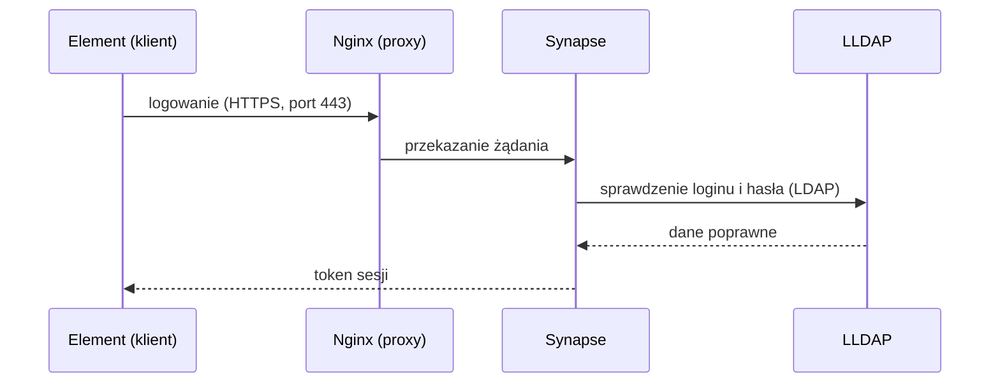

<p align="center">
  
</p>

# Matrix PoC – komunikator firmowy (matrix.local)

Proof of Concept zamkniętego komunikatora firmowego opartego na Matrix:

- **Synapse** – serwer Matrix (federacja wyłączona),
- **LLDAP** – lekki serwer katalogowy symulujący Active Directory; logowanie kontami z LDAP,
- **Coturn** – STUN/TURN dla rozmów audio/wideo 1:1 (WebRTC),
- **Nginx** – reverse proxy z SSL,
- **PostgreSQL** – baza Synapse,
- **Synapse Admin** – webowy panel administracyjny (konta, pokoje), dostępny tylko z VM / przez tunel SSH
  (patrz [Synapse Admin](docs/administrowanie.md#synapse-admin--panel-www-do-administrowania-serwerem)),
- **Pokój „Książka adresowa”** – lista pracowników z działami jako wiadomości w pokoju tylko do odczytu, widoczny dla
  wszystkich (budowany skryptem z grup LLDAP; patrz [Etap 2](docs/administrowanie.md#etap-2)),
- **Pokój „Ogłoszenia”** – publiczny pokój tylko do odczytu, w którym ogłoszenia firmowe publikują wskazane osoby
  (tworzony skryptem `setup_announcements.py`; patrz [Etap 2](docs/administrowanie.md#etap-2)),
- **Tailscale** – prywatna sieć, która symuluje izolowaną sieć firmową między lokalizacjami.

Instrukcja jest napisana tak, żeby dało się ją odtworzyć od zera – krok po kroku, z komendami do wklejenia.
Domena testowa to `matrix.local`, reverse proxy to Nginx.

> **Status:** to środowisko testowe (PoC), nie produkcyjne. Przed wdrożeniem przejdź listę kontrolną
> w sekcji [Przed wdrożeniem produkcyjnym](#przed-wdrożeniem-produkcyjnym).
>
> Zwijane ramki **🏭 Produkcja** (w całym dokumencie) zbierają, co trzeba zmienić przy wdrożeniu
> produkcyjnym – na PoC możesz je pominąć. Szukaj po 🏭.
>
> Oznaczenia: ✅ = sprawdzone w praktyce na PoC, ⚠️ = niesprawdzone albo sprawdzone tylko częściowo.

---

## Architektura

<p align="center">
  
</p>

Jak wygląda logowanie (uproszczony schemat):



---

## Spis treści

**Mapa etapów: [co uruchomić po zmianie](#mapa-etapów-i-co-uruchomić-po-zmianie)**

**Część 1 – Przygotowanie środowiska** ([opis](#czesc-1))

0. [Oznaczenia i zasady](#0-oznaczenia-i-zasady)
1. [Połącz się z VM](#krok-1--połącz-się-z-vm)
2. [Docker i Docker Compose](#krok-2--docker-i-docker-compose)
3. [Tailscale na serwerze](#krok-3--tailscale-na-serwerze)
4. [Pliki projektu na serwerze](#krok-4--pliki-projektu-na-serwerze)
5. [Sekrety i pliki lokalne](#krok-5--sekrety-i-pliki-lokalne)
6. [Certyfikaty (PKI)](#krok-6--certyfikaty-pki)
7. [Uruchomienie usług](#krok-7--uruchomienie-usług)
8. [Konta w LLDAP](#krok-8--konta-w-lldap)
9. [Klienci: Windows i Android](#krok-9--klienci)
    - [Komputer w innej lokalizacji (u kolegi)](#93-komputer-w-innej-lokalizacji-u-kolegi)
10. [Testy](#krok-10--testy)
    - [Drugie konto w Elemencie bez zamykania pierwszego](#drugie-konto-w-elemencie-bez-zamykania-pierwszego-przydatne-w-testach)

**Część 2 – Konta i książka adresowa** ([opis](#czesc-2)): Przygotowanie, Etap 0 (konto administratora), Etap 1 (konta w Synapse),
Etap 2 (książka adresowa: pokój, dane dodatkowe; pokój „Ogłoszenia”), Etap 3 (bieżąca praca)

11. [Konta i książka adresowa](#czesc-2)
12. [Etap 3: bieżąca praca (administrowanie)](docs/administrowanie.md#bieżąca-praca-etap-3) – podręcznik, skrypty automatyzujące i przydatne komendy
13. [Przed wdrożeniem produkcyjnym](#przed-wdrożeniem-produkcyjnym) – [docs/produkcja.md](docs/produkcja.md)
14. [Rozwiązywanie problemów](#rozwiązywanie-problemów) – [docs/rozwiazywanie-problemow.md](docs/rozwiazywanie-problemow.md)
15. [Znane ograniczenia](#znane-ograniczenia-poc) – [docs/produkcja.md](docs/produkcja.md)
16. [Wygląd Element Desktop (opcjonalnie)](#wyglad-element-desktop) – [docs/wyglad-element.md](docs/wyglad-element.md)

<p align="center">
  
</p>

---

## Mapa etapów i co uruchomić po zmianie

Instrukcja ma **dwie części**:

- **Część 1 – Przygotowanie środowiska** (kroki 1–10): VM, Docker, Tailscale, certyfikaty, uruchomienie usług, LLDAP, klienci.
- **Część 2 – Konta i książka adresowa** (etapy 0–3): na działającym już komunikatorze budujesz konta, strukturę firmy
  i książkę adresową, a potem prowadzisz bieżącą pracę.

Dane płyną **w jedną stronę**: LLDAP (w firmie: Active Directory) → konta w Synapse → książka adresowa.
Zmiany robisz **zawsze na początku łańcucha** i uruchamiasz skrypty po kolei od tego miejsca do końca. Ręczne poprawki
w Elemencie albo w panelu Synapse Admin (nazwy, członkostwo) nadpisze następne uruchomienie skryptu.


| Część / etap | Co | Czym | Gdzie |
|---|---|---|---|
| **Część 1** | VM, Docker, Tailscale, certyfikaty, 6 kontenerów, LLDAP, klienci | kroki 1–10 (ręcznie) | [Część 1](#czesc-1) |
| **Przygotowanie** | wyszukiwanie wszystkich użytkowników (A); konta i grupy-działy w LLDAP (w firmie: AD; w PoC testowa masa, B0) | `homeserver.yaml`; `seed_test_employees.py` | [Przygotowanie](docs/administrowanie.md#przygotowanie-jednorazowo) |
| **Etap 0** | Konto administratora Synapse | jedno polecenie SQL (raz) | [Etap 0](docs/administrowanie.md#etap-0) |
| **Etap 1** | Konta w Synapse z nazwą „Imię Nazwisko – Dział” | `provision_synapse_users.py` | [Etap 1](docs/administrowanie.md#etap-1) |
| **Etap 2** | Książka adresowa: 2.1 pokój z wiadomościami, 2.2 dane dodatkowe; 2.4 pokój „Ogłoszenia” | `setup_directory.py`, `directory_extra.csv`; `setup_announcements.py` | [Etap 2](docs/administrowanie.md#etap-2) |
| **Etap 3** | Bieżąca praca: usuwanie pokoi, konta, panel, logi, kopie | Admin API, Synapse Admin, komendy | [Etap 3](docs/administrowanie.md#bieżąca-praca-etap-3) |

### Zmieniłem X – co uruchomić

Wszystkie skrypty: 🪟 **PC**, `cd scripts`, `venv\Scripts\activate`, najpierw `--dry-run`. Każdy loguje administratora Synapse,
więc **nie puszczaj ich pod rząd bez przerw** (HTTP 429, ok. 4 min – [Rozwiązywanie problemów](#rozwiązywanie-problemów), pkt 4).

| Co zmieniasz | Gdzie | Uruchom po kolei |
|---|---|---|
| **Nowy pracownik** | LLDAP: konto + grupa-dział | `provision_synapse_users.py` → `setup_directory.py` → `setup_announcements.py` (skrypty dołączają wszystkich do swoich pokoi) |
| **Konto bez działu** (np. `a.nowak`, `j.kowalski`) albo zła nazwa/dział | LLDAP: dodaj do grupy-działu (lub popraw imię i nazwisko) | `provision_synapse_users.py` → `setup_directory.py` → `setup_announcements.py` |
| **Przeniesienie do innego działu** | LLDAP: zmień grupę | `provision_synapse_users.py` → `setup_directory.py` |
| **Odejście pracownika** | LLDAP: usuń/zablokuj | `deactivate_orphans.py` (albo ręcznie: panel Synapse Admin / Admin API) → `setup_directory.py` (nieaktywne konta znikają z listy) |
| **Nowy dział** | LLDAP: nowa grupa; nowa pozycja w `DEPARTMENTS` w `provision_synapse_users.py` (bez niej dział nie trafi do nazwy wyświetlanej) | `provision_synapse_users.py` → `setup_directory.py --rebuild` (kolejność alfabetyczna) |
| **Telefon, pokój, piętro, stanowisko** | `scripts/directory_extra.csv` (nowe osoby: `setup_directory.py --write-extra-template`) | tylko `setup_directory.py` |
| **Ukryć konto techniczne w książce** | `DIRECTORY_EXCLUDE` w `.env` albo `--exclude login1,login2` | tylko `setup_directory.py` |
| **Nazwa lub temat pokoju książki** | `DIRECTORY_ROOM_NAME`, `DIRECTORY_ROOM_TOPIC` w `.env` | tylko `setup_directory.py` |
| **Nazwa, temat lub autorzy ogłoszeń** | `ANNOUNCE_ROOM_NAME`, `ANNOUNCE_ROOM_TOPIC`, `ANNOUNCE_WRITERS` w `.env` | tylko `setup_announcements.py` |
| **Hasło użytkownika** | tylko LLDAP (logowanie idzie przez LDAP) | nic z powyższych |

Zasada kciuka: zmiana **kto i w jakim dziale** zaczyna się w LLDAP i przechodzi przez wszystkie skrypty; zmiana **danych
kontaktowych** dotyczy tylko `setup_directory.py`.

---

## Zawartość repozytorium

```
docker-compose.yml                  6 usług: proxy, synapse, postgres, coturn, lldap, synapse-admin
.env.example                        wzór sekretów i ustawień (skopiuj do .env i ustaw własne wartości)
docker/synapse/Dockerfile           Synapse + moduł matrix-synapse-ldap3
synapse/homeserver.yaml.example     wzór konfiguracji Synapse (federacja wyłączona, Postgres, LDAP, Coturn)
synapse/matrix.local.log.config     konfiguracja logowania Synapse
nginx/conf.d/matrix.conf.example    wzór konfiguracji reverse proxy z SSL (+ blok panelu Synapse Admin na porcie 8080)
pki/generate-pki.sh, pki/v3.ext     Root CA + certyfikat serwera dla matrix.local
scripts/seed_test_employees.py      Przygotowanie B0: testowe konta i grupy-działy w LLDAP (też --reassign)
scripts/provision_synapse_users.py  Etap 1: zakładanie kont w Synapse z nazwą „Imię Nazwisko – Dział”
scripts/setup_directory.py          Etap 2.1: książka adresowa jako wiadomości w pokoju tylko do odczytu (✅ uruchomiony przez użytkownika 2026-10-20)
scripts/setup_announcements.py      Etap 2.4: pokój „Ogłoszenia” – publiczny, tylko do odczytu; używa biblioteki setup_main_room.py (✅ uruchomiony 2026-10-20)
scripts/test_directory_message.py   zakończony eksperyment z układem wiadomości (zwijane <details> vs nagłówki; --measure = rozmiar)
scripts/directory_extra.csv         (tworzony lokalnie, w repo go nie ma) stanowisko/telefon/pokój/piętro dla książki adresowej
scripts/setup_main_room.py          biblioteka wspólna (klasa Synapse itd.) używana przez setup_directory.py, setup_announcements.py i test_directory_message.py;
                                    NIE uruchamiać jako skryptu
scripts/cleanup_spaces.py           jednorazowo: usuwa stare pokoje-przestrzenie (Spaces) po odchudzeniu; --dry-run, --keep-book (✅ uruchomiony 2026-10-20)
scripts/deactivate_orphans.py       odejście pracownika: dezaktywuje w Synapse konta, których nie ma już w LLDAP (--dry-run; ✅ uruchomiony 2026-10-20)
scripts/requirements.txt            zależności Pythona dla skryptów (requests)
docs/img/*.svg                      grafiki do README (baner, architektura, mapa kroków)
docs/administrowanie.md             Etap 3: konto admina, Admin API, kopie, logi, panel Synapse Admin, skrypty, komendy
docs/rozwiazywanie-problemow.md     problemy 1-10 z diagnozą
docs/produkcja.md                   lista kontrolna przed produkcją, ramki 🏭, znane ograniczenia PoC
docs/wyglad-element.md              motywy i logo Element Desktop (opcjonalnie)
docs/klienci-dodatkowe.md           Android i komputer w innej lokalizacji (opcjonalnie)
docs/szkic-coturn-webrtc.md         szkic konfiguracji Coturn/WebRTC
element-layout/                     config.json, logo i motywy Element Desktop (opcjonalnie)
```

Prawdziwe pliki z hasłami, certyfikaty i klucze tworzysz u siebie na podstawie wzorów `*.example` (krok 5 i 6).

---

<a id="czesc-1"></a>
# CZĘŚĆ 1 – Przygotowanie środowiska

Kroki 1–10: od pustej VM do działającego komunikatora (Synapse, LLDAP, Coturn, Nginx, Postgres, panel Synapse Admin), do którego
logujesz się z Elementa kontem z LLDAP. Gdy to działa, przechodzisz do [Części 2](#czesc-2).

## 0. Oznaczenia i zasady

**Gdzie wpisujesz komendy** (przy każdym bloku jest znacznik):

| Znacznik | Gdzie | Jak wygląda |
|---|---|---|
| 🪟 **PC** | PowerShell na komputerze z Windows | `PS C:\Users\...>` |
| 🐧 **VM** | terminal na serwerze Ubuntu (przez SSH) | `uzytkownik@serwer:/opt/matrix$` |

**Wartości do podstawienia** (w komendach występują w nawiasach ostrych `<...>`):

| Placeholder | Co wpisać |
|---|---|
| `<IP_VM>` | adres VM w sieci lokalnej |
| `<UZYTKOWNIK>` | użytkownik Linuksa na VM |
| `<IP_TAILSCALE>` | adres Tailscale serwera (`tailscale ip -4` na VM) |
| `<PELNA-NAZWA-TS>` | pełna nazwa serwera w Tailscale, np. `matrix-test.nazwa-tailnetu.ts.net` (panel Tailscale albo `tailscale status`) |

**Najważniejsze zasady:**

1. **Nigdy nie wpisuj znaku `$` na początku komendy.** W dokumentacji `$` oznacza tylko „tu jest wiersz poleceń".
   Wpisanie `$bash ...` kończy się błędem `Permission denied`.
2. Komendy wklejaj **po jednej** i czytaj wynik, zanim pójdziesz dalej.
3. Wielkość liter ma znaczenie na Linuksie (`Matrix` ≠ `matrix`).
4. Jak coś nie działa – **nie kombinuj dalej**, zajrzyj do [Rozwiązywania problemów](#rozwiązywanie-problemów)
   i do logów (`docker compose logs`).
5. Domena testowa to `matrix.local`. Nie jest nigdzie zarejestrowana – komputery rozwiązują ją przez wpis
   w pliku `hosts` (krok 9).

**Wymagania:** VM z Debianem 12 lub Ubuntu 24.04 (min. 4 GB RAM, 2 vCPU – dla testu wystarczy; dla kilkuset
użytkowników rozmiar niesprawdzony), konto w Tailscale, komputery klienckie z Windows lub telefon z Androidem.

### Checklista postępu (Część 1)

Odhaczaj w swojej kopii na bieżąco; każdy krok ma na końcu własne sprawdzenie.

- [ ] [Krok 1 – Połącz się z VM](#krok-1--połącz-się-z-vm)
- [ ] [Krok 2 – Docker i Docker Compose](#krok-2--docker-i-docker-compose)
- [ ] [Krok 3 – Tailscale na serwerze](#krok-3--tailscale-na-serwerze)
- [ ] [Krok 4 – Pliki projektu na serwerze](#krok-4--pliki-projektu-na-serwerze)
- [ ] [Krok 5 – Sekrety i pliki lokalne](#krok-5--sekrety-i-pliki-lokalne)
- [ ] [Krok 6 – Certyfikaty (PKI)](#krok-6--certyfikaty-pki)
- [ ] [Krok 7 – Uruchomienie usług](#krok-7--uruchomienie-usług)
- [ ] [Krok 8 – Konta w LLDAP](#krok-8--konta-w-lldap)
- [ ] [Krok 9 – Klienci](#krok-9--klienci)
- [ ] [Krok 10 – Testy](#krok-10--testy)

Potem [Część 2](#czesc-2): Przygotowanie, Etap 0 (konto admina), Etap 1 (konta w Synapse), Etap 2 (książka adresowa).

---

## Krok 1 – Połącz się z VM

🪟 **PC**, PowerShell:

```powershell
ssh <UZYTKOWNIK>@<IP_VM>
```

Wpisz hasło (przy wpisywaniu nic się nie wyświetla – to normalne). Gotowe, gdy widzisz znak zachęty
na serwerze. Od teraz wszystko oznaczone 🐧 robisz w tym oknie.

---

## Krok 2 – Docker i Docker Compose

🐧 **VM**:

```bash
docker --version
docker compose version
```

Oba polecenia muszą pokazać numer wersji.

- Jeśli `docker compose` nie działa: `sudo apt install docker-compose-plugin`
- Jeśli `docker ps` pisze `permission denied`: `sudo usermod -aG docker <UZYTKOWNIK>`
  i **wyloguj się oraz zaloguj ponownie**.

---

## Krok 3 – Tailscale na serwerze

Tailscale to prywatna sieć VPN. Dzięki niej komputery klienckie „widzą" serwer, jakby były w jednej sieci.

🐧 **VM**:

```bash
curl -fsSL https://tailscale.com/install.sh | sh
sudo tailscale up
```

Komenda `tailscale up` wypisze **link** – otwórz go w przeglądarce i zaloguj się kontem Tailscale. Potem:

```bash
tailscale ip -4
```

Wynik (np. `100.64.12.34`) to **`<IP_TAILSCALE>`**. Zapisz go – wpiszesz go w pliku `.env` i na klientach.

Pozostałe komputery (i telefon) muszą być w **tym samym tailnecie** (zaproś użytkownika albo udostępnij
mu maszynę w panelu Tailscale).

**Sprawdzenie:** `tailscale ip -4` pokazuje adres `100.x.x.x`, a w panelu Tailscale serwer ma status **Connected**.

---

## Krok 4 – Pliki projektu na serwerze

Projekt ma trafić do `/opt/matrix` na VM. Wybierz jedną drogę.

**A. Przez git** (🐧 **VM**; repozytorium prywatne wymaga uwierzytelnienia):

```bash
sudo mkdir -p /opt/matrix && sudo chown <UZYTKOWNIK>:<UZYTKOWNIK> /opt/matrix
git clone <ADRES_REPOZYTORIUM> /opt/matrix
```

**B. Przez scp z komputera, na którym masz katalog projektu** (🪟 **PC**; najpierw na VM:
`sudo mkdir -p /opt/matrix && sudo chown <UZYTKOWNIK>:<UZYTKOWNIK> /opt/matrix`):

```powershell
scp -r "<KATALOG_PROJEKTU>\*" <UZYTKOWNIK>@<IP_VM>:/opt/matrix/
```

Sprawdzenie (🐧 **VM**):

```bash
cd /opt/matrix
ls -a
```

Musisz widzieć m.in. `docker-compose.yml`, `.env.example`, `docker`, `nginx`, `pki`, `synapse`.
(Plik `.env.example` jest ukryty – dlatego `ls -a`.)

---

## Krok 5 – Sekrety i pliki lokalne

W repozytorium są wzory z placeholderami `CHANGE_ME_...`. Tworzysz z nich prawdziwe pliki
**na serwerze**:

🐧 **VM**:

```bash
cd /opt/matrix
cp .env.example .env
cp synapse/homeserver.yaml.example synapse/homeserver.yaml
cp nginx/conf.d/matrix.conf.example nginx/conf.d/matrix.conf
```

### 5.1 Hasła

Wygeneruj osobne, losowe wartości (bez znaków specjalnych, bezpieczne dla `.env` i YAML) – po jednej dla
każdego z pięciu sekretów:

```bash
openssl rand -hex 24
```

Wpisz je w `.env` (`nano .env`; w `nano`: `Ctrl+O`, `Enter` – zapis, `Ctrl+X` – wyjście):

```
TS_IP=<IP_TAILSCALE>
POSTGRES_PASSWORD=...
TURN_SECRET=...
LLDAP_ADMIN_PASSWORD=...
LLDAP_JWT_SECRET=...
LLDAP_KEY_SEED=...
```

> ### ⚠️ Trzy hasła muszą być w DWÓCH plikach: `.env` ORAZ `synapse/homeserver.yaml`
>
> Synapse **nie czyta zmiennych z `.env`** w swoim pliku konfiguracyjnym, więc trzy wartości są wpisane
> na sztywno w `homeserver.yaml` i muszą być **identyczne** jak w `.env`. Zmiana w jednym pliku bez drugiego
> = Synapse nie połączy się z bazą / LDAP / Coturn.
>
> | Wartość | W `.env` | W `synapse/homeserver.yaml` | Do czego służy |
> |---|---|---|---|
> | Hasło PostgreSQL | `POSTGRES_PASSWORD` | `database.args.password` | Synapse → baza |
> | Sekret TURN | `TURN_SECRET` | `turn_shared_secret` | Synapse ↔ Coturn (rozmowy A/V) |
> | Hasło admina LLDAP | `LLDAP_ADMIN_PASSWORD` | `modules[].config.bind_password` | Synapse → LDAP (logowanie) |
>
> Tylko w `.env`: `LLDAP_JWT_SECRET`, `LLDAP_KEY_SEED`, `TS_IP`.

**Hasła używane przez skrypty (od 2026-10-17, ⚠️ zmiana nieprzetestowana):** skrypty z `scripts/` nie mają haseł
w kodzie. Dopisz do `.env`:

- na **PC** (skąd uruchamiasz skrypty): `SYNAPSE_ADMIN_LOGIN` i `SYNAPSE_ADMIN_PASSWORD` – login i hasło konta administratora Synapse (dowolne konto z LLDAP,
  które w [Etapie 0](docs/administrowanie.md#etap-0) dostaje flagę `admin`; hasło takie jak w LLDAP),
- na **VM**: `TEST_PASSWORD` – wspólne hasło kont testowych z Etapu B0; czyta je `set_test_passwords.sh`.

Brak wartości albo placeholder `CHANGE_ME...` kończy skrypt czytelnym komunikatem. Wzór: `.env.example`.

Edytuj `synapse/homeserver.yaml` (`nano synapse/homeserver.yaml`) i podmień trzy wartości `CHANGE_ME_...`.

**Ustaw hasła przed pierwszym uruchomieniem.** Postgres i LLDAP zapisują je w wolumenie przy pierwszym
starcie, więc późniejsza zmiana samego `.env` może ich nie zmienić (patrz
[Przed wdrożeniem produkcyjnym](#przed-wdrożeniem-produkcyjnym)).

### 5.2 Adresy dla dostępu z telefonu (opcjonalnie)

Jeśli **nie** będziesz łączyć się z telefonu, usuń z `nginx/conf.d/matrix.conf` dwa ostatnie bloki `server`
(te z nazwą `matrix-test.TWOJ-TAILNET.ts.net`) i zostaw w `homeserver.yaml` wartość
`public_baseurl: "https://matrix.local/"`.

Jeśli będziesz – robisz to w kroku 9.2 (potrzebna jest `<PELNA-NAZWA-TS>`).

**Sprawdzenie:** `grep -n CHANGE_ME .env synapse/homeserver.yaml` nic nie wypisuje (wszystkie placeholdery podmienione).

---

## Krok 6 – Certyfikaty (PKI)

Skrypt tworzy własny „urząd certyfikacji" (Root CA) i certyfikat dla `matrix.local`, dzięki czemu
komputery łączą się przez HTTPS bez ostrzeżeń (po zainstalowaniu Root CA).

🐧 **VM**:

```bash
cd /opt/matrix
bash pki/generate-pki.sh
ls certs
```

> ⚠️ Pisz `bash pki/...`, nie `$bash` i nie samo `pki/generate-pki.sh` (patrz „Rozwiązywanie problemów").

W `certs/` muszą być: `matrix.crt`, `matrix.key`, `rootCA.pem`. Klucz Root CA (`pki/rootCA.key`) zostaje
na serwerze i **nigdy nie może trafić do repozytorium ani na inne komputery** – na klienty rozdajesz tylko
`rootCA.pem`.

Jeśli skrypt wypisze błędy ze znakiem `\r` (`$'\r': command not found`), pliki mają windowsowe końce linii:

```bash
sed -i 's/\r$//' pki/generate-pki.sh pki/v3.ext
bash pki/generate-pki.sh
```

---

## Krok 7 – Uruchomienie usług

🐧 **VM**:

```bash
cd /opt/matrix
docker compose up -d --build
docker compose ps
```

Pierwszy raz trwa kilka minut (pobieranie obrazów, budowa Synapse). **Cel:** 6 kontenerów ze statusem
`running`/`Up` (Postgres może mieć `healthy`): `matrix-proxy`, `matrix-synapse`, `matrix-postgres`,
`matrix-coturn`, `matrix-lldap`, `matrix-synapse-admin`.

Jak któryś się restartuje lub ma status `exited`:

```bash
docker compose logs --tail=50 synapse
```

(zamiast `synapse` wstaw nazwę usługi: `proxy`, `postgres`, `coturn`, `lldap`). Przy kontenerze,
który ciągle się restartuje, czytaj **początek** logu (`docker compose logs NAZWA | head -15`) – przyczyna jest
na samym początku, końcówka to zwykle tylko wydruk pomocy.

---

## Krok 8 – Konta w LLDAP

1. Przeglądarka: `http://<IP_TAILSCALE>:17170` (albo `<IP_VM>`, jeśli jesteś w sieci lokalnej).
2. Logowanie: użytkownik `admin`, hasło = `LLDAP_ADMIN_PASSWORD` z `.env`.
3. **Groups → Create group:** utwórz `Zarzad` i `IT`.
4. **Users → Create user:**
   - `j.kowalski` (Display name: Jan Kowalski, e-mail `j.kowalski@matrix.local`, hasło min. 8 znaków) → grupa `Zarzad`,
   - `a.nowak` (Anna Nowak, e-mail `a.nowak@matrix.local`, hasło) → grupa `IT`.

**Sprawdzenie:** w LLDAP (Users) widzisz `j.kowalski` w grupie `Zarzad` i `a.nowak` w grupie `IT`.

> Dla większej liczby kont (testy na realnej skali) użyj skryptu `seed_test_employees.py` – patrz
> [Przygotowanie, B0](docs/administrowanie.md#etap-b0--testowa-struktura-firmy-w-lldap). Książka adresowa
> w Elemencie powstaje z **grup** LLDAP – patrz [Etap 2](docs/administrowanie.md#etap-2).

---

## Krok 9 – Klienci

### 9.1 Windows (Element Desktop)

Robisz **na każdym komputerze** testowym.

**Tailscale:** zainstaluj (tailscale.com/download) i zaloguj się do tego samego tailnetu co serwer.

**Plik hosts:**

1. Menu Start → `Notatnik` → prawy przycisk → **Uruchom jako administrator**.
2. Plik → Otwórz → `C:\Windows\System32\drivers\etc\hosts` (filtr: „Wszystkie pliki").
3. Dopisz na końcu (z adresem Tailscale serwera; w sieci lokalnej możesz użyć `<IP_VM>`):
   ```
   <IP_TAILSCALE>   matrix.local
   ```
4. **Zapisz plik (Ctrl+S)** – niezapisany plik to najczęstsza przyczyna, że `matrix.local` się nie rozwiązuje.

**Certyfikat `rootCA.pem`** – pobierz go z serwera (🪟 **PC**):

```powershell
scp <UZYTKOWNIK>@<IP_VM>:/opt/matrix/certs/rootCA.pem .
```

Instalacja w systemie:

> ⚠️ U nas dwuklik na pliku `.pem` **nie działał** (Windows nie zna tego rozszerzenia). Obejście: skopiuj
> plik jako `rootCA.crt` (`Copy-Item rootCA.pem rootCA.crt`) i dwuklikaj ten, albo w PowerShellu uruchomionym
> jako administrator: `certutil -addstore -f "Root" rootCA.pem`. Firefox ma własny magazyn certyfikatów
> i wymaga osobnego importu; Chrome, Edge i Element korzystają z magazynu Windows.

1. Dwuklik na `rootCA.crt` → **Zainstaluj certyfikat**.
2. Wybierz **Komputer lokalny** → Dalej.
3. **Umieść wszystkie certyfikaty w następującym magazynie** → Przeglądaj → **Zaufane główne urzędy certyfikacji**.
4. Dalej → Zakończ → potwierdź ostrzeżenie „Tak".

Test: w przeglądarce otwórz `https://matrix.local/_matrix/client/versions` – ma pokazać tekst JSON
**bez** ostrzeżenia o certyfikacie.

**Element Desktop:** zainstaluj (element.io/download), przy logowaniu kliknij **Edytuj** przy serwerze
domowym i wpisz `https://matrix.local`. Zaloguj się loginem i hasłem z LLDAP (np. `j.kowalski`).

### 9.2 Android (Element przez nazwę z Tailscale)

*Opcjonalne – tylko jeśli chcesz łączyć się z telefonu.* Telefon nie ma pliku `hosts`, więc łączy się przez nazwę MagicDNS z Tailscale
(`<PELNA-NAZWA-TS>`) i certyfikat z Tailscale (bez instalowania Root CA). Kroki (certyfikat, Nginx, `public_baseurl`, test, logowanie)
i lista rzeczy niesprawdzonych: [docs/klienci-dodatkowe.md](docs/klienci-dodatkowe.md).

### 9.3 Komputer w innej lokalizacji (u kolegi)

*Opcjonalne – test z drugiej sieci; ⚠️ niesprawdzone w praktyce.* Kolega dołącza do tailnetu i łączy się po `<PELNA-NAZWA-TS>`, bez
instalowania certyfikatów. Plan krok po kroku i lista testów (w tym A/V przez Coturn): [docs/klienci-dodatkowe.md](docs/klienci-dodatkowe.md).
---

## Krok 10 – Testy

1. **Logowanie** – kontem z LLDAP w Elemencie.
2. **Pokój i wiadomości** – utwórz pokój `Firma-Ogolny`, zaproś drugie konto z drugiego komputera,
   wymieńcie wiadomości.
3. **Wyszukiwanie osoby** – w Elemencie: **+ → Rozpocznij czat** i wpisz fragment imienia, nazwiska albo
   nazwy działu (np. `Sprzedaż`). Kliknięcie znalezionej osoby otwiera rozmowę 1:1 ✅ (patrz [Przygotowanie, A](docs/administrowanie.md#przygotowanie-jednorazowo)).
4. **Rozmowa audio/wideo 1:1** – w czacie bezpośrednim kliknij ikonę słuchawki / kamery. Wymaga, żeby klient
   był w Tailscale (adres zewnętrzny Coturn to `TS_IP`). Jeśli nie ma dźwięku lub obrazu, zajrzyj w logi:
   `docker compose logs --tail=50 coturn`. Porty: 3478 oraz 49160–49200 na IP Tailscale. Test A/V
   **niepotwierdzony**.

Kolejność testów: najpierw w sieci lokalnej, potem przez Tailscale.

### Drugie konto w Elemencie bez zamykania pierwszego (przydatne w testach)

Do testów (np. rozmowa 1:1, test widoku zwykłego pracownika w pokoju książki adresowej) czasem wygodniej jest mieć
na **jednym komputerze** dwie niezależne, równocześnie zalogowane sesje Elementa, zamiast wylogowywać się
i logując ponownie za każdym razem. Element Desktop domyślnie trzyma dane jednej sesji w jednym profilu,
więc zwykłe ponowne uruchomienie otworzy to samo, już zalogowane okno.

🪟 **PC**, PowerShell – uruchom drugą, niezależną instancję z osobnym profilem (Electron, na którym
działa Element, wspiera to natywnie przez flagę `--profile`):

```powershell
& "$env:LOCALAPPDATA\element-desktop\Element.exe" --profile testowy2
```

Ścieżka do `Element.exe` zależy od instalacji – powyższa pasuje do instalacji per-użytkownik w
`AppData\Local\element-desktop\`. Jeśli u Ciebie nie działa (np. `Nie można znaleźć ścieżki`), namierz
ją samemu: kliknij prawym na skrócie do Elementa (pulpit albo menu Start) → **Właściwości** → pole
**Element docelowy** pokaże pełną ścieżkę do `Element.exe` na Twoim komputerze.

Druga instancja startuje jako zupełnie nowa, pusta aplikacja (własny katalog danych wyznaczony nazwą po
`--profile`) – logujesz się w niej drugim kontem z LLDAP, a pierwsze okno zostaje zalogowane bez zmian.
Można mieć otwarte oba naraz i np. wysyłać wiadomości między nimi bez drugiego komputera. Chcesz trzeci
instancję – inna nazwa profilu (`--profile testowy3`). ✅ (użyte w testach książki adresowej)

> ⚠️ **Alternatywa, NIEPOTWIERDZONA:** zalogowanie się przez `app.element.io` w przeglądarce, z serwerem
> domowym ustawionym na `matrix.local` – to również daje niezależną sesję bez instalowania czegokolwiek.

---

<a id="czesc-2"></a>
<a id="książka-adresowa-dla-całej-firmy"></a>
# CZĘŚĆ 2 – Konta i książka adresowa

Cała Część 2 (konta w Synapse, książka adresowa, pokój „Ogłoszenia”, bieżąca praca administratora) jest w osobnym pliku:
**[docs/administrowanie.md](docs/administrowanie.md)**. Zakłada, że [Część 1](#czesc-1) jest gotowa: komunikator działa,
a w LLDAP (w firmie: Active Directory) są konta i grupy-działy.

| Etap | Co robisz | Opis |
|---|---|---|
| Przygotowanie | jednorazowa konfiguracja katalogu, dane w LLDAP | [Przygotowanie](docs/administrowanie.md#przygotowanie-jednorazowo) |
| Etap 0 | konto administratora Synapse (raz) | [Etap 0](docs/administrowanie.md#etap-0) |
| Etap 1 | konta w Synapse na podstawie LLDAP | [Etap 1](docs/administrowanie.md#etap-1) |
| Etap 2 | książka adresowa: pokój, dane dodatkowe; pokój „Ogłoszenia” | [Etap 2](docs/administrowanie.md#etap-2) |
| Etap 3 | bieżąca praca, panel Synapse Admin, skrypty | [Bieżąca praca](docs/administrowanie.md#bieżąca-praca-etap-3) |

---

## Przed wdrożeniem produkcyjnym

**Pełna lista kontrolna przeniesiona do [docs/produkcja.md](docs/produkcja.md)** – własne hasła, domena i `server_name`,
konto administratora serwisowe, kopie zapasowe, Synapse Admin,
rotacja słabych haseł PoC – wszystkie punkty plus zebrane ramki 🏭 Produkcja z całego dokumentu.

---

## Rozwiązywanie problemów

**Pełna lista przeniesiona do [docs/rozwiazywanie-problemow.md](docs/rozwiazywanie-problemow.md)** – zweryfikowane
problemy 1-5 (m.in. `Permission denied` przy PKI, `matrix.local` się nie rozwiązuje, telefon wisi na synchronizacji,
HTTP 429, Admin API 404) i niesprawdzone 6-10.

---

## Znane ograniczenia PoC

**Pełna lista przeniesiona do [docs/produkcja.md](docs/produkcja.md)** – m.in. brak automatycznej synchronizacji
książki adresowej (skrypty trzeba uruchamiać ręcznie), zwijane działy niedziałające na telefonie, wygaśnięcie certyfikatów, wyłączona federacja.

---

<a id="wyglad-element-desktop"></a>
## Wygląd Element Desktop (motywy i logo, opcjonalnie)

Opcjonalna kosmetyka (niepotrzebna do testowego wdrożenia), tylko Element Desktop: ciemny motyw, logo firmy, serwer `matrix.local` ustawiony z góry.
Pełny opis, tabela motywów, ręczne ustawienia konta (wersja b; `config.json` – na kiedyś, wersja a) i lista rzeczy niesprawdzonych: [docs/wyglad-element.md](docs/wyglad-element.md).

