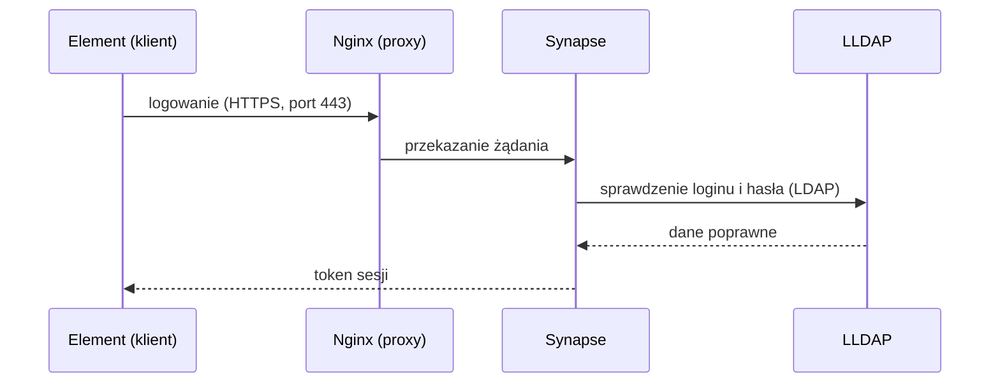
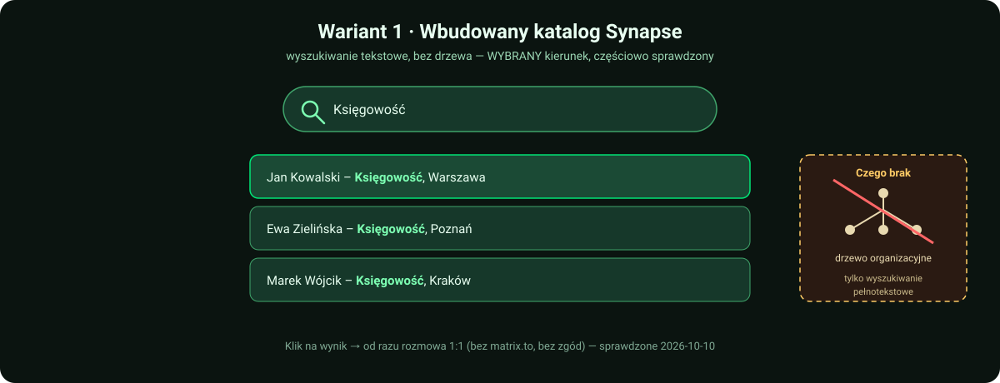
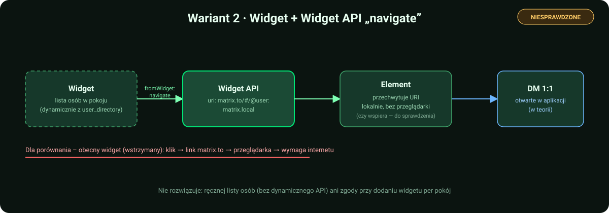

<p align="center">
  
</p>

# Matrix PoC – komunikator firmowy (matrix.local)

Proof of Concept zamkniętego komunikatora firmowego opartego na Matrix:

- **Synapse** – serwer Matrix (federacja wyłączona),
- **LLDAP** – lekki serwer katalogowy symulujący Active Directory; logowanie kontami z LDAP,
- **Coturn** – STUN/TURN dla rozmów audio/wideo 1:1 (WebRTC),
- **Nginx** – reverse proxy z SSL oraz osobny kontener z widżetem książki adresowej (widżet jest
  wstrzymany – patrz [Książka adresowa dla całej firmy](#książka-adresowa-dla-całej-firmy-zmiana-planu)),
- **PostgreSQL** – baza Synapse,
- **Tailscale** – prywatna sieć, która symuluje izolowaną sieć firmową między lokalizacjami.

Instrukcja jest napisana tak, żeby dało się ją odtworzyć od zera – krok po kroku, z komendami do wklejenia.
`Matrix.md` to pierwotny plan testów (zakładał domenę `matrix.twojtest.local` i dowolny reverse proxy;
w projekcie użyto `matrix.local` i Nginx).

> **Status:** to środowisko testowe (PoC), nie produkcyjne. Przed wdrożeniem przejdź listę kontrolną
> w sekcji [Przed wdrożeniem produkcyjnym](#przed-wdrożeniem-produkcyjnym).
>
> Zwijane ramki **🏭 Produkcja** (w całym dokumencie) zbierają, co trzeba zmienić przy wdrożeniu
> produkcyjnym – na PoC możesz je pominąć. Szukaj po 🏭.

---

## Architektura

<p align="center">
  
</p>

Jak wygląda logowanie (uproszczony schemat):



---

## Spis treści

0. [Oznaczenia i zasady](#0-oznaczenia-i-zasady)
1. [Połącz się z VM](#krok-1--połącz-się-z-vm)
2. [Docker i Docker Compose](#krok-2--docker-i-docker-compose)
3. [Tailscale na serwerze](#krok-3--tailscale-na-serwerze)
4. [Pliki projektu na serwerze](#krok-4--pliki-projektu-na-serwerze)
5. [Sekrety i pliki lokalne](#krok-5--sekrety-i-pliki-lokalne)
6. [Certyfikaty (PKI)](#krok-6--certyfikaty-pki)
7. [Uruchomienie usług](#krok-7--uruchomienie-usług)
8. [Konta w LLDAP](#krok-8--konta-w-lldap)
9. [Klienci: Windows i Android](#krok-9--klienci)
    - [Komputer w innej lokalizacji (u kolegi)](#93-komputer-w-innej-lokalizacji-u-kolegi)
10. [Testy](#krok-10--testy)
    - [Drugie konto w Elemencie bez zamykania pierwszego](#drugie-konto-w-elemencie-bez-zamykania-pierwszego-przydatne-w-testach)
11. [Książka adresowa dla całej firmy (zmiana planu)](#książka-adresowa-dla-całej-firmy-zmiana-planu)
12. [💡 Pomysły do sprawdzenia: książka adresowa (niepotwierdzone)](#-pomysły-do-sprawdzenia-książka-adresowa-niepotwierdzone)
13. [💡 Inne pomysły (niepotwierdzone)](#-inne-pomysły-niepotwierdzone)
14. [🤖 Skrypty automatyzujące](#-skrypty-automatyzujące)
15. [Przydatne komendy](#przydatne-komendy)
16. [Przed wdrożeniem produkcyjnym](#przed-wdrożeniem-produkcyjnym)
17. [Rozwiązywanie problemów](#rozwiązywanie-problemów)
18. [Znane ograniczenia](#znane-ograniczenia-poc)

<p align="center">
  
</p>

---

## Zawartość repozytorium

```
docker-compose.yml                  6 usług: proxy, synapse, postgres, coturn, lldap, widget
.env.example                        wzór sekretów (skopiuj do .env i ustaw własne wartości)
docker/synapse/Dockerfile           Synapse + moduł matrix-synapse-ldap3
synapse/homeserver.yaml.example     wzór konfiguracji Synapse (federacja wyłączona, Postgres, LDAP, Coturn)
synapse/matrix.local.log.config     konfiguracja logowania Synapse
nginx/conf.d/matrix.conf.example    wzór konfiguracji reverse proxy z SSL
pki/generate-pki.sh, pki/v3.ext     Root CA + certyfikat serwera dla matrix.local
widget/index.html                   Książka Adresowa (wyszukiwarka JS)
scripts/seed_test_employees.py      Etap B0: testowe konta w LLDAP (patrz Książka adresowa)
scripts/provision_synapse_users.py  Etap B+C: zakładanie kont w Synapse z działem/lokalizacją
scripts/generate_address_book_widget.py  ściąga struktury firmy → widget/index.html (dane z LLDAP)
scripts/setup_main_room.py          dwa pokoje tylko do odczytu (ogłoszenia + struktura z widgetem), dołącza wszystkich (Admin API)
scripts/requirements.txt            zależności Pythona dla skryptów wyżej (requests)
Matrix.md                           pierwotny plan testów
docs/img/*.svg                      grafiki do README (baner, architektura, mapa kroków)
.gitignore, .gitattributes          wyłączenie sekretów z repozytorium, końce linii LF
```

W repozytorium są **tylko wzory** (`*.example`). Prawdziwe pliki z hasłami, certyfikaty i klucze tworzysz
u siebie (krok 5 i 6) – są wyłączone przez `.gitignore`.

---

## 0. Oznaczenia i zasady

**Gdzie wpisujesz komendy** (przy każdym bloku jest znacznik):

| Znacznik | Gdzie | Jak wygląda |
|---|---|---|
| 🪟 **PC** | PowerShell na komputerze z Windows | `PS C:\Users\...>` |
| 🐧 **VM** | terminal na serwerze Ubuntu (przez SSH) | `uzytkownik@serwer:/opt/matrix$` |

**Wartości do podstawienia** (w komendach występują w nawiasach ostrych `<...>`):

| Placeholder | Co wpisać |
|---|---|
| `<IP_VM>` | adres VM w sieci lokalnej |
| `<UZYTKOWNIK>` | użytkownik Linuksa na VM |
| `<IP_TAILSCALE>` | adres Tailscale serwera (`tailscale ip -4` na VM) |
| `<PELNA-NAZWA-TS>` | pełna nazwa serwera w Tailscale, np. `matrix-test.nazwa-tailnetu.ts.net` (panel Tailscale albo `tailscale status`) |

**Najważniejsze zasady:**

1. **Nigdy nie wpisuj znaku `$` na początku komendy.** W dokumentacji `$` oznacza tylko „tu jest wiersz poleceń".
   Wpisanie `$bash ...` kończy się błędem `Permission denied`.
2. Komendy wklejaj **po jednej** i czytaj wynik, zanim pójdziesz dalej.
3. Wielkość liter ma znaczenie na Linuksie (`Matrix` ≠ `matrix`).
4. Jak coś nie działa – **nie kombinuj dalej**, zajrzyj do [Rozwiązywania problemów](#rozwiązywanie-problemów)
   i do logów (`docker compose logs`).
5. Domena testowa to `matrix.local`. Nie jest nigdzie zarejestrowana – komputery rozwiązują ją przez wpis
   w pliku `hosts` (krok 9).

**Wymagania:** VM z Debianem 12 lub Ubuntu 24.04 (min. 4 GB RAM, 2 vCPU – dla testu wystarczy; dla ok. 300
użytkowników rozmiar niesprawdzony), konto w Tailscale, komputery klienckie z Windows lub telefon z Androidem.

---

## Krok 1 – Połącz się z VM

🪟 **PC**, PowerShell:

```powershell
ssh <UZYTKOWNIK>@<IP_VM>
```

Wpisz hasło (przy wpisywaniu nic się nie wyświetla – to normalne). Gotowe, gdy widzisz znak zachęty
na serwerze. Od teraz wszystko oznaczone 🐧 robisz w tym oknie.

---

## Krok 2 – Docker i Docker Compose

🐧 **VM**:

```bash
docker --version
docker compose version
```

Oba polecenia muszą pokazać numer wersji.

- Jeśli `docker compose` nie działa: `sudo apt install docker-compose-plugin`
- Jeśli `docker ps` pisze `permission denied`: `sudo usermod -aG docker <UZYTKOWNIK>`
  i **wyloguj się oraz zaloguj ponownie**.

---

## Krok 3 – Tailscale na serwerze

Tailscale to prywatna sieć VPN. Dzięki niej komputery klienckie „widzą" serwer, jakby były w jednej sieci.

🐧 **VM**:

```bash
curl -fsSL https://tailscale.com/install.sh | sh
sudo tailscale up
```

Komenda `tailscale up` wypisze **link** – otwórz go w przeglądarce i zaloguj się kontem Tailscale. Potem:

```bash
tailscale ip -4
```

Wynik (np. `100.64.12.34`) to **`<IP_TAILSCALE>`**. Zapisz go – wpiszesz go w pliku `.env` i na klientach.

Pozostałe komputery (i telefon) muszą być w **tym samym tailnecie** (zaproś użytkownika albo udostępnij
mu maszynę w panelu Tailscale).

---

## Krok 4 – Pliki projektu na serwerze

Projekt ma trafić do `/opt/matrix` na VM. Wybierz jedną drogę.

**A. Przez git** (🐧 **VM**; repozytorium prywatne wymaga uwierzytelnienia):

```bash
sudo mkdir -p /opt/matrix && sudo chown <UZYTKOWNIK>:<UZYTKOWNIK> /opt/matrix
git clone <ADRES_REPOZYTORIUM> /opt/matrix
```

**B. Przez scp z komputera, na którym masz katalog projektu** (🪟 **PC**; najpierw na VM:
`sudo mkdir -p /opt/matrix && sudo chown <UZYTKOWNIK>:<UZYTKOWNIK> /opt/matrix`):

```powershell
scp -r "<KATALOG_PROJEKTU>\*" <UZYTKOWNIK>@<IP_VM>:/opt/matrix/
```

Sprawdzenie (🐧 **VM**):

```bash
cd /opt/matrix
ls -a
```

Musisz widzieć m.in. `docker-compose.yml`, `.env.example`, `docker`, `nginx`, `pki`, `synapse`, `widget`.
(Plik `.env.example` jest ukryty – dlatego `ls -a`.)

---

## Krok 5 – Sekrety i pliki lokalne

W repozytorium są wzory z placeholderami `CHANGE_ME_...`. Tworzysz z nich prawdziwe pliki
**na serwerze** (są w `.gitignore` – **nie commituj ich**):

🐧 **VM**:

```bash
cd /opt/matrix
cp .env.example .env
cp synapse/homeserver.yaml.example synapse/homeserver.yaml
cp nginx/conf.d/matrix.conf.example nginx/conf.d/matrix.conf
```

### 5.1 Hasła

Wygeneruj osobne, losowe wartości (bez znaków specjalnych, bezpieczne dla `.env` i YAML) – po jednej dla
każdego z pięciu sekretów:

```bash
openssl rand -hex 24
```

Wpisz je w `.env` (`nano .env`; w `nano`: `Ctrl+O`, `Enter` – zapis, `Ctrl+X` – wyjście):

```
TS_IP=<IP_TAILSCALE>
POSTGRES_PASSWORD=...
TURN_SECRET=...
LLDAP_ADMIN_PASSWORD=...
LLDAP_JWT_SECRET=...
LLDAP_KEY_SEED=...
```

> ### ⚠️ Trzy hasła muszą być w DWÓCH plikach: `.env` ORAZ `synapse/homeserver.yaml`
>
> Synapse **nie czyta zmiennych z `.env`** w swoim pliku konfiguracyjnym, więc trzy wartości są wpisane
> na sztywno w `homeserver.yaml` i muszą być **identyczne** jak w `.env`. Zmiana w jednym pliku bez drugiego
> = Synapse nie połączy się z bazą / LDAP / Coturn.
>
> | Wartość | W `.env` | W `synapse/homeserver.yaml` | Do czego służy |
> |---|---|---|---|
> | Hasło PostgreSQL | `POSTGRES_PASSWORD` | `database.args.password` | Synapse → baza |
> | Sekret TURN | `TURN_SECRET` | `turn_shared_secret` | Synapse ↔ Coturn (rozmowy A/V) |
> | Hasło admina LLDAP | `LLDAP_ADMIN_PASSWORD` | `modules[].config.bind_password` | Synapse → LDAP (logowanie) |
>
> Tylko w `.env`: `LLDAP_JWT_SECRET`, `LLDAP_KEY_SEED`, `TS_IP`.

Edytuj `synapse/homeserver.yaml` (`nano synapse/homeserver.yaml`) i podmień trzy wartości `CHANGE_ME_...`.

**Ustaw hasła przed pierwszym uruchomieniem.** Postgres i LLDAP zapisują je w wolumenie przy pierwszym
starcie, więc późniejsza zmiana samego `.env` może ich nie zmienić (patrz
[Przed wdrożeniem produkcyjnym](#przed-wdrożeniem-produkcyjnym)).

### 5.2 Adresy dla dostępu z telefonu (opcjonalnie)

Jeśli **nie** będziesz łączyć się z telefonu, usuń z `nginx/conf.d/matrix.conf` dwa ostatnie bloki `server`
(te z nazwą `matrix-test.TWOJ-TAILNET.ts.net`) i zostaw w `homeserver.yaml` wartość
`public_baseurl: "https://matrix.local/"`.

Jeśli będziesz – robisz to w kroku 9.2 (potrzebna jest `<PELNA-NAZWA-TS>`).

---

## Krok 6 – Certyfikaty (PKI)

Skrypt tworzy własny „urząd certyfikacji" (Root CA) i certyfikat dla `matrix.local`, dzięki czemu
komputery łączą się przez HTTPS bez ostrzeżeń (po zainstalowaniu Root CA).

🐧 **VM**:

```bash
cd /opt/matrix
bash pki/generate-pki.sh
ls certs
```

> ⚠️ Pisz `bash pki/...`, nie `$bash` i nie samo `pki/generate-pki.sh` (patrz „Rozwiązywanie problemów").

W `certs/` muszą być: `matrix.crt`, `matrix.key`, `rootCA.pem`. Klucz Root CA (`pki/rootCA.key`) zostaje
na serwerze i **nigdy nie może trafić do repozytorium ani na inne komputery** – na klienty rozdajesz tylko
`rootCA.pem`.

Jeśli skrypt wypisze błędy ze znakiem `\r` (`$'\r': command not found`), pliki mają windowsowe końce linii:

```bash
sed -i 's/\r$//' pki/generate-pki.sh pki/v3.ext
bash pki/generate-pki.sh
```

(Plik `.gitattributes` w repozytorium wymusza końce linii LF, więc po sklonowaniu nie powinno to wystąpić.)

---

## Krok 7 – Uruchomienie usług

🐧 **VM**:

```bash
cd /opt/matrix
docker compose up -d --build
docker compose ps
```

Pierwszy raz trwa kilka minut (pobieranie obrazów, budowa Synapse). **Cel:** 6 kontenerów ze statusem
`running`/`Up` (Postgres może mieć `healthy`): `matrix-proxy`, `matrix-synapse`, `matrix-postgres`,
`matrix-coturn`, `matrix-lldap`, `matrix-widget`.

Jak któryś się restartuje lub ma status `exited`:

```bash
docker compose logs --tail=50 synapse
```

(zamiast `synapse` wstaw nazwę usługi: `proxy`, `postgres`, `coturn`, `lldap`, `widget`). Przy kontenerze,
który ciągle się restartuje, czytaj **początek** logu (`docker compose logs NAZWA | head -15`) – przyczyna jest
na samym początku, końcówka to zwykle tylko wydruk pomocy.

---

## Krok 8 – Konta w LLDAP

1. Przeglądarka: `http://<IP_TAILSCALE>:17170` (albo `<IP_VM>`, jeśli jesteś w sieci lokalnej).
2. Logowanie: użytkownik `admin`, hasło = `LLDAP_ADMIN_PASSWORD` z `.env`.
3. **Groups → Create group:** utwórz `Zarzad` i `IT`.
4. **Users → Create user:**
   - `j.kowalski` (Display name: Jan Kowalski, e-mail `j.kowalski@matrix.local`, hasło min. 8 znaków) → grupa `Zarzad`,
   - `a.nowak` (Anna Nowak, e-mail `a.nowak@matrix.local`, hasło) → grupa `IT`.

> Login w LLDAP musi zgadzać się z `login` w tablicy `PEOPLE` w pliku `widget/index.html`
> (lista osób w widżecie jest wpisana ręcznie – nowe konta trzeba tam dopisać).
> Widżet jest jednak **wstrzymany** – docelowo książkę adresową zastąpi katalog użytkowników Synapse
> (patrz [Książka adresowa dla całej firmy](#książka-adresowa-dla-całej-firmy-zmiana-planu)).

---

## Krok 9 – Klienci

### 9.1 Windows (Element Desktop)

Robisz **na każdym komputerze** testowym.

**Tailscale:** zainstaluj (tailscale.com/download) i zaloguj się do tego samego tailnetu co serwer.

**Plik hosts:**

1. Menu Start → `Notatnik` → prawy przycisk → **Uruchom jako administrator**.
2. Plik → Otwórz → `C:\Windows\System32\drivers\etc\hosts` (filtr: „Wszystkie pliki").
3. Dopisz na końcu (z adresem Tailscale serwera; w sieci lokalnej możesz użyć `<IP_VM>`):
   ```
   <IP_TAILSCALE>   matrix.local
   ```
4. **Zapisz plik (Ctrl+S)** – niezapisany plik to najczęstsza przyczyna, że `matrix.local` się nie rozwiązuje.

**Certyfikat `rootCA.pem`** – pobierz go z serwera (🪟 **PC**):

```powershell
scp <UZYTKOWNIK>@<IP_VM>:/opt/matrix/certs/rootCA.pem .
```

Instalacja w systemie:

> ⚠️ U nas dwuklik na pliku `.pem` **nie działał** (Windows nie zna tego rozszerzenia). Obejście: skopiuj
> plik jako `rootCA.crt` (`Copy-Item rootCA.pem rootCA.crt`) i dwuklikaj ten, albo w PowerShellu uruchomionym
> jako administrator: `certutil -addstore -f "Root" rootCA.pem`. Firefox ma własny magazyn certyfikatów
> i wymaga osobnego importu; Chrome, Edge i Element korzystają z magazynu Windows.

1. Dwuklik na `rootCA.crt` → **Zainstaluj certyfikat**.
2. Wybierz **Komputer lokalny** → Dalej.
3. **Umieść wszystkie certyfikaty w następującym magazynie** → Przeglądaj → **Zaufane główne urzędy certyfikacji**.
4. Dalej → Zakończ → potwierdź ostrzeżenie „Tak".

Test: w przeglądarce otwórz `https://matrix.local/_matrix/client/versions` – ma pokazać tekst JSON
**bez** ostrzeżenia o certyfikacie.

**Element Desktop:** zainstaluj (element.io/download), przy logowaniu kliknij **Edytuj** przy serwerze
domowym i wpisz `https://matrix.local`. Zaloguj się loginem i hasłem z LLDAP (np. `j.kowalski`).

### 9.2 Android (Element przez nazwę z Tailscale)

**Dlaczego inaczej niż na Windows:** telefon nie ma pliku `hosts`, więc nie rozwiąże `matrix.local`.
Zamiast tego łączymy się przez nazwę MagicDNS z Tailscale (`<PELNA-NAZWA-TS>`) i prawdziwy certyfikat
z Tailscale – **na telefonie nie instalujesz żadnego Root CA**.

> Sprawdzone na: Android 16, Element Classic 1.6.66. Telefon musi mieć włączone Tailscale i być w tym samym
> tailnecie co serwer.

**1. Panel Tailscale** (login.tailscale.com → zakładka **DNS**): włącz **MagicDNS** i **HTTPS Certificates**.

**2. Certyfikat z Tailscale** – 🐧 **VM**:

```bash
cd /opt/matrix/certs
sudo tailscale cert <PELNA-NAZWA-TS>
```

Wynik: `Wrote public cert to ...crt` i `Wrote private key to ...key`. Nazwy plików muszą być takie same
jak w `nginx/conf.d/matrix.conf` (krok 3).

**3. Nginx** – w `nginx/conf.d/matrix.conf` zamień wszystkie wystąpienia `matrix-test.TWOJ-TAILNET.ts.net`
na `<PELNA-NAZWA-TS>` (pięć miejsc: dwa `server_name`, dwie ścieżki certyfikatu i adres w
`.well-known`). Drugi blok `server` ma **własny** `/.well-known/matrix/client` wskazujący na tę nazwę – to
ważne, bo ten z `matrix.local` jest dla telefonu nieosiągalny.

**4. Synapse (kluczowe!)** – w `synapse/homeserver.yaml` ustaw:

```yaml
public_baseurl: "https://<PELNA-NAZWA-TS>/"
```

Synapse dokleja ten adres do odpowiedzi na logowanie, a Element na telefonie przełącza się na niego.
Przy `https://matrix.local/` telefon loguje się, ale potem wisi na „Wstępna synchronizacja – czekanie
na odpowiedź serwera" (patrz „Rozwiązywanie problemów"). Skutek uboczny: Element na Windowsie przy **nowym**
logowaniu też przełączy się na tę nazwę (wymaga włączonego Tailscale); zalogowane sesje się nie zmieniają.

**5. Sprawdzenie i restart** – 🐧 **VM**:

```bash
cd /opt/matrix
docker compose exec proxy nginx -t
docker compose restart proxy
docker compose restart synapse
```

`nginx -t` musi pokazać `syntax is ok` i `test is successful`. Nginx nie wstanie, jeśli plików z kroku 2
nie ma w `certs/`.

**6. Test w przeglądarce telefonu** (przed Elementem): otwórz
`https://<PELNA-NAZWA-TS>/_matrix/client/versions` – ma pokazać JSON, **bez** ostrzeżenia o certyfikacie.

**7. Element na telefonie:** zmień serwer domowy na `https://<PELNA-NAZWA-TS>` i zaloguj się loginem
z LLDAP (np. `j.kowalski`, bez `@` i bez domeny). Jeśli wcześniej logowałeś się z błędnym `public_baseurl`,
najpierw wyloguj się albo w ustawieniach Androida wyczyść dane Elementa – inaczej aplikacja zapamięta
stary adres.

**Jeszcze niesprawdzone:**

- weryfikacja nowego urządzenia w Elemencie (klucz odzyskiwania lub emotikony z drugiej sesji),
- rozmowy audio/wideo z telefonu – `turn_uris` w `homeserver.yaml` wskazują `matrix.local`, którego telefon
  nie rozwiąże; trzeba je zmienić na `<PELNA-NAZWA-TS>`,
- odnawianie certyfikatu z Tailscale (ważny ok. 90 dni) – trzeba powtórzyć `tailscale cert` i zrestartować
  proxy, najlepiej w cronie.

### 9.3 Komputer w innej lokalizacji (u kolegi)

> ⚠️ **Status: opisane, ale NIESPRAWDZONE w praktyce.** To jest plan krok po kroku na test „co widzi osoba
> w zupełnie innej sieci, u siebie w domu/biurze” – symulacja drugiej lokalizacji firmy. Dopisz tu wynik,
> gdy kolega faktycznie to przetestuje.

**Dlaczego to inny przypadek niż Krok 9.1 (Windows w tej samej sieci):** tam komputer łączył się po
`matrix.local`, co wymagało ręcznego wpisu w pliku `hosts` i zainstalowania **własnego** Root CA (`rootCA.pem`)
jako zaufanego urzędu – to ma sens na firmowym komputerze, ale instalowanie prywatnego CA na komputerze
osoby z zewnątrz to niepotrzebne namieszanie w zaufaniu cudzego systemu. Zamiast tego używamy **tej samej
drogi co telefon w kroku 9.2** – adresu `<PELNA-NAZWA-TS>` z certyfikatem wydanym przez Tailscale (publicznie
zaufanym, przez Let's Encrypt) – **kolega NIE instaluje żadnego certyfikatu ani CA**, dzięki czemu ryzyko
i kłopot po jego stronie są minimalne.

**Co kolega musi zrobić u siebie, krok po kroku:**

1. **Założyć konto w Tailscale** (tailscale.com, może być darmowe konto osobiste – np. logowanie przez
   Google/Microsoft), jeśli jeszcze nie ma.
2. **Dostać zaproszenie do sieci (tailnetu)** – to robi administrator (Ty), nie kolega:
   - Panel Tailscale (login.tailscale.com) → **Access controls** albo wprost przy maszynie VM na liście
     **Machines** → opcja **Share** → podajesz e-mail kolegi. Kolega dostaje e-mail z linkiem, klika
     **Accept** – to udostępnia mu **tylko tę jedną maszynę** (VM), bez dołączania do reszty Twojej sieci.
   - **Niesprawdzone:** czy udostępniona w ten sposób maszyna działa identycznie jak pełne członkostwo
     w tailnecie (np. czy adres `100.x.x.x` VM wygląda tak samo po stronie kolegi), czy ruch jest
     rzeczywiście jednokierunkowy (kolega widzi VM, ale czy VM/inni mogliby zobaczyć jego komputer).
     Jeśli **Share** nie zadziała jak trzeba, alternatywa to zaproszenie kolegi jako pełnego członka
     Twojego tailnetu (ten sam ekran, zakładka **Users** → **Invite**).
3. **Zainstalować Tailscale** na swoim komputerze (tailscale.com/download) i zalogować się kontem
   z punktu 1 – zaakceptuje zaproszenie automatycznie.
4. **Sprawdzić połączenie** – w terminalu/PowerShellu kolegi:
   ```powershell
   tailscale ping <PELNA-NAZWA-TS>
   ```
   Powinno pokazać odpowiedzi (czas w ms), a nie `no response`. Jeśli nie działa – sprawdź w panelu
   Tailscale, czy maszyna kolegi faktycznie jest połączona (status **Connected**).
5. **Test w przeglądarce** (przed Elementem, tak jak w kroku 9.2.6): otwórz
   `https://<PELNA-NAZWA-TS>/_matrix/client/versions` – ma pokazać JSON, **bez żadnego ostrzeżenia
   o certyfikacie** (to jest ten test, który potwierdza, że certyfikat jest publicznie zaufany i kolega
   nie musi niczego instalować).
6. **Zainstalować Element Desktop** (element.io/download).
7. **Przy logowaniu** kliknij **Edytuj** przy serwerze domowym i wpisz `https://<PELNA-NAZWA-TS>`
   (NIE `matrix.local` – tego kolega nie rozwiąże, bo nie ma takiego wpisu w swoim pliku `hosts`).
8. **Zalogować się** loginem i hasłem z LLDAP. **Zalecane: użyj jednego z testowych kont z Etapu B0**
   (patrz [Książka adresowa dla całej firmy](#książka-adresowa-dla-całej-firmy-zmiana-planu), ok. 200
   fikcyjnych kont, wspólne hasło testowe) zamiast prawdziwego konta pracownika – to dane niezwiązane
   z żadną realną tożsamością, bezpieczniejsze do testu z kimś spoza zaufanego środowiska.

**Co przetestować po zalogowaniu:**

- **Wiadomości:** pokój `Firma-Ogolny` albo nowy DM z kolegi do Ciebie – podstawowy test, czy w ogóle
  wszystko działa przez prawdziwą sieć (nie LAN).
- **Rozmowa audio/wideo 1:1** – to jest kluczowy test tego scenariusza (symulacja 2. lokalizacji firmy).
  **Niesprawdzone, do zweryfikowania:**
  - czy połączenie A/V w ogóle przechodzi między dwiema różnymi sieciami przez Coturn (u nas testowane
    tylko w jednej sieci lokalnej),
  - jeśli u kolegi jest zawężony firewall/ACL (np. sieć firmowa, router korporacyjny) – Coturn
    potrzebuje portu **3478** oraz zakresu **49160–49200** na adresie Tailscale serwera (`TS_IP`), poza
    standardowym **443** dla samego Elementa. Jeśli połączenie głosowe/wideo nie działa, to pierwsze
    podejrzane miejsce.
- Kolejność zalecana: najpierw zwykłe wiadomości, dopiero potem A/V – łatwiej odróżnić, czy problem jest
  w samym połączeniu Tailscale, czy specyficznie w Coturn/WebRTC.

---

## Krok 10 – Testy

1. **Logowanie** – kontem z LLDAP w Elemencie.
2. **Pokój i wiadomości** – utwórz pokój `Firma-Ogolny`, zaproś drugie konto z drugiego komputera,
   wymieńcie wiadomości.
3. **Widżet książki adresowej** *(wstrzymany – test pokazuje, jak działa demonstracja; docelowe rozwiązanie
   w sekcji [Książka adresowa dla całej firmy](#książka-adresowa-dla-całej-firmy-zmiana-planu))* – w pokoju
   wpisz w polu wiadomości:
   ```
   /addwidget https://matrix.local/widget/
   ```
   Zatwierdź zgodę na widżet, wpisz nazwisko w wyszukiwarce i kliknij osobę. Klik otwiera `matrix.to`
   w przeglądarce (patrz „Znane ograniczenia"); czy kończy się to czatem 1:1 w Elemencie – **niepotwierdzone**.
4. **Rozmowa audio/wideo 1:1** – w czacie bezpośrednim kliknij ikonę słuchawki / kamery. Wymaga, żeby klient
   był w Tailscale (adres zewnętrzny Coturn to `TS_IP`). Jeśli nie ma dźwięku lub obrazu, zajrzyj w logi:
   `docker compose logs --tail=50 coturn`. Porty: 3478 oraz 49160–49200 na IP Tailscale. Test A/V
   **niepotwierdzony**.

Kolejność testów: najpierw w sieci lokalnej, potem przez Tailscale.

### Drugie konto w Elemencie bez zamykania pierwszego (przydatne w testach)

Do testów (np. rozmowa 1:1, test drugiego konta w książce adresowej) czasem wygodniej jest mieć na
**jednym komputerze** dwie niezależne, równocześnie zalogowane sesje Elementa, zamiast wylogowywać się
i logując ponownie za każdym razem. Element Desktop domyślnie trzyma dane jednej sesji w jednym profilu,
więc zwykłe ponowne uruchomienie otworzy to samo, już zalogowane okno.

🪟 **PC**, PowerShell – uruchom drugą, niezależną instancję z osobnym profilem (Electron, na którym
działa Element, wspiera to natywnie przez flagę `--profile`):

```powershell
& "C:\Users\Admin\AppData\Local\element-desktop\Element.exe" --profile testowy2
```

Ścieżka do `Element.exe` zależy od instalacji – powyższa pasuje do instalacji per-użytkownik w
`AppData\Local\element-desktop\`. Jeśli u Ciebie nie działa (np. `Nie można znaleźć ścieżki`), namierz
ją samemu: kliknij prawym na skrócie do Elementa (pulpit albo menu Start) → **Właściwości** → pole
**Element docelowy** pokaże pełną ścieżkę do `Element.exe` na Twoim komputerze.

Druga instancja startuje jako zupełnie nowa, pusta aplikacja (własny katalog danych wyznaczony nazwą po
`--profile`) – logujesz się w niej drugim kontem z LLDAP, a pierwsze okno zostaje zalogowane bez zmian.
Można mieć otwarte oba naraz i np. wysyłać wiadomości między nimi bez drugiego komputera. Chcesz trzeci
instancję – inna nazwa profilu (`--profile testowy3`).

> ⚠️ **Alternatywa, NIEPOTWIERDZONA:** zalogowanie się przez `app.element.io` w przeglądarce, z serwerem
> domowym ustawionym na `matrix.local` – to również daje niezależną sesję bez instalowania czegokolwiek.
> Obie metody (profil Elementa Desktop i `app.element.io`) były rozważane przy pierwszym tekście drugiego
> konta (Piotr Wiśniewski) – nie ustalono wtedy jednoznacznie, której faktycznie użyto, więc jeśli coś nie
> zadziała tak jak opisano, spróbuj drugiej metody.

---

## Książka adresowa dla całej firmy (zmiana planu)

> ⚠️ **Status: plan, jeszcze niesprawdzony w praktyce.** Poniżej opisane jest, co zamierzamy zrobić i dlaczego.
> Kiedy któryś etap zadziała, zmieniamy jego opis na instrukcję krok po kroku.

**Wymagania** (docelowo ok. 300 pracowników w 3 lokalizacjach):

- pracownik loguje się i od razu może wyszukać każdego kolegę,
- bez klikania zgód i bez pośredników (`matrix.to`),
- kliknięcie osoby otwiera rozmowę 1:1,
- nowi pracownicy z LLDAP pojawiają się automatycznie,
- w wynikach widać dział i lokalizację.

**Dlaczego nie widżet** (sprawdzone w teście 3 w kroku 10):

1. Lista osób (`PEOPLE` w `widget/index.html`) jest wpisana ręcznie – nowe konta z LLDAP się w niej nie pojawią.
2. Kliknięcie osoby otwiera `matrix.to` w przeglądarce – to pośrednik, który wymaga internetu na kliencie.
3. Widżet jest dodawany do każdego pokoju osobno i przy dodaniu pyta o zgodę. Globalnego widżetu
   w pasku bocznym Elementa nie znaleziono.

**Nowe podejście:** wbudowany katalog użytkowników Synapse. W Elemencie: **+ → Rozpocznij czat →
wyszukiwarka**; kliknięcie osoby tworzy rozmowę 1:1. Widżet zostaje w repozytorium (nie jest usunięty) jako
ewentualny dodatek do przeglądania drzewka działów.

| Etap | Co | Status |
|---|---|---|
| **A** | Katalog użytkowników wyszukuje **wszystkich** (nie tylko osoby ze wspólnych pokoi) | ✅ sprawdzone na PoC |
| **B0** | Testowa struktura firmy w LLDAP (skrypt, ~200–300 kont, do testów) | ✅ sprawdzone na PoC |
| **B** | Automatyczne zakładanie kont w **Synapse** na podstawie LLDAP (skrypt) | ✅ sprawdzone na PoC |
| **C** | Dział i lokalizacja w nazwie wyświetlanej | ✅ sprawdzone na PoC (zrobione razem z B) |
| **D** | Wdrożenie klientów na stanowiskach (Element Desktop z domyślnym serwerem) | do sprawdzenia przy produkcji |

### Etap A – wyszukiwanie wszystkich użytkowników ✅ *(sprawdzone na PoC)*

W `synapse/homeserver.yaml` dopisz:

```yaml
user_directory:
  search_all_users: true
```

Według dokumentacji Synapse bez tej opcji katalog pokazuje tylko osoby, które mają z Tobą wspólny pokój albo
są w pokojach publicznych. Po zmianie (🐧 **VM**, w `/opt/matrix`): `docker compose restart synapse`.

**Wynik testu (2026-10-10):** konto `p.wisniewski` (nazwa wyświetlana `Piotr Wiśniewski – Sprzedaż`, z LLDAP)
nie miało wspólnego pokoju z `j.kowalski`. Po pierwszym zalogowaniu Piotra pojawił się w tabeli
`user_directory` w bazie, a w Elemencie na koncie Jana wyszukiwanie frazy `Sprzedaż` go znalazło.
Nazwa wyświetlana z LLDAP (`cn`) przechodzi w całości, razem z działem, więc wyszukiwanie działa po dziale.

Podgląd katalogu w bazie (🐧 **VM**):

```bash
docker compose exec postgres psql -U synapse -d synapse -c "select user_id, display_name from user_directory;"
```

**Ważne:** konto trafia do katalogu dopiero po **pierwszym logowaniu** (przed nim w tabeli go nie ma,
więc wyszukiwarka go nie znajdzie). Dla całej firmy rozwiązuje to etap B.

Kliknięcie znalezionej osoby otwiera od razu rozmowę 1:1 (sprawdzone 2026-10-10, bez `matrix.to` i bez dodatkowych zgód).

Osoby, które nigdy się nie logowały, nie istnieją w Synapse, więc nie ma ich w katalogu – to nie wymaga
`regenerate_directory`, tylko założenia kont (etap B).

### Etap B0 – testowa struktura firmy w LLDAP ✅ *(sprawdzone na PoC, 2026-10-11)*

Zanim zabierzemy się za Etap B (zakładanie kont w **Synapse**), trzeba mieć w LLDAP realną liczbę kont
żeby w ogóle mieć co testować – kilka ręcznie wpisanych użytkowników (jak `j.kowalski`, `a.nowak`) nie
pokazuje, jak zachowa się katalog przy setkach osób. Etap B0 to skrypt, który generuje taką testową
strukturę **w samym LLDAP** (nie w Synapse – to osobna rzecz, patrz Etap B niżej).

**Pliki:** `scripts/seed_test_employees.py` (uruchamiany na PC), `scripts/requirements.txt`.

**Co robi:** tworzy ok. 200–300 fikcyjnych pracowników w LLDAP (imię+nazwisko, login w formacie
`i.nazwisko` jak u istniejących kont), przypisanych do grup-działów (Księgowość, Wydział EFS,
Dyrekcja, IT, Sprzedaż) i grup-lokalizacji (Warszawa, Kraków, Poznań – podmień na prawdziwe nazwy
w pliku, jeśli mają być inne), wszystkich z **jednym wspólnym hasłem testowym**. Wyłącznie do
testów PoC – nigdy tak na produkcji z prawdziwymi ludźmi.

**Dlaczego dwa etapy, a nie jeden skrypt:** LLDAP tworzy użytkowników i grupy przez swoje GraphQL API
(działa to zwykłym zapytaniem HTTP, więc można to robić wprost z PC). Ustawianie **haseł** jest inne –
LLDAP używa do tego protokołu PAKE (Opaque) ze względów bezpieczeństwa, a nie zwykłego REST-a.

> ⚠️ **Złapane w praktyce (2026-10-11):** pierwsza wersja skryptu próbowała ustawić hasło endpointem
> `POST /api/users/{id}/set-password-force`. Endpoint **zwracał status sukcesu**, ale hasło faktycznie
> nie działało – logowanie (do Elementa i do samego panelu LLDAP) kończyło się błędem
> „Nieprawidłowa nazwa użytkownika i/lub hasło”. Poprawne narzędzie to oficjalny plik binarny
> **`lldap_set_password`**, który siedzi **wewnątrz kontenera LLDAP** (ścieżka `/app/lldap_set_password`,
> NIE jest w `$PATH` – trzeba pełną ścieżką). Działa tylko uruchomiony **na VM** (`docker compose exec`),
> nie da się go wywołać zdalnie przez HTTP z PC.

**Krok 1 – konta i grupy (PC):**

🪟 **PC**, PowerShell:

```powershell
cd "<KATALOG_PROJEKTU>\scripts"
python -m venv venv
venv\Scripts\activate
pip install -r requirements.txt
python seed_test_employees.py
```

Skrypt sam czyta adres serwera (`TS_IP`) i hasło admina (`LLDAP_ADMIN_PASSWORD`) z Twojego `.env` –
nic nie trzeba wpisywać ręcznie ani commitować. Na górze pliku jest `LIMIT` – **zacznij od małej
wartości (np. 3)**, sprawdź czy działa, dopiero potem ustaw `LIMIT = None` (wszyscy, do `TOTAL_TARGET`).
Skrypt jest idempotentny – można go puszczać wielokrotnie, pomija już istniejące konta.

Po zakończeniu w katalogu `scripts/` pojawi się plik `set_test_passwords.sh` (generowany, w
`.gitignore` – nie trafia do repo).

**Krok 2 – hasła (VM):**

🪟 **PC**:

```powershell
scp "<KATALOG_PROJEKTU>\scripts\set_test_passwords.sh" <UZYTKOWNIK>@<IP_VM>:/opt/matrix/scripts/
```

(jeśli `scp` zwraca `dest open ... Failure` – katalog `scripts/` prawdopodobnie jeszcze nie istnieje
na VM; załóż go: 🐧 **VM** `mkdir -p /opt/matrix/scripts`).

🐧 **VM**:

```bash
cd /opt/matrix
bash scripts/set_test_passwords.sh
```

Ten skrypt czyta `LLDAP_ADMIN_PASSWORD` wprost z `.env` na VM i dla każdego konta woła
`docker compose exec lldap /app/lldap_set_password`. Po zakończeniu spróbuj zalogować się do
Elementa jednym z testowych kont (login z listy, hasło = `TEST_PASSWORD` z góry skryptu
`seed_test_employees.py`, domyślnie `TestHaslo123!`).

**Sprawdzone 2026-10-11:** pełny cykl (konta + grupy z PC → hasła na VM) zweryfikowany końcowym
logowaniem do Elementa – zadziałało za pierwszym poprawnym uruchomieniem.

> ⚠️ Jeśli przy logowaniu zobaczysz `M_LIMIT_EXCEEDED` – to limiter prób logowania w Synapse (ochrona
> przed brute-force), nie błąd hasła. Napotkane po kilku nieudanych próbach pod rząd (zanim jeszcze
> naprawiliśmy hasło). Rozwiązanie: 🐧 **VM** `docker compose restart synapse` (czyści licznik),
> potem spróbuj **raz**, nie wielokrotnie pod rząd.

### Etap B + C – automatyczne zakładanie kont w Synapse, z działem i lokalizacją ✅ *(sprawdzone na PoC, 2026-10-11)*

Inny temat niż Etap B0 wyżej (ten dotyczył LLDAP, ten dotyczy **Synapse**). Konto w Synapse (i wpis
w katalogu `user_directory`, z którego korzysta wyszukiwarka w Elemencie) powstaje domyślnie dopiero
przy **pierwszym logowaniu** przez LDAP. Ten skrypt zakłada konta z wyprzedzeniem, przez Admin API
Synapse, bez potrzeby logowania każdej osoby osobno – i przy okazji ustawia nazwę wyświetlaną
w formacie `Imię Nazwisko – Dział, Lokalizacja` (Etap C), bo dane o dziale/lokalizacji i tak są już
w grupach LLDAP z Etapu B0 – szkoda byłoby robić to w dwóch osobnych przebiegach.

**Plik:** `scripts/provision_synapse_users.py` (uruchamiany na PC).

**Wynik testu:** konto `a.kowalczyk` (nigdy wcześniej niezalogowane) zostało znalezione w wyszukiwarce
Elementa po frazie „Kraków”/„Księgowość”, z poprawną nazwą wyświetlaną „Alicja Kowalczyk –
Księgowość, Kraków”, a kliknięcie otworzyło DM. Po uruchomieniu na pełnej puli (~204 konta z LLDAP)
skrypt przeszedł bez błędów.

**Wymagania wstępne (jednorazowe):**

**1. Konto administratora Synapse.** Zamiast zakładać nowe (co wymagałoby ustawienia
`registration_shared_secret`, którego nie mamy skonfigurowanego), podnosimy uprawnienia jednemu
z już istniejących, działających kont testowych z Etapu B0 (tu użyte: `s.lewandowski`) –
bezpośrednim wpisem w bazie:

🐧 **VM**, w `/opt/matrix` (koniecznie w tym katalogu – inaczej `docker compose` nie znajdzie
`docker-compose.yml` i zwróci `no configuration file provided`):

```bash
docker compose exec postgres psql -U synapse -d synapse -c "UPDATE users SET admin = 1 WHERE name = '@s.lewandowski:matrix.local';"
```

Powinno pokazać `UPDATE 1`. To NIE zmienia hasla ani nic innego w LLDAP – tylko flagę admina w Synapse.

**2. Admin API musi być przepuszczone przez reverse proxy.** ⚠️ **Złapane w praktyce (2026-10-11):**
nginx miał (celowo, ze względów bezpieczeństwa z pierwotnego setupu) regułę, która przepuszczała tylko
`/_matrix` i `/_synapse/client`, NIE `/_synapse/admin` – każde wywołanie Admin API kończyło się
blokiem `404 Not Found` od samego nginx (nie od Synapse). W `nginx/conf.d/matrix.conf.example` jest to
już poprawione (reguła zawiera `/_synapse/admin`), ale **prawdziwy plik na VM trzeba zaktualizować
ręcznie** (jest w `.gitignore`, nie synchronizuje się automatycznie z repo):

🐧 **VM**, w `/opt/matrix`:

```bash
sed -i 's#\^(/_matrix|/_synapse/client)#^(/_matrix|/_synapse/client|/_synapse/admin)#' nginx/conf.d/matrix.conf
```

> Jeśli `grep -A1 "API Matrix" nginx/conf.d/matrix.conf` nie pokaże zmiany – edytuj plik ręcznie
> (`nano nginx/conf.d/matrix.conf`), dopisz `|/_synapse/admin` do regexu w linii
> `location ~ ^(/_matrix|/_synapse/client) {`.

Potem przeładuj nginx:

```bash
docker compose exec proxy nginx -s reload
```

> Admin API jest w ten sposób wystawione publicznie przez to samo proxy co klienci – wciąż chronione
> tokenem administratora, ale na produkcji warto rozważyć dodatkowe ograniczenie (np. po adresie IP).

**Uruchomienie (PC):**

🪟 **PC**, PowerShell (ten sam `venv` co Etap B0):

```powershell
cd "<KATALOG_PROJEKTU>\scripts"
python provision_synapse_users.py
```

Skrypt: (1) czyta wszystkich użytkowników z LLDAP razem z ich grupami (dział/lokalizacja) przez
GraphQL, (2) loguje się do Synapse jako administrator (`s.lewandowski`, to samo hasło testowe co
reszta kont z Etapu B0) przez zwykłe `/login`, (3) dla każdego usera woła
`PUT /_synapse/admin/v2/users/@login:matrix.local` z `displayname` w formacie
`Imię Nazwisko – Dział, Lokalizacja` (bez pola `password` – nie jest wymagane, bo logowanie i tak
idzie przez LDAP). Jak w Etapie B0: **`LIMIT`** na górze pliku – zacznij od małej wartości, sprawdź,
dopiero potem `LIMIT = None`.

**Jak sprawdzić, czy zadziałało:** w Elemencie (kontem, którym normalnie pracujesz) wyszukaj jedną
z przetworzonych osób po dziale/lokalizacji – **bez logowania się na jej konto**. Jeśli się znajdzie,
konto istnieje w katalogu mimo braku logowania.

> ⚠️ **Zaobserwowany efekt uboczny (nie błąd):** DM do konta założonego przez Admin API (nigdy
> niezalogowanego) otwiera się jako **nieszyfrowany**, z ostrzeżeniem Elementa o braku E2E. To logiczne –
> takie konto nie ma jeszcze żadnego urządzenia ani kluczy szyfrowania (powstają dopiero przy pierwszym
> prawdziwym logowaniu tej osoby). Czy po jej zalogowaniu ten sam pokój automatycznie staje się
> szyfrowany, czy trzeba nowego pokoju/weryfikacji – **niesprawdzone**.

### Etap D – klienci *(do sprawdzenia przy produkcji)*

- `config.json` Element Desktop z domyślnym serwerem `matrix.local`, żeby pracownik nie wpisywał adresu,
- `rootCA.pem` na stanowiskach (docelowo przez GPO),
- DNS zamiast wpisów w pliku `hosts`,
- opcjonalnie `auto_join_rooms` (wspólny pokój dla wszystkich) – nie wiadomo, czy działa dla kont
  zakładanych przez LDAP / Admin API. Dołączanie wszystkich kont do pokoju głównego robi na razie skrypt
  `setup_main_room.py` (patrz [Skrypty automatyzujące](#-skrypty-automatyzujące)).

### Decyzja: jeden serwer dla całej firmy

Na produkcji działa **jeden serwer Synapse dla wszystkich trzech lokalizacji**. Dzięki temu wbudowany katalog
użytkowników wystarcza (jedna lista wszystkich pracowników) i nie jest potrzebna osobna, centralna książka
adresowa. Opcja „osobny serwer na każdą lokalizację z federacją” odpada – tam katalog obejmowałby tylko
użytkowników własnego serwera.

Skutek: federacja pozostaje wyłączona (`federation_domain_whitelist: []`), a rozmiar jednej maszyny
(obecnie 4 GB / 2 vCPU) trzeba oceniać pod ok. 300 użytkowników naraz – niesprawdzone.

---

## Pomysły do sprawdzenia: książka adresowa (niepotwierdzone)

> UWAGA: to jest sekcja na pomysły, nie na instrukcje. Nic poniżej nie zostało sprawdzone w praktyce.
> To zapis rozważań, żeby nie zgubić wątku między sesjami. Gdy któryś wariant zostanie przetestowany
> i zadziała, jego opis przenosimy do sekcji Książka adresowa dla całej firmy jako właściwą
> dokumentację (kolejny Etap w tabeli), a stąd znika.

Mamy trzy rozważane warianty na to, jak ma wyglądać książka adresowa / widoczność struktury firmy
(działy typu Księgowość, Wydział EFS, Dyrekcja, IT):

### Wariant 1 - Wbudowany katalog użytkowników Synapse (WYBRANY kierunek, częściowo sprawdzony)

<p align="center">
  
</p>

To jest aktualnie realizowana droga - pełny, żywy status (Etapy A-D, co działa, co nie) jest w sekcji
Książka adresowa dla całej firmy wyżej - nie duplikujemy tego tutaj. Ograniczenie warte zapamiętania:
dział/lokalizacja pokażą się tylko jako tekst w nazwie wyświetlanej (przeszukiwalny), nie jako
drzewo organizacyjne - bez osobnej kolumny, filtra czy grupowania wizualnego.

### Wariant 2 - Widget + Widget API navigate (pomysł, niesprawdzony)

<p align="center">
  
</p>

Zamiast linku matrix.to otwieranego w przeglądarce (próbowany wcześniej), widget mógłby wysłać przez
Widget API akcję navigate:

```
{ api: "fromWidget", action: "navigate", data: { uri: "https://matrix.to/#/@j.kowalski:matrix.local" } }
```

Idea: Element przechwytuje ten format URI i obsługuje lokalnie (otwiera DM w aplikacji) - matrix.to
pełni tu rolę tylko formatu identyfikatora, nie serwisu internetowego, do którego trzeba się łączyć.
To rozwiązałoby problem pośrednika wymagającego internetu.

Czego NIE rozwiązuje: lista osób w widgecie nadal musiałaby być budowana dynamicznie (JS
odpytujący user_directory API zamiast ręcznej listy), a widget nadal jest dodawany per pokój
i pyta o zgodę przy dodaniu.

Niepewności: czy Element Desktop w aktualnej wersji faktycznie wspiera akcję navigate w praktyce
(sprawdzona tylko dokumentacja); czy działa dla DM-a, który jeszcze nie istnieje; czy wymaga
dodatkowych uprawnień (capability) widgeta.

### Wariant 3 - Matrix Spaces jako drzewo organizacyjne (pomysł, niesprawdzony)

<p align="center">
  
</p>

Spaces w Matrixie to natywny mechanizm hierarchii, widoczny w pasku bocznym Elementa jako rozwijane
drzewo - czyli dokładnie to, czego brakuje w user_directory. Pomysł:

- Space "Firma" jako korzeń,
- pod nim sub-Spaces per dział: "Księgowość", "Wydział EFS", "Dyrekcja", "IT" - widoczne jako
  rozwijane drzewo w sidebarze,
- w każdym dział-Space pokój-katalog z dołączonymi użytkownikami jako namiastka listy kontaktów
  (klik na osobę w liście uczestników pokoju też otwiera DM).

Niewiadome: czy Spaces da się tworzyć/zarządzać automatycznie przez Admin API tak jak konta, czy
dobrze skaluje się na ~300 osób, jak wygląda UX dla kogoś kto należy do więcej niż jednego działu.

### Wspólny fundament wszystkich wariantów

Warianty 2 i 3 (a właściwie również wariant 1) zależą od tego samego kroku: Etapu B z sekcji wyżej
(skrypt LLDAP -> Synapse Admin API, zakładanie kont bez logowania każdej osoby z osobna). Bez niego
user_directory - z którego korzystałby też dynamiczny widget - jest pusty/niekompletny. To nie jest
wybór "jeden z trzech" na starcie, tylko wspólny warunek wstępny dla każdego z nich.

### Ustalona kolejność działania

1. ~~Zrobić Etap B~~ ✅ ZROBIONE 2026-10-11 (patrz Etap B+C w sekcji Książka adresowa wyżej). Pre-provisioning
   wszystkich kont z wyprzedzeniem działa; `auto_join_rooms` (wspólny pokój dla wszystkich) zostaje
   osobnym, niesprawdzonym wątkiem (Etap D).
2. ~~Przetestować w praktyce Wariant 1~~ ✅ ZROBIONE – działa dobrze na realnej skali (~204 konta),
   wyszukiwanie po dziale/lokalizacji działa, DM otwiera się od razu.
3. Skoro Wariant 1 + Etap B działają dobrze, Warianty 2 (widget) i 3 (Spaces) poniżej **nie są obecnie
   potrzebne** – zostają jako zapisane pomysły na później, gdyby jednak zabrakło im czegoś (np. realnej
   struktury drzewa zamiast wyszukiwania tekstowego).

---

## 💡 Inne pomysły (niepotwierdzone)

> Tak samo jak sekcja o książce adresowej wyżej – to miejsce na pomysły, nie na instrukcje. Nic poniżej
> nie zostało sprawdzone w praktyce.

### Synapse Admin – GUI do zarządzania serwerem (pomysł, niesprawdzony)

Obecnie zarządzanie Synapse (konta, pokoje, uprawnienia) odbywa się przez surowe wywołania Admin API
(`curl`/skrypty Python, patrz Etap B wyżej) albo bezpośrednio w bazie. Istnieje popularny,
open-source'owy projekt **Synapse Admin**
([Awesome-Technologies/synapse-admin](https://github.com/Awesome-Technologies/synapse-admin)) – webowe
GUI (nie jest częścią samego Synapse, osobny projekt społecznościowy), które łączy się z serwerem przez
to samo Admin API i pozwala z przeglądarki: przeglądać/edytować/dezaktywować konta, resetować hasła,
nadawać uprawnienia admina, zarządzać pokojami, podejrzeć statystyki serwera.

**Jak by to pasowało do obecnego setupu:** to kolejny kontener Docker
(`awesometechnologies/synapse-admin`) + kolejny blok `location` w nginx serwujący jego pliki statyczne –
koncepcyjnie podobne do tego, co już jest zrobione z widgetem. Logowanie do niego odbywałoby się kontem
administratora Synapse (tym samym mechanizmem co w Etapie B, np. `s.lewandowski`). Admin API jest już
przepuszczone przez proxy (patrz Etap B+C wyżej), więc ten element jest gotowy.

**Niewiadome:** czy obraz Docker tego projektu jest aktywnie utrzymywany pod aktualną wersję Synapse,
jak dokładnie skonfigurować dla niego nginx (osobna ścieżka/subdomena), czy wymaga dodatkowej
konfiguracji CORS po stronie Synapse.

---

## 🤖 Skrypty automatyzujące

Przegląd wszystkich skryptów Python w `scripts/` – co robią, kiedy ich użyć, jak uruchomić. Wszystkie
czytają adres serwera i hasła automatycznie z `.env` (nic nie trzeba wpisywać na sztywno ani commitować).

**Wspólne środowisko** (raz, przy pierwszym użyciu któregokolwiek ze skryptów):

🪟 **PC**, PowerShell:

```powershell
cd "<KATALOG_PROJEKTU>\scripts"
python -m venv venv
venv\Scripts\activate
pip install -r requirements.txt
```

Kolejne razy – tylko `venv\Scripts\activate`, bez ponownego tworzenia środowiska i instalowania zależności.

| Skrypt | Co robi | Kiedy użyć |
|---|---|---|
| `seed_test_employees.py` | Tworzy testowe konta w LLDAP (działy + lokalizacje, wspólne hasło testowe) | Potrzebujesz testowej masy pracowników do testów na realnej skali |
| `provision_synapse_users.py` | Zakłada/aktualizuje konta w **Synapse** przez Admin API, bez logowania każdego z osobna, z nazwą `Imię Nazwisko – Dział, Lokalizacja` | Żeby cała firma była od razu widoczna w katalogu Synapse |
| `generate_address_book_widget.py` | Generuje statyczną „ściągę” (`widget/index.html`) – drzewo Dział → Lokalizacja → Osoby, BEZ klikalnych linków | Szybki wizualny podgląd struktury firmy w widgecie |
| `setup_main_room.py` | Zakłada dwa pokoje tylko do odczytu – „Firma-Ogłoszenia” (tablica ogłoszeń) i „Struktura organizacyjna” (widget-ściąga na całe okno) – i dołącza do nich wszystkich | Po provisioningu kont – żeby ogłoszenia i ściągę miał **każdy** pracownik |

### `seed_test_employees.py` i `provision_synapse_users.py`

Pełny opis, wymagania wstępne i wynik testów – w sekcji
[Książka adresowa dla całej firmy](#książka-adresowa-dla-całej-firmy-zmiana-planu), podsekcje
**Etap B0** i **Etap B + C**. Nie duplikujemy tego tutaj.

### `generate_address_book_widget.py` – ściąga struktury firmy w widgecie

Generuje `widget/index.html` – statyczną stronę z drzewem **Dział → Lokalizacja → Osoby**, czytanym
bezpośrednio z LLDAP (GraphQL, ten sam mechanizm co dwa skrypty wyżej). Zastępuje starą, ręcznie
wpisywaną listę `PEOPLE` z poprzedniej wersji widgetu.

**Celowo bez żadnych linków/akcji:** każda osoba to zwykły tekst (imię, nazwisko, login) – kliknięcie
niczego nie otwiera. Osoba, która znajdzie tu kogoś, sama wpisuje jego imię w wyszukiwarce Elementa
(**+ → Rozpocznij czat**, lewy panel – czyli wbudowany katalog z Etapu A). To świadoma decyzja:
poprzednie podejście z klikalnymi linkami `matrix.to` miało udokumentowane problemy (pośrednik
wymagający internetu, patrz „Znane ograniczenia”) – ten widget ich unika, bo nic nie trzeba klikać.

Dział i lokalizacja są zwijane/rozwijane (`<details>`); wyszukiwarka w widgecie filtruje i automatycznie
rozwija pasujące sekcje, ale też niczego nie otwiera – to czysto wizualny filtr. Przy każdej osobie widać
dopisek w tym samym formacie co nazwa wyświetlana w Elemencie (`Imię Nazwisko – Dział, Lokalizacja`), więc
duplikaty imion i nazwisk da się odróżnić; sortowanie jest po polsku (nazwisko, potem imię).

**Uruchomienie:**

```powershell
cd "<KATALOG_PROJEKTU>\scripts"
python generate_address_book_widget.py
```

Nadpisuje `widget/index.html` lokalnie. Bezpieczna operacja – nie dotyka żadnych kont ani serwera,
tylko czyta z LLDAP.

**Wysłanie na VM** – plik jest śledzony w repo (nie w `.gitignore`), więc:

```powershell
git add widget/index.html
git commit -m "Aktualizacja sciagi widgetu"
git push
```

a na VM: `git pull` (jeśli tak wdrażasz) albo:

```powershell
scp "<KATALOG_PROJEKTU>\widget\index.html" <UZYTKOWNIK>@<IP_VM>:/opt/matrix/widget/index.html
```

Żaden restart kontenera nie jest potrzebny – nginx serwuje plik na żywo; w Elemencie wystarczy odświeżyć
widget w pokoju.

**Status:** ⚠️ plik wygenerowano lokalnie na ~204 osobach (2026-10-13), potem poprawiono skrypt (polskie sortowanie, dopiski z działem i lokalizacją, reset wyszukiwarki) – trzeba wygenerować go ponownie; widget nie został jeszcze
obejrzany w realnym Elemencie.

<details>
<summary>🏭 <b>Produkcja:</b> widget-ściąga i skrypt, który go generuje</summary>

- **Dane osobowe pod publicznym adresem.** Wygenerowany plik zawiera imiona, nazwiska i loginy wszystkich
  pracowników i jest serwowany pod `/widget/` każdemu, kto dotrze do hosta. W PoC chroni to Tailscale. Na
  produkcji ogranicz dostęp do sieci wewnętrznej (nginx `allow`/`deny`) albo przebuduj widget tak, żeby
  pobierał dane dopiero po zalogowaniu (np. tokenem OpenID z Widget API) zamiast statycznego pliku.
- **Gdzie uruchamiać.** Teraz skrypt działa na PC, kontem `admin` LLDAP i hasłem z `.env`. Na produkcji uruchamiaj
  go na serwerze (cron albo zaraz po `provision_synapse_users.py`), najlepiej kontem tylko do odczytu
  (grupa `lldap_strict_readonly` – do sprawdzenia, czy wystarcza do zapytania `users`).
- **Listy działów i lokalizacji** (`DEPARTMENTS`, `LOCATIONS`) są wpisane na sztywno w trzech skryptach. Na
  produkcji wynieś je do jednego pliku konfiguracyjnego albo czytaj z grup LLDAP.
- **Repozytorium:** wygenerowany `widget/index.html` jest śledzony w git, a więc dane pracowników trafiają do
  repo. Na produkcji dodaj go do `.gitignore` i generuj na serwerze.

</details>

### `setup_main_room.py` – dwa pokoje tylko do odczytu: ogłoszenia i struktura organizacyjna

Widget w Matrixie jest przypisany do **pokoju** (to zdarzenie stanu pokoju), nie do użytkownika ani do całego
serwera – ustawienia „widget dla wszystkich” nie ma. Żeby każdy pracownik miał ściągę, musi być w pokoju,
w którym administrator ustawił widget i jego układ. Skrypt zakłada **dwa pokoje tylko do odczytu** (te same
zasady uprawnień i ta sama lista piszących) i dołącza do nich wszystkich:

| Pokój | Alias | Zawartość |
|---|---|---|
| **Firma-Ogłoszenia** | `#firma-ogloszenia:matrix.local` | tablica ogłoszeń, bez widgetu |
| **Struktura organizacyjna** | `#struktura-organizacyjna:matrix.local` | widget-ściąga przypięty u góry na 100% wysokości okna |

**Dlaczego dwa pokoje, a nie jeden z widgetem obok ogłoszeń** (sprawdzone w Elemencie Desktop, 2026-10-14):
widget przypięty u góry (`top`) pokazuje się od razu, bez klikania (sprawdzone na koncie administratora), ale jako
poziomy pasek nad wiadomościami. Widget w panelu bocznym (`right`) **nie otwiera się sam** – trzeba kliknąć
„Rozszerzenia”, a szerokości panelu serwer nie ustawi (to ustawienie klienta; każdy ustawia ją u siebie).
Dlatego widget trafił do osobnego pokoju, w którym zajmuje całe okno.

Skrypt robi to automatycznie, dla każdego z pokoi:

1. loguje się do Synapse jako administrator (to samo konto co w `provision_synapse_users.py`),
2. znajduje pokój po aliasie (`MAIN_ROOM_ALIAS` dla ogłoszeń, `ORG_ROOM_ALIAS` dla struktury), a jeśli go nie ma – tworzy go
   (albo używa pokoju wskazanego przez `--room-id`, razem z `--only`),
3. ustawia nazwę, temat i uprawnienia: widget, jego układ, nazwę, temat i uprawnienia pokoju może zmieniać tylko
   administrator. Przy `MAIN_ROOM_READONLY=true` oba pokoje są **tylko do odczytu**: czytają wszyscy, a pisać mogą
   tylko administrator i osoby wpisane w `MAIN_ROOM_WRITERS` (reakcje emoji mogą dawać wszyscy; wątki i
   odpowiedzi to zwykłe wiadomości, więc też wymagają prawa pisania),
4. dołącza do pokoju wszystkie lokalne konta przez Admin API (bez zaproszeń i klikania); pomija osoby, które
   już są w pokoju, oraz te, które same z niego wyszły (chyba że dasz `--rejoin`),
5. w pokoju „Struktura organizacyjna” ustawia widget (adres z `WIDGET_URL`) i przypina go u góry na 100% wysokości
   okna; w pokoju „Firma-Ogłoszenia” usuwa widget i jego przypięcie, jeśli kiedyś tam były (ręczne usunięcie
   widgetu przez administratora cofa kolejne uruchomienie skryptu).

Skrypt jest idempotentny – można go puszczać wielokrotnie (np. po każdym `provision_synapse_users.py`).

**Wymagania wstępne:** konta istnieją w Synapse (Etap B + C), działa konto administratora i nginx przepuszcza
`/_synapse/admin` (opisane w Etapie B + C), a w `.env` jest adres widgetu (wzór w `.env.example`):

```
# adres widgetu – w PoC nazwa z Tailscale, na produkcji prawdziwa domena
WIDGET_URL=https://<PELNA-NAZWA-TS>/widget/

# ustawienia pokoju (wszystko opcjonalne; poniżej wartości domyślne)
# alias: małe litery, bez spacji i polskich znaków; READONLY=false oznacza zwykły pokój, w którym piszą wszyscy;
# WRITERS: loginy osób z prawem pisania (oprócz admina), po przecinku
# pokój ogłoszeń (bez widgetu)
MAIN_ROOM_NAME=Firma-Ogłoszenia
MAIN_ROOM_ALIAS=firma-ogloszenia
MAIN_ROOM_TOPIC=Ogłoszenia dla wszystkich pracowników (tylko do odczytu)
# pokój ze strukturą firmy (z widgetem na całe okno)
ORG_ROOM_NAME=Struktura organizacyjna
ORG_ROOM_ALIAS=struktura-organizacyjna
ORG_ROOM_TOPIC=Ściąga: kto jest kim w firmie (tylko do odczytu)
# zasady wspólne dla obu pokoi
MAIN_ROOM_READONLY=true
MAIN_ROOM_WRITERS=j.kowalski,a.nowak
```

Adres musi być osiągalny po HTTPS z **każdego** klienta – w PoC to nazwa z Tailscale (jak dla telefonu w kroku
9.2), nie `matrix.local`. Zapisany w pokoju jest jeden adres, a `matrix.local` rozwiąże tylko komputer z wpisem
w `hosts`.

**Uruchomienie** (🪟 **PC**, to samo środowisko `venv` co pozostałe skrypty):

```powershell
cd "<KATALOG_PROJEKTU>\scripts"
venv\Scripts\activate
python setup_main_room.py --dry-run
python setup_main_room.py
```

Najpierw `--dry-run` – pokazuje, co skrypt by zrobił (ile kont dołączy, czy pokój istnieje), niczego nie
zapisując. Jeśli pokój jeszcze nie istnieje, tryb próbny sprawdza tylko logowanie i konfigurację i pomija
resztę kroków. Bezpieczna kolejność przy pierwszym użyciu: `--only struktura --skip-join` (sam pokój i widget,
bez ludzi), obejrzenie wyniku w Elemencie jako administrator, dopiero potem pełny przebieg bez `--skip-join`.
Każde uruchomienie loguje konto administratora – nie uruchamiaj skryptu wielokrotnie pod rząd (patrz
[Rozwiązywanie problemów](#rozwiązywanie-problemów), punkt 5).

| Opcja | Co robi |
|---|---|
| `--dry-run` | tylko pokazuje plan, bez zapisu |
| `--only ogloszenia` / `--only struktura` | obsługuje tylko jeden z dwóch pokoi (domyślnie oba) |
| `--room-id '!abc:matrix.local'` | używa istniejącego pokoju zamiast aliasu; wymaga `--only` (konto admina musi być w nim członkiem z uprawnieniami moderatora) |
| `--skip-join` | nie dołącza użytkowników (tylko uprawnienia i widget) |
| `--rejoin` | dołącza też osoby, które wcześniej same wyszły z pokoju |

> W PoC jest już ręcznie założony pokój `Firma-Ogólny` (bez aliasu). Domyślne ustawienia zakładają **nowe** pokoje
> `Firma-Ogłoszenia` i `Struktura organizacyjna`, więc nie ma kolizji nazw. Jeśli wolisz użyć starego pokoju, wskaż go
> przez `--only ... --room-id` (identyfikator: Element → ustawienia pokoju → Zaawansowane); konto administratora
> musi być w nim członkiem.

**Co sprawdzić po uruchomieniu:** zaloguj się **drugim kontem** (np. `--profile`, patrz Krok 10) i zobacz, czy
oba pokoje są na liście, czy w „Strukturze organizacyjnej” widget zajmuje okno, a w „Firma-Ogłoszenia” widgetu nie
ma, czy zwykły użytkownik nie może pisać i czy osoba z `MAIN_ROOM_WRITERS` może. Gdyby Element ograniczył
wysokość widgetu poniżej 100%, można go rozwinąć przyciskiem „powiększ” w jego nagłówku.

**Status:** napisane 2026-10-13, przerobione na dwa pokoje 2026-10-14.

- ✅ Sprawdzone: skrypt loguje się, tworzy pokoje, ustawia uprawnienia, a widget zapisany przez skrypt wyświetlił się
  w Elemencie na koncie administratora (u góry pokoju, przy wysokości 35%). Ponowne uruchomienie jest idempotentne
  (`--dry-run` pokazuje „już poprawne” / „już ustawiony”).
- ⚠️ Niesprawdzone: wygląd widgetu przy 100% wysokości; dołączenie ~204 kont do obu pokoi (przebieg uruchomiony
  2026-10-14, wyniku nie potwierdzono); zachowanie na drugim koncie (czy zwykły użytkownik nie może pisać, czy
  osoba z `MAIN_ROOM_WRITERS` może, czy reakcje emoji działają); czy Element przy pierwszym otwarciu zapyta
  każdego użytkownika o zgodę na widget dodany przez inną osobę.

Formaty zdarzeń stanu (`im.vector.modular.widgets`, `io.element.widgets.layout`) są napisane na podstawie tego, jak
działa Element. Jeśli widget kiedyś przestanie się wyświetlać, dodaj go raz ręcznie (`/addwidget <WIDGET_URL>`),
obejrzyj zapisane zdarzenie (`/devtools` → Eksploruj stan pokoju) i porównaj z tym, co zapisuje skrypt.

<details>
<summary>🏭 <b>Produkcja:</b> pokój główny, adres widgetu, konto administratora</summary>

- **Domena widgetu.** Adres w pokoju jest jeden i musi działać na każdym kliencie, z certyfikatem zaufanym bez
  ręcznej instalacji. `matrix.local` odpada (`.local` jest zarezerwowane dla mDNS, na PoC wymaga wpisu w `hosts`
  i ręcznie zainstalowanego rootCA). Na produkcji: prawdziwa domena (np. `matrix.firma.pl`), DNS wewnętrzny lub
  publiczny i certyfikat z Let's Encrypt albo z wewnętrznego CA rozdanego przez GPO/MDM. Adres trzymaj w
  `WIDGET_URL`; po zmianie domeny wystarczy ponownie uruchomić skrypt.
- **`server_name` jest nie do zmiany.** `matrix.local` jest wpisane w każdy identyfikator użytkownika
  (`@login:matrix.local`) i Synapse nie pozwala tego zmienić po fakcie. Docelową domenę wybierz **przed**
  założeniem kont produkcyjnych – migracja oznacza konta od nowa. (`public_baseurl` i adres widgetu mogą mieć
  inną nazwę niż `server_name`.)
- **Konto administratora.** W PoC: konto testowe `s.lewandowski`, hasło wpisane w skrypcie i flaga `admin` ustawiona
  `UPDATE`-em w bazie. Na produkcji: osobne konto serwisowe (nie osoba z działu), założone przez
  `register_new_matrix_user -a` (wymaga `registration_shared_secret`), z hasłem lub tokenem poza kodem
  (`.env` albo menedżer sekretów).
- **Admin API.** `/_synapse/admin` jest w PoC wystawione przez to samo proxy co klienci. Na produkcji ogranicz je
  po adresie IP albo uruchamiaj skrypty na serwerze przez localhost.
- **Nowi pracownicy.** Ustaw `auto_join_rooms` w `homeserver.yaml` (niesprawdzone dla kont z Admin API i LDAP)
  i/lub uruchamiaj skrypt cyklicznie po provisioningu. Skrypt nie wciąga z powrotem osób, które same wyszły.
- **Wyjście z pokoju.** Matrix nie pozwala zablokować wyjścia z pokoju – kto wyjdzie, traci widget. Opisz to w
  instrukcji dla pracowników albo dołącz taką osobę ponownie (`--rejoin`).
- **Kto może pisać.** Lista `MAIN_ROOM_WRITERS` w `.env` jest najprostsza na PoC. Na produkcji lepiej wyprowadzić ją
  z grupy w LLDAP (np. `Ogloszenia`), żeby nie edytować pliku na serwerze przy każdej zmianie osoby.
- **Szyfrowanie.** Pokój jest tworzony bez E2E (duży pokój zbiorczy, a zdarzenia stanu nie są szyfrowane i tak).
  Zdecyduj świadomie, czy na produkcji ma być inaczej.
- **Zgoda na widget.** Możliwe, że każdy pracownik zobaczy przy pierwszym otwarciu pytanie o zgodę na widget
  dodany przez administratora – niesprawdzone. Jeśli tak, dopisz do instrukcji dla pracowników.
- **Limit logowania (`rc_login`).** Każde uruchomienie skryptu loguje konto administratora, a Synapse ogranicza
  liczbę prób (w PoC po kilku uruchomieniach pod rząd czekanie sięgnęło ok. 4 minut). Na produkcji uruchamiaj
  skrypt rzadko (np. po provisioningu) albo użyj tokenu zamiast logowania hasłem; limit można też poluzować w
  `homeserver.yaml` dla konta serwisowego.

</details>

---

## Przydatne komendy

🐧 **VM**, zawsze w `/opt/matrix`:

| Co chcę zrobić | Komenda |
|---|---|
| Zobaczyć, co działa | `docker compose ps` |
| Logi jednej usługi | `docker compose logs --tail=50 NAZWA` |
| Logi na żywo | `docker compose logs -f NAZWA` (wyjście: `Ctrl+C`) |
| Zrestartować usługę | `docker compose restart NAZWA` |
| Zatrzymać wszystko | `docker compose down` |
| Uruchomić po zmianach | `docker compose up -d --build` |
| ⚠️ Skasować wszystko razem z danymi | `docker compose down -v` *(usuwa bazę i konta LLDAP!)* |

---

## Przed wdrożeniem produkcyjnym

1. **Własne, losowe hasła** w `.env` i `synapse/homeserver.yaml` (`openssl rand -hex 24`) – nigdy wartości
   z przykładów ani z dokumentacji.
2. **Wpisz je w OBU plikach** (tabela w kroku 5): `POSTGRES_PASSWORD`, `TURN_SECRET`, `LLDAP_ADMIN_PASSWORD`.
3. **Ustaw hasła PRZED pierwszym uruchomieniem.** *(Niesprawdzone u nas, ale to typowe zachowanie
   kontenerów:)* PostgreSQL i LLDAP zapisują hasło w wolumenie przy pierwszym starcie, więc późniejsza
   zmiana samego `.env` może go nie zmienić. Jeśli trzeba zmienić po fakcie – zmień hasło w samej bazie /
   w panelu LLDAP albo odtwórz wolumeny (`docker compose down -v` **kasuje dane!**).
4. Nie wrzucaj `.env`, `homeserver.yaml`, certyfikatów ani kluczy do repozytorium i nie wysyłaj ich
   komunikatorem.
5. Panel LLDAP (port 17170) jest w `docker-compose.yml` otwarty na wszystkich interfejsach VM – rozważ
   ograniczenie go do adresu Tailscale (*niesprawdzone*).
6. Po zmianach przetestuj ponownie: logowanie kontem z LLDAP (Synapse → LDAP) i rozmowę A/V
   (Synapse ↔ Coturn).
7. Rozmiar VM (4 GB / 2 vCPU) dla ok. 300 użytkowników jest **niesprawdzony**.
8. **Domena i `server_name`:** wybierz docelową domenę przed założeniem kont – `server_name` jest wpisany
   w każdy identyfikator użytkownika i nie da się go zmienić (szczegóły: ramka 🏭 przy `setup_main_room.py`).
9. **Konto administratora Synapse:** osobne konto serwisowe zamiast testowego, hasło poza kodem skryptów.
10. Przejrzyj wszystkie zwijane ramki **🏭 Produkcja** w tym dokumencie (szukaj po 🏭).

---

## Rozwiązywanie problemów

### ✅ Zweryfikowane

**1. `-bash: pki/generate-pki.sh: Permission denied`**
- **Przyczyna:** komenda wpisana jako `$bash pki/generate-pki.sh`. Znak `$` na początku robi z `bash` pustą
  zmienną, więc system próbuje uruchomić sam plik, który nie ma prawa wykonywania.
- **Rozwiązanie:** wpisz bez `$`: `bash pki/generate-pki.sh`.

**2. Kontener Coturn w pętli `Restarting (255)`, w logach cała lista opcji**
- **Przyczyna:** pierwsza linia logu mówiła `unrecognized option '--no-dtls'` – obraz `coturn/coturn:latest`
  nie zna tej opcji. Reszta listy to tylko wydruk pomocy. W tym repozytorium opcja jest już usunięta.
- **Wskazówka:** przy restartującym się kontenerze czytaj **początek** logu
  (`docker compose logs coturn | head -15`), a nie końcówkę.

**3. `ping matrix.local` → „could not find host", przeglądarka nie otwiera strony**
- **Przyczyna:** wpis w pliku `hosts` nie został zapisany (Notatnik otwarty, ale bez Ctrl+S). Inne możliwe
  przyczyny: brak uprawnień administratora, plik zapisany jako `hosts.txt`.
- **Diagnoza:** `Get-Content C:\Windows\System32\drivers\etc\hosts` – czy jest tam linia z `matrix.local`.
- **Rozwiązanie:** zapisz plik albo dopisz z PowerShella jako administrator:
  `Add-Content C:\Windows\System32\drivers\etc\hosts "`n<IP_TAILSCALE>   matrix.local"`,
  potem `ipconfig /flushdns`.

**4. Element na telefonie loguje się, ale „Wstępna synchronizacja – czekanie na odpowiedź serwera" wisi bez końca**
- **Objawy:** w logu Nginx (`docker compose logs --tail=60 proxy | grep -E "sync|keys|login"`) są tylko
  dwa wpisy `GET` i `POST /_matrix/client/r0/login` z kodem 200, potem nic – ani `sync`, ani `keys`.
  Serwer jest bezczynny (`docker stats`), a przeglądarka telefonu ładuje `/_matrix/client/versions`.
- **Przyczyna:** w `homeserver.yaml` było `public_baseurl: "https://matrix.local/"`. Synapse dokleja ten adres
  do odpowiedzi na logowanie, więc Element po zalogowaniu przełączał się na `matrix.local`, którego telefon
  nie rozwiązuje – kolejne zapytania nie docierały do serwera.
- **Rozwiązanie:** `public_baseurl: "https://<PELNA-NAZWA-TS>/"`, `docker compose restart synapse`,
  wylogowanie (albo wyczyszczenie danych Elementa) i ponowne logowanie na `https://<PELNA-NAZWA-TS>`.
- **Wskazówka:** `sudo ss -tn | grep IP_TELEFONU` na VM **nic nie pokazuje**, bo Nginx działa w kontenerze –
  do podglądu zapytań użyj logów (`docker compose logs -f --tail=0 proxy`).

**5. Skrypt (`setup_main_room.py`) kończy się `HTTP 429 M_LIMIT_EXCEEDED` przy logowaniu administratora**
- **Objawy:** `Logowanie admina 's.lewandowski' nie powiodło się: HTTP 429 ... retry_after_ms`.
- **Przyczyna:** limiter prób logowania w Synapse (to nie jest błąd hasła). Każde uruchomienie skryptu loguje
  to samo konto, a kilka uruchomień pod rząd wydłuża czas oczekiwania (2026-10-14: z kilkunastu sekund do ok.
  4 minut).
- **Rozwiązanie:** poczekaj. Skrypt sam czeka i ponawia logowanie (wypisuje `limit prób logowania, czekam Ns`) –
  nie przerywaj go i nie uruchamiaj drugiego równolegle, bo to wydłuża czekanie. Ewentualnie `docker compose
  restart synapse` czyści licznik (jak w uwadze przy Etapie B0).

### ⚠️ Możliwe, niesprawdzone (zajrzyj tu dopiero, jeśli zobaczysz taki objaw)

**6. Błędy `\r` przy uruchamianiu skryptu** – windowsowe końce linii; naprawa:
`sed -i 's/\r$//' pki/generate-pki.sh pki/v3.ext`.

**7. Synapse restartuje się, w logach brak klucza podpisu (`signing key`) lub brak uprawnień do `/data`**
Obraz Synapse nie zawsze sam tworzy klucz, a działa jako użytkownik `991`, który może nie mieć prawa zapisu
w zamontowanym katalogu. Rozwiązanie (do potwierdzenia po zobaczeniu logów):

```bash
cd /opt/matrix
sudo chown -R 991:991 synapse
docker compose run --rm --entrypoint python synapse -m synapse.app.homeserver --config-path /data/homeserver.yaml --generate-keys
docker compose up -d
```

**8. Nginx (`matrix-proxy`) nie startuje** – zwykle brakuje certyfikatów w `/opt/matrix/certs`. Sprawdź
`ls certs` i powtórz krok 6. Po dodaniu bloków dla Tailscale (krok 9.2) brakujące pliki
`<PELNA-NAZWA-TS>.crt` i `.key` też zatrzymają Nginx.

---

## Znane ograniczenia PoC

- **Widżet książki adresowej jest wstrzymany** (patrz [Książka adresowa dla całej firmy](#książka-adresowa-dla-całej-firmy-zmiana-planu)).
  Poniższe dwa punkty opisują jego ograniczenia.
- Linki `https://matrix.to/#/@login:matrix.local` w widżecie otwierają stronę `matrix.to`, która wymaga
  dostępu do internetu na kliencie (sama strona tylko przekierowuje do aplikacji Element). W izolowanej sieci
  można to zastąpić linkami `element://` albo wywołaniem DM przez Widget API. Widżet jest dodawany do każdego
  pokoju osobno i przy dodaniu pyta o zgodę.
- Lista osób w widżecie (`PEOPLE` w `widget/index.html`) jest ręczna – konta z LLDAP nie pojawiają się w niej
  automatycznie.
- Certyfikat serwera jest ważny 825 dni, Root CA 10 lat; certyfikat z Tailscale ok. 90 dni.
- Federacja jest wyłączona (`federation_domain_whitelist: []`) – serwer nie łączy się z innymi serwerami Matrix.
