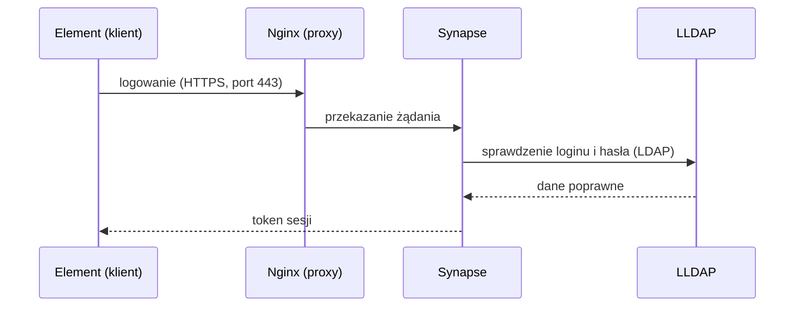

<p align="center">
  
</p>

# Matrix PoC – komunikator firmowy (matrix.local)

Proof of Concept zamkniętego komunikatora firmowego opartego na Matrix:

- **Synapse** – serwer Matrix (federacja wyłączona),
- **LLDAP** – lekki serwer katalogowy symulujący Active Directory; logowanie kontami z LDAP,
- **Coturn** – STUN/TURN dla rozmów audio/wideo 1:1 (WebRTC),
- **Nginx** – reverse proxy z SSL oraz osobny kontener z widżetem książki adresowej (widżet jest
  wstrzymany – patrz [Książka adresowa dla całej firmy](#książka-adresowa-dla-całej-firmy-zmiana-planu)),
- **PostgreSQL** – baza Synapse,
- **Tailscale** – prywatna sieć, która symuluje izolowaną sieć firmową między lokalizacjami.

Instrukcja jest napisana tak, żeby dało się ją odtworzyć od zera – krok po kroku, z komendami do wklejenia.
`Matrix.md` to pierwotny plan testów (zakładał domenę `matrix.twojtest.local` i dowolny reverse proxy;
w projekcie użyto `matrix.local` i Nginx).

> **Status:** to środowisko testowe (PoC), nie produkcyjne. Przed wdrożeniem przejdź listę kontrolną
> w sekcji [Przed wdrożeniem produkcyjnym](#przed-wdrożeniem-produkcyjnym).

---

## Architektura

<p align="center">
  
</p>

Jak wygląda logowanie (uproszczony schemat):



---

## Spis treści

0. [Oznaczenia i zasady](#0-oznaczenia-i-zasady)
1. [Połącz się z VM](#krok-1--połącz-się-z-vm)
2. [Docker i Docker Compose](#krok-2--docker-i-docker-compose)
3. [Tailscale na serwerze](#krok-3--tailscale-na-serwerze)
4. [Pliki projektu na serwerze](#krok-4--pliki-projektu-na-serwerze)
5. [Sekrety i pliki lokalne](#krok-5--sekrety-i-pliki-lokalne)
6. [Certyfikaty (PKI)](#krok-6--certyfikaty-pki)
7. [Uruchomienie usług](#krok-7--uruchomienie-usług)
8. [Konta w LLDAP](#krok-8--konta-w-lldap)
9. [Klienci: Windows i Android](#krok-9--klienci)
10. [Testy](#krok-10--testy)
11. [Książka adresowa dla całej firmy (zmiana planu)](#książka-adresowa-dla-całej-firmy-zmiana-planu)
12. [Przydatne komendy](#przydatne-komendy)
13. [Przed wdrożeniem produkcyjnym](#przed-wdrożeniem-produkcyjnym)
14. [Rozwiązywanie problemów](#rozwiązywanie-problemów)
15. [Znane ograniczenia](#znane-ograniczenia-poc)

<p align="center">
  
</p>

---

## Zawartość repozytorium

```
docker-compose.yml                  6 usług: proxy, synapse, postgres, coturn, lldap, widget
.env.example                        wzór sekretów (skopiuj do .env i ustaw własne wartości)
docker/synapse/Dockerfile           Synapse + moduł matrix-synapse-ldap3
synapse/homeserver.yaml.example     wzór konfiguracji Synapse (federacja wyłączona, Postgres, LDAP, Coturn)
synapse/matrix.local.log.config     konfiguracja logowania Synapse
nginx/conf.d/matrix.conf.example    wzór konfiguracji reverse proxy z SSL
pki/generate-pki.sh, pki/v3.ext     Root CA + certyfikat serwera dla matrix.local
widget/index.html                   Książka Adresowa (wyszukiwarka JS)
Matrix.md                           pierwotny plan testów
docs/img/*.svg                      grafiki do README (baner, architektura, mapa kroków)
.gitignore, .gitattributes          wyłączenie sekretów z repozytorium, końce linii LF
```

W repozytorium są **tylko wzory** (`*.example`). Prawdziwe pliki z hasłami, certyfikaty i klucze tworzysz
u siebie (krok 5 i 6) – są wyłączone przez `.gitignore`.

---

## 0. Oznaczenia i zasady

**Gdzie wpisujesz komendy** (przy każdym bloku jest znacznik):

| Znacznik | Gdzie | Jak wygląda |
|---|---|---|
| 🪟 **PC** | PowerShell na komputerze z Windows | `PS C:\Users\...>` |
| 🐧 **VM** | terminal na serwerze Ubuntu (przez SSH) | `uzytkownik@serwer:/opt/matrix$` |

**Wartości do podstawienia** (w komendach występują w nawiasach ostrych `<...>`):

| Placeholder | Co wpisać |
|---|---|
| `<IP_VM>` | adres VM w sieci lokalnej |
| `<UZYTKOWNIK>` | użytkownik Linuksa na VM |
| `<IP_TAILSCALE>` | adres Tailscale serwera (`tailscale ip -4` na VM) |
| `<PELNA-NAZWA-TS>` | pełna nazwa serwera w Tailscale, np. `matrix-test.nazwa-tailnetu.ts.net` (panel Tailscale albo `tailscale status`) |

**Najważniejsze zasady:**

1. **Nigdy nie wpisuj znaku `$` na początku komendy.** W dokumentacji `$` oznacza tylko „tu jest wiersz poleceń".
   Wpisanie `$bash ...` kończy się błędem `Permission denied`.
2. Komendy wklejaj **po jednej** i czytaj wynik, zanim pójdziesz dalej.
3. Wielkość liter ma znaczenie na Linuksie (`Matrix` ≠ `matrix`).
4. Jak coś nie działa – **nie kombinuj dalej**, zajrzyj do [Rozwiązywania problemów](#rozwiązywanie-problemów)
   i do logów (`docker compose logs`).
5. Domena testowa to `matrix.local`. Nie jest nigdzie zarejestrowana – komputery rozwiązują ją przez wpis
   w pliku `hosts` (krok 9).

**Wymagania:** VM z Debianem 12 lub Ubuntu 24.04 (min. 4 GB RAM, 2 vCPU – dla testu wystarczy; dla ok. 300
użytkowników rozmiar niesprawdzony), konto w Tailscale, komputery klienckie z Windows lub telefon z Androidem.

---

## Krok 1 – Połącz się z VM

🪟 **PC**, PowerShell:

```powershell
ssh <UZYTKOWNIK>@<IP_VM>
```

Wpisz hasło (przy wpisywaniu nic się nie wyświetla – to normalne). Gotowe, gdy widzisz znak zachęty
na serwerze. Od teraz wszystko oznaczone 🐧 robisz w tym oknie.

---

## Krok 2 – Docker i Docker Compose

🐧 **VM**:

```bash
docker --version
docker compose version
```

Oba polecenia muszą pokazać numer wersji.

- Jeśli `docker compose` nie działa: `sudo apt install docker-compose-plugin`
- Jeśli `docker ps` pisze `permission denied`: `sudo usermod -aG docker <UZYTKOWNIK>`
  i **wyloguj się oraz zaloguj ponownie**.

---

## Krok 3 – Tailscale na serwerze

Tailscale to prywatna sieć VPN. Dzięki niej komputery klienckie „widzą" serwer, jakby były w jednej sieci.

🐧 **VM**:

```bash
curl -fsSL https://tailscale.com/install.sh | sh
sudo tailscale up
```

Komenda `tailscale up` wypisze **link** – otwórz go w przeglądarce i zaloguj się kontem Tailscale. Potem:

```bash
tailscale ip -4
```

Wynik (np. `100.64.12.34`) to **`<IP_TAILSCALE>`**. Zapisz go – wpiszesz go w pliku `.env` i na klientach.

Pozostałe komputery (i telefon) muszą być w **tym samym tailnecie** (zaproś użytkownika albo udostępnij
mu maszynę w panelu Tailscale).

---

## Krok 4 – Pliki projektu na serwerze

Projekt ma trafić do `/opt/matrix` na VM. Wybierz jedną drogę.

**A. Przez git** (🐧 **VM**; repozytorium prywatne wymaga uwierzytelnienia):

```bash
sudo mkdir -p /opt/matrix && sudo chown <UZYTKOWNIK>:<UZYTKOWNIK> /opt/matrix
git clone <ADRES_REPOZYTORIUM> /opt/matrix
```

**B. Przez scp z komputera, na którym masz katalog projektu** (🪟 **PC**; najpierw na VM:
`sudo mkdir -p /opt/matrix && sudo chown <UZYTKOWNIK>:<UZYTKOWNIK> /opt/matrix`):

```powershell
scp -r "<KATALOG_PROJEKTU>\*" <UZYTKOWNIK>@<IP_VM>:/opt/matrix/
```

Sprawdzenie (🐧 **VM**):

```bash
cd /opt/matrix
ls -a
```

Musisz widzieć m.in. `docker-compose.yml`, `.env.example`, `docker`, `nginx`, `pki`, `synapse`, `widget`.
(Plik `.env.example` jest ukryty – dlatego `ls -a`.)

---

## Krok 5 – Sekrety i pliki lokalne

W repozytorium są wzory z placeholderami `CHANGE_ME_...`. Tworzysz z nich prawdziwe pliki
**na serwerze** (są w `.gitignore` – **nie commituj ich**):

🐧 **VM**:

```bash
cd /opt/matrix
cp .env.example .env
cp synapse/homeserver.yaml.example synapse/homeserver.yaml
cp nginx/conf.d/matrix.conf.example nginx/conf.d/matrix.conf
```

### 5.1 Hasła

Wygeneruj osobne, losowe wartości (bez znaków specjalnych, bezpieczne dla `.env` i YAML) – po jednej dla
każdego z pięciu sekretów:

```bash
openssl rand -hex 24
```

Wpisz je w `.env` (`nano .env`; w `nano`: `Ctrl+O`, `Enter` – zapis, `Ctrl+X` – wyjście):

```
TS_IP=<IP_TAILSCALE>
POSTGRES_PASSWORD=...
TURN_SECRET=...
LLDAP_ADMIN_PASSWORD=...
LLDAP_JWT_SECRET=...
LLDAP_KEY_SEED=...
```

> ### ⚠️ Trzy hasła muszą być w DWÓCH plikach: `.env` ORAZ `synapse/homeserver.yaml`
>
> Synapse **nie czyta zmiennych z `.env`** w swoim pliku konfiguracyjnym, więc trzy wartości są wpisane
> na sztywno w `homeserver.yaml` i muszą być **identyczne** jak w `.env`. Zmiana w jednym pliku bez drugiego
> = Synapse nie połączy się z bazą / LDAP / Coturn.
>
> | Wartość | W `.env` | W `synapse/homeserver.yaml` | Do czego służy |
> |---|---|---|---|
> | Hasło PostgreSQL | `POSTGRES_PASSWORD` | `database.args.password` | Synapse → baza |
> | Sekret TURN | `TURN_SECRET` | `turn_shared_secret` | Synapse ↔ Coturn (rozmowy A/V) |
> | Hasło admina LLDAP | `LLDAP_ADMIN_PASSWORD` | `modules[].config.bind_password` | Synapse → LDAP (logowanie) |
>
> Tylko w `.env`: `LLDAP_JWT_SECRET`, `LLDAP_KEY_SEED`, `TS_IP`.

Edytuj `synapse/homeserver.yaml` (`nano synapse/homeserver.yaml`) i podmień trzy wartości `CHANGE_ME_...`.

**Ustaw hasła przed pierwszym uruchomieniem.** Postgres i LLDAP zapisują je w wolumenie przy pierwszym
starcie, więc późniejsza zmiana samego `.env` może ich nie zmienić (patrz
[Przed wdrożeniem produkcyjnym](#przed-wdrożeniem-produkcyjnym)).

### 5.2 Adresy dla dostępu z telefonu (opcjonalnie)

Jeśli **nie** będziesz łączyć się z telefonu, usuń z `nginx/conf.d/matrix.conf` dwa ostatnie bloki `server`
(te z nazwą `matrix-test.TWOJ-TAILNET.ts.net`) i zostaw w `homeserver.yaml` wartość
`public_baseurl: "https://matrix.local/"`.

Jeśli będziesz – robisz to w kroku 9.2 (potrzebna jest `<PELNA-NAZWA-TS>`).

---

## Krok 6 – Certyfikaty (PKI)

Skrypt tworzy własny „urząd certyfikacji" (Root CA) i certyfikat dla `matrix.local`, dzięki czemu
komputery łączą się przez HTTPS bez ostrzeżeń (po zainstalowaniu Root CA).

🐧 **VM**:

```bash
cd /opt/matrix
bash pki/generate-pki.sh
ls certs
```

> ⚠️ Pisz `bash pki/...`, nie `$bash` i nie samo `pki/generate-pki.sh` (patrz „Rozwiązywanie problemów").

W `certs/` muszą być: `matrix.crt`, `matrix.key`, `rootCA.pem`. Klucz Root CA (`pki/rootCA.key`) zostaje
na serwerze i **nigdy nie może trafić do repozytorium ani na inne komputery** – na klienty rozdajesz tylko
`rootCA.pem`.

Jeśli skrypt wypisze błędy ze znakiem `\r` (`$'\r': command not found`), pliki mają windowsowe końce linii:

```bash
sed -i 's/\r$//' pki/generate-pki.sh pki/v3.ext
bash pki/generate-pki.sh
```

(Plik `.gitattributes` w repozytorium wymusza końce linii LF, więc po sklonowaniu nie powinno to wystąpić.)

---

## Krok 7 – Uruchomienie usług

🐧 **VM**:

```bash
cd /opt/matrix
docker compose up -d --build
docker compose ps
```

Pierwszy raz trwa kilka minut (pobieranie obrazów, budowa Synapse). **Cel:** 6 kontenerów ze statusem
`running`/`Up` (Postgres może mieć `healthy`): `matrix-proxy`, `matrix-synapse`, `matrix-postgres`,
`matrix-coturn`, `matrix-lldap`, `matrix-widget`.

Jak któryś się restartuje lub ma status `exited`:

```bash
docker compose logs --tail=50 synapse
```

(zamiast `synapse` wstaw nazwę usługi: `proxy`, `postgres`, `coturn`, `lldap`, `widget`). Przy kontenerze,
który ciągle się restartuje, czytaj **początek** logu (`docker compose logs NAZWA | head -15`) – przyczyna jest
na samym początku, końcówka to zwykle tylko wydruk pomocy.

---

## Krok 8 – Konta w LLDAP

1. Przeglądarka: `http://<IP_TAILSCALE>:17170` (albo `<IP_VM>`, jeśli jesteś w sieci lokalnej).
2. Logowanie: użytkownik `admin`, hasło = `LLDAP_ADMIN_PASSWORD` z `.env`.
3. **Groups → Create group:** utwórz `Zarzad` i `IT`.
4. **Users → Create user:**
   - `j.kowalski` (Display name: Jan Kowalski, e-mail `j.kowalski@matrix.local`, hasło min. 8 znaków) → grupa `Zarzad`,
   - `a.nowak` (Anna Nowak, e-mail `a.nowak@matrix.local`, hasło) → grupa `IT`.

> Login w LLDAP musi zgadzać się z `login` w tablicy `PEOPLE` w pliku `widget/index.html`
> (lista osób w widżecie jest wpisana ręcznie – nowe konta trzeba tam dopisać).
> Widżet jest jednak **wstrzymany** – docelowo książkę adresową zastąpi katalog użytkowników Synapse
> (patrz [Książka adresowa dla całej firmy](#książka-adresowa-dla-całej-firmy-zmiana-planu)).

---

## Krok 9 – Klienci

### 9.1 Windows (Element Desktop)

Robisz **na każdym komputerze** testowym.

**Tailscale:** zainstaluj (tailscale.com/download) i zaloguj się do tego samego tailnetu co serwer.

**Plik hosts:**

1. Menu Start → `Notatnik` → prawy przycisk → **Uruchom jako administrator**.
2. Plik → Otwórz → `C:\Windows\System32\drivers\etc\hosts` (filtr: „Wszystkie pliki").
3. Dopisz na końcu (z adresem Tailscale serwera; w sieci lokalnej możesz użyć `<IP_VM>`):
   ```
   <IP_TAILSCALE>   matrix.local
   ```
4. **Zapisz plik (Ctrl+S)** – niezapisany plik to najczęstsza przyczyna, że `matrix.local` się nie rozwiązuje.

**Certyfikat `rootCA.pem`** – pobierz go z serwera (🪟 **PC**):

```powershell
scp <UZYTKOWNIK>@<IP_VM>:/opt/matrix/certs/rootCA.pem .
```

Instalacja w systemie:

> ⚠️ U nas dwuklik na pliku `.pem` **nie działał** (Windows nie zna tego rozszerzenia). Obejście: skopiuj
> plik jako `rootCA.crt` (`Copy-Item rootCA.pem rootCA.crt`) i dwuklikaj ten, albo w PowerShellu uruchomionym
> jako administrator: `certutil -addstore -f "Root" rootCA.pem`. Firefox ma własny magazyn certyfikatów
> i wymaga osobnego importu; Chrome, Edge i Element korzystają z magazynu Windows.

1. Dwuklik na `rootCA.crt` → **Zainstaluj certyfikat**.
2. Wybierz **Komputer lokalny** → Dalej.
3. **Umieść wszystkie certyfikaty w następującym magazynie** → Przeglądaj → **Zaufane główne urzędy certyfikacji**.
4. Dalej → Zakończ → potwierdź ostrzeżenie „Tak".

Test: w przeglądarce otwórz `https://matrix.local/_matrix/client/versions` – ma pokazać tekst JSON
**bez** ostrzeżenia o certyfikacie.

**Element Desktop:** zainstaluj (element.io/download), przy logowaniu kliknij **Edytuj** przy serwerze
domowym i wpisz `https://matrix.local`. Zaloguj się loginem i hasłem z LLDAP (np. `j.kowalski`).

### 9.2 Android (Element przez nazwę z Tailscale)

**Dlaczego inaczej niż na Windows:** telefon nie ma pliku `hosts`, więc nie rozwiąże `matrix.local`.
Zamiast tego łączymy się przez nazwę MagicDNS z Tailscale (`<PELNA-NAZWA-TS>`) i prawdziwy certyfikat
z Tailscale – **na telefonie nie instalujesz żadnego Root CA**.

> Sprawdzone na: Android 16, Element Classic 1.6.66. Telefon musi mieć włączone Tailscale i być w tym samym
> tailnecie co serwer.

**1. Panel Tailscale** (login.tailscale.com → zakładka **DNS**): włącz **MagicDNS** i **HTTPS Certificates**.

**2. Certyfikat z Tailscale** – 🐧 **VM**:

```bash
cd /opt/matrix/certs
sudo tailscale cert <PELNA-NAZWA-TS>
```

Wynik: `Wrote public cert to ...crt` i `Wrote private key to ...key`. Nazwy plików muszą być takie same
jak w `nginx/conf.d/matrix.conf` (krok 3).

**3. Nginx** – w `nginx/conf.d/matrix.conf` zamień wszystkie wystąpienia `matrix-test.TWOJ-TAILNET.ts.net`
na `<PELNA-NAZWA-TS>` (pięć miejsc: dwa `server_name`, dwie ścieżki certyfikatu i adres w
`.well-known`). Drugi blok `server` ma **własny** `/.well-known/matrix/client` wskazujący na tę nazwę – to
ważne, bo ten z `matrix.local` jest dla telefonu nieosiągalny.

**4. Synapse (kluczowe!)** – w `synapse/homeserver.yaml` ustaw:

```yaml
public_baseurl: "https://<PELNA-NAZWA-TS>/"
```

Synapse dokleja ten adres do odpowiedzi na logowanie, a Element na telefonie przełącza się na niego.
Przy `https://matrix.local/` telefon loguje się, ale potem wisi na „Wstępna synchronizacja – czekanie
na odpowiedź serwera" (patrz „Rozwiązywanie problemów"). Skutek uboczny: Element na Windowsie przy **nowym**
logowaniu też przełączy się na tę nazwę (wymaga włączonego Tailscale); zalogowane sesje się nie zmieniają.

**5. Sprawdzenie i restart** – 🐧 **VM**:

```bash
cd /opt/matrix
docker compose exec proxy nginx -t
docker compose restart proxy
docker compose restart synapse
```

`nginx -t` musi pokazać `syntax is ok` i `test is successful`. Nginx nie wstanie, jeśli plików z kroku 2
nie ma w `certs/`.

**6. Test w przeglądarce telefonu** (przed Elementem): otwórz
`https://<PELNA-NAZWA-TS>/_matrix/client/versions` – ma pokazać JSON, **bez** ostrzeżenia o certyfikacie.

**7. Element na telefonie:** zmień serwer domowy na `https://<PELNA-NAZWA-TS>` i zaloguj się loginem
z LLDAP (np. `j.kowalski`, bez `@` i bez domeny). Jeśli wcześniej logowałeś się z błędnym `public_baseurl`,
najpierw wyloguj się albo w ustawieniach Androida wyczyść dane Elementa – inaczej aplikacja zapamięta
stary adres.

**Jeszcze niesprawdzone:**

- weryfikacja nowego urządzenia w Elemencie (klucz odzyskiwania lub emotikony z drugiej sesji),
- rozmowy audio/wideo z telefonu – `turn_uris` w `homeserver.yaml` wskazują `matrix.local`, którego telefon
  nie rozwiąże; trzeba je zmienić na `<PELNA-NAZWA-TS>`,
- odnawianie certyfikatu z Tailscale (ważny ok. 90 dni) – trzeba powtórzyć `tailscale cert` i zrestartować
  proxy, najlepiej w cronie.

---

## Krok 10 – Testy

1. **Logowanie** – kontem z LLDAP w Elemencie.
2. **Pokój i wiadomości** – utwórz pokój `Firma-Ogolny`, zaproś drugie konto z drugiego komputera,
   wymieńcie wiadomości.
3. **Widżet książki adresowej** *(wstrzymany – test pokazuje, jak działa demonstracja; docelowe rozwiązanie
   w sekcji [Książka adresowa dla całej firmy](#książka-adresowa-dla-całej-firmy-zmiana-planu))* – w pokoju
   wpisz w polu wiadomości:
   ```
   /addwidget https://matrix.local/widget/
   ```
   Zatwierdź zgodę na widżet, wpisz nazwisko w wyszukiwarce i kliknij osobę. Klik otwiera `matrix.to`
   w przeglądarce (patrz „Znane ograniczenia"); czy kończy się to czatem 1:1 w Elemencie – **niepotwierdzone**.
4. **Rozmowa audio/wideo 1:1** – w czacie bezpośrednim kliknij ikonę słuchawki / kamery. Wymaga, żeby klient
   był w Tailscale (adres zewnętrzny Coturn to `TS_IP`). Jeśli nie ma dźwięku lub obrazu, zajrzyj w logi:
   `docker compose logs --tail=50 coturn`. Porty: 3478 oraz 49160–49200 na IP Tailscale. Test A/V
   **niepotwierdzony**.

Kolejność testów: najpierw w sieci lokalnej, potem przez Tailscale.

---

## Książka adresowa dla całej firmy (zmiana planu)

> ⚠️ **Status: plan, jeszcze niesprawdzony w praktyce.** Poniżej opisane jest, co zamierzamy zrobić i dlaczego.
> Kiedy któryś etap zadziała, zmieniamy jego opis na instrukcję krok po kroku.

**Wymagania** (docelowo ok. 300 pracowników w 3 lokalizacjach):

- pracownik loguje się i od razu może wyszukać każdego kolegę,
- bez klikania zgód i bez pośredników (`matrix.to`),
- kliknięcie osoby otwiera rozmowę 1:1,
- nowi pracownicy z LLDAP pojawiają się automatycznie,
- w wynikach widać dział i lokalizację.

**Dlaczego nie widżet** (sprawdzone w teście 3 w kroku 10):

1. Lista osób (`PEOPLE` w `widget/index.html`) jest wpisana ręcznie – nowe konta z LLDAP się w niej nie pojawią.
2. Kliknięcie osoby otwiera `matrix.to` w przeglądarce – to pośrednik, który wymaga internetu na kliencie.
3. Widżet jest dodawany do każdego pokoju osobno i przy dodaniu pyta o zgodę. Globalnego widżetu
   w pasku bocznym Elementa nie znaleziono.

**Nowe podejście:** wbudowany katalog użytkowników Synapse. W Elemencie: **+ → Rozpocznij czat →
wyszukiwarka**; kliknięcie osoby tworzy rozmowę 1:1. Widżet zostaje w repozytorium (nie jest usunięty) jako
ewentualny dodatek do przeglądania drzewka działów.

| Etap | Co | Status |
|---|---|---|
| **A** | Katalog użytkowników wyszukuje **wszystkich** (nie tylko osoby ze wspólnych pokoi) | ✅ sprawdzone na PoC |
| **B** | Automatyczne zakładanie kont na podstawie LLDAP (skrypt) | do zrobienia |
| **C** | Dział i lokalizacja w nazwie wyświetlanej | do zrobienia |
| **D** | Wdrożenie klientów na stanowiskach (Element Desktop z domyślnym serwerem) | do sprawdzenia przy produkcji |

### Etap A – wyszukiwanie wszystkich użytkowników ✅ *(sprawdzone na PoC)*

W `synapse/homeserver.yaml` dopisz:

```yaml
user_directory:
  search_all_users: true
```

Według dokumentacji Synapse bez tej opcji katalog pokazuje tylko osoby, które mają z Tobą wspólny pokój albo
są w pokojach publicznych. Po zmianie (🐧 **VM**, w `/opt/matrix`): `docker compose restart synapse`.

**Wynik testu (2026-10-10):** konto `p.wisniewski` (nazwa wyświetlana `Piotr Wiśniewski – Sprzedaż`, z LLDAP)
nie miało wspólnego pokoju z `j.kowalski`. Po pierwszym zalogowaniu Piotra pojawił się w tabeli
`user_directory` w bazie, a w Elemencie na koncie Jana wyszukiwanie frazy `Sprzedaż` go znalazło.
Nazwa wyświetlana z LLDAP (`cn`) przechodzi w całości, razem z działem, więc wyszukiwanie działa po dziale.

Podgląd katalogu w bazie (🐧 **VM**):

```bash
docker compose exec postgres psql -U synapse -d synapse -c "select user_id, display_name from user_directory;"
```

**Ważne:** konto trafia do katalogu dopiero po **pierwszym logowaniu** (przed nim w tabeli go nie ma,
więc wyszukiwarka go nie znajdzie). Dla całej firmy rozwiązuje to etap B.

Kliknięcie znalezionej osoby otwiera od razu rozmowę 1:1 (sprawdzone 2026-10-10, bez `matrix.to` i bez dodatkowych zgód).

Osoby, które nigdy się nie logowały, nie istnieją w Synapse, więc nie ma ich w katalogu – to nie wymaga
`regenerate_directory`, tylko założenia kont (etap B).

### Etap B – automatyczne zakładanie kont *(niesprawdzone)*

Konto w Synapse powstaje dopiero przy **pierwszym logowaniu** przez LDAP, więc dopóki ktoś się nie zaloguje,
nie ma go w katalogu. Dla ok. 300 osób potrzebny jest skrypt (np. cron na VM), który czyta użytkowników
z LLDAP i zakłada ich w Synapse przez Admin API (`PUT /_synapse/admin/v2/users/@login:matrix.local`
z nazwą wyświetlaną; wymaga tokenu konta administratora Synapse).

Do sprawdzenia: czy konto założone w ten sposób potem normalnie loguje się przez moduł LDAP i czy API
wymaga hasła (wtedy losowego, nieużywanego).

### Etap C – dział i lokalizacja *(niesprawdzone)*

Prosty sposób: wpisać dział i lokalizację w nazwę wyświetlaną, np. `Imię Nazwisko – Dział, Lokalizacja`.
Skrypt z etapu B skleja ją z grup i atrybutów LLDAP. Dokładny format do ustalenia.

### Etap D – klienci *(do sprawdzenia przy produkcji)*

- `config.json` Element Desktop z domyślnym serwerem `matrix.local`, żeby pracownik nie wpisywał adresu,
- `rootCA.pem` na stanowiskach (docelowo przez GPO),
- DNS zamiast wpisów w pliku `hosts`,
- opcjonalnie `auto_join_rooms` (wspólny pokój dla wszystkich) – nie wiadomo, czy działa dla kont
  zakładanych przez LDAP / Admin API.

### Decyzja: jeden serwer dla całej firmy

Na produkcji działa **jeden serwer Synapse dla wszystkich trzech lokalizacji**. Dzięki temu wbudowany katalog
użytkowników wystarcza (jedna lista wszystkich pracowników) i nie jest potrzebna osobna, centralna książka
adresowa. Opcja „osobny serwer na każdą lokalizację z federacją” odpada – tam katalog obejmowałby tylko
użytkowników własnego serwera.

Skutek: federacja pozostaje wyłączona (`federation_domain_whitelist: []`), a rozmiar jednej maszyny
(obecnie 4 GB / 2 vCPU) trzeba oceniać pod ok. 300 użytkowników naraz – niesprawdzone.

---

## Przydatne komendy

🐧 **VM**, zawsze w `/opt/matrix`:

| Co chcę zrobić | Komenda |
|---|---|
| Zobaczyć, co działa | `docker compose ps` |
| Logi jednej usługi | `docker compose logs --tail=50 NAZWA` |
| Logi na żywo | `docker compose logs -f NAZWA` (wyjście: `Ctrl+C`) |
| Zrestartować usługę | `docker compose restart NAZWA` |
| Zatrzymać wszystko | `docker compose down` |
| Uruchomić po zmianach | `docker compose up -d --build` |
| ⚠️ Skasować wszystko razem z danymi | `docker compose down -v` *(usuwa bazę i konta LLDAP!)* |

---

## Przed wdrożeniem produkcyjnym

1. **Własne, losowe hasła** w `.env` i `synapse/homeserver.yaml` (`openssl rand -hex 24`) – nigdy wartości
   z przykładów ani z dokumentacji.
2. **Wpisz je w OBU plikach** (tabela w kroku 5): `POSTGRES_PASSWORD`, `TURN_SECRET`, `LLDAP_ADMIN_PASSWORD`.
3. **Ustaw hasła PRZED pierwszym uruchomieniem.** *(Niesprawdzone u nas, ale to typowe zachowanie
   kontenerów:)* PostgreSQL i LLDAP zapisują hasło w wolumenie przy pierwszym starcie, więc późniejsza
   zmiana samego `.env` może go nie zmienić. Jeśli trzeba zmienić po fakcie – zmień hasło w samej bazie /
   w panelu LLDAP albo odtwórz wolumeny (`docker compose down -v` **kasuje dane!**).
4. Nie wrzucaj `.env`, `homeserver.yaml`, certyfikatów ani kluczy do repozytorium i nie wysyłaj ich
   komunikatorem.
5. Panel LLDAP (port 17170) jest w `docker-compose.yml` otwarty na wszystkich interfejsach VM – rozważ
   ograniczenie go do adresu Tailscale (*niesprawdzone*).
6. Po zmianach przetestuj ponownie: logowanie kontem z LLDAP (Synapse → LDAP) i rozmowę A/V
   (Synapse ↔ Coturn).
7. Rozmiar VM (4 GB / 2 vCPU) dla ok. 300 użytkowników jest **niesprawdzony**.

---

## Rozwiązywanie problemów

### ✅ Zweryfikowane

**1. `-bash: pki/generate-pki.sh: Permission denied`**
- **Przyczyna:** komenda wpisana jako `$bash pki/generate-pki.sh`. Znak `$` na początku robi z `bash` pustą
  zmienną, więc system próbuje uruchomić sam plik, który nie ma prawa wykonywania.
- **Rozwiązanie:** wpisz bez `$`: `bash pki/generate-pki.sh`.

**2. Kontener Coturn w pętli `Restarting (255)`, w logach cała lista opcji**
- **Przyczyna:** pierwsza linia logu mówiła `unrecognized option '--no-dtls'` – obraz `coturn/coturn:latest`
  nie zna tej opcji. Reszta listy to tylko wydruk pomocy. W tym repozytorium opcja jest już usunięta.
- **Wskazówka:** przy restartującym się kontenerze czytaj **początek** logu
  (`docker compose logs coturn | head -15`), a nie końcówkę.

**3. `ping matrix.local` → „could not find host", przeglądarka nie otwiera strony**
- **Przyczyna:** wpis w pliku `hosts` nie został zapisany (Notatnik otwarty, ale bez Ctrl+S). Inne możliwe
  przyczyny: brak uprawnień administratora, plik zapisany jako `hosts.txt`.
- **Diagnoza:** `Get-Content C:\Windows\System32\drivers\etc\hosts` – czy jest tam linia z `matrix.local`.
- **Rozwiązanie:** zapisz plik albo dopisz z PowerShella jako administrator:
  `Add-Content C:\Windows\System32\drivers\etc\hosts "`n<IP_TAILSCALE>   matrix.local"`,
  potem `ipconfig /flushdns`.

**4. Element na telefonie loguje się, ale „Wstępna synchronizacja – czekanie na odpowiedź serwera" wisi bez końca**
- **Objawy:** w logu Nginx (`docker compose logs --tail=60 proxy | grep -E "sync|keys|login"`) są tylko
  dwa wpisy `GET` i `POST /_matrix/client/r0/login` z kodem 200, potem nic – ani `sync`, ani `keys`.
  Serwer jest bezczynny (`docker stats`), a przeglądarka telefonu ładuje `/_matrix/client/versions`.
- **Przyczyna:** w `homeserver.yaml` było `public_baseurl: "https://matrix.local/"`. Synapse dokleja ten adres
  do odpowiedzi na logowanie, więc Element po zalogowaniu przełączał się na `matrix.local`, którego telefon
  nie rozwiązuje – kolejne zapytania nie docierały do serwera.
- **Rozwiązanie:** `public_baseurl: "https://<PELNA-NAZWA-TS>/"`, `docker compose restart synapse`,
  wylogowanie (albo wyczyszczenie danych Elementa) i ponowne logowanie na `https://<PELNA-NAZWA-TS>`.
- **Wskazówka:** `sudo ss -tn | grep IP_TELEFONU` na VM **nic nie pokazuje**, bo Nginx działa w kontenerze –
  do podglądu zapytań użyj logów (`docker compose logs -f --tail=0 proxy`).

### ⚠️ Możliwe, niesprawdzone (zajrzyj tu dopiero, jeśli zobaczysz taki objaw)

**5. Błędy `\r` przy uruchamianiu skryptu** – windowsowe końce linii; naprawa:
`sed -i 's/\r$//' pki/generate-pki.sh pki/v3.ext`.

**6. Synapse restartuje się, w logach brak klucza podpisu (`signing key`) lub brak uprawnień do `/data`**
Obraz Synapse nie zawsze sam tworzy klucz, a działa jako użytkownik `991`, który może nie mieć prawa zapisu
w zamontowanym katalogu. Rozwiązanie (do potwierdzenia po zobaczeniu logów):

```bash
cd /opt/matrix
sudo chown -R 991:991 synapse
docker compose run --rm --entrypoint python synapse -m synapse.app.homeserver --config-path /data/homeserver.yaml --generate-keys
docker compose up -d
```

**7. Nginx (`matrix-proxy`) nie startuje** – zwykle brakuje certyfikatów w `/opt/matrix/certs`. Sprawdź
`ls certs` i powtórz krok 6. Po dodaniu bloków dla Tailscale (krok 9.2) brakujące pliki
`<PELNA-NAZWA-TS>.crt` i `.key` też zatrzymają Nginx.

---

## Znane ograniczenia PoC

- **Widżet książki adresowej jest wstrzymany** (patrz [Książka adresowa dla całej firmy](#książka-adresowa-dla-całej-firmy-zmiana-planu)).
  Poniższe dwa punkty opisują jego ograniczenia.
- Linki `https://matrix.to/#/@login:matrix.local` w widżecie otwierają stronę `matrix.to`, która wymaga
  dostępu do internetu na kliencie (sama strona tylko przekierowuje do aplikacji Element). W izolowanej sieci
  można to zastąpić linkami `element://` albo wywołaniem DM przez Widget API. Widżet jest dodawany do każdego
  pokoju osobno i przy dodaniu pyta o zgodę.
- Lista osób w widżecie (`PEOPLE` w `widget/index.html`) jest ręczna – konta z LLDAP nie pojawiają się w niej
  automatycznie.
- Certyfikat serwera jest ważny 825 dni, Root CA 10 lat; certyfikat z Tailscale ok. 90 dni.
- Federacja jest wyłączona (`federation_domain_whitelist: []`) – serwer nie łączy się z innymi serwerami Matrix.
