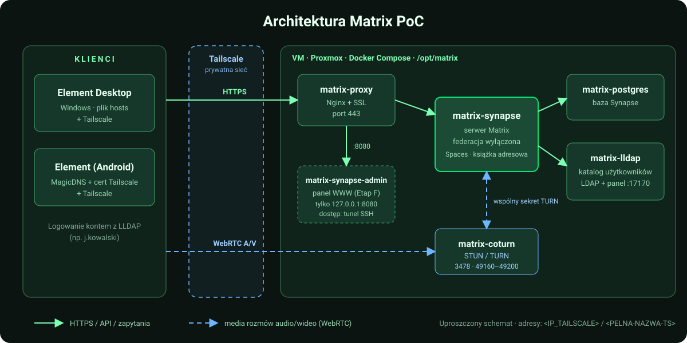
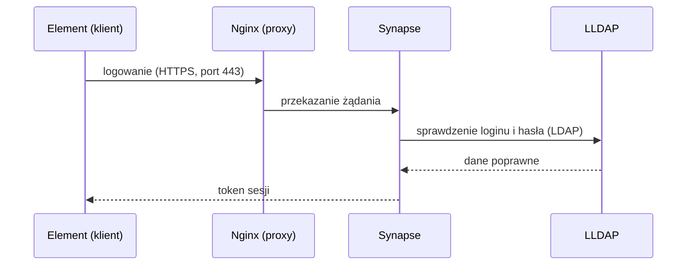
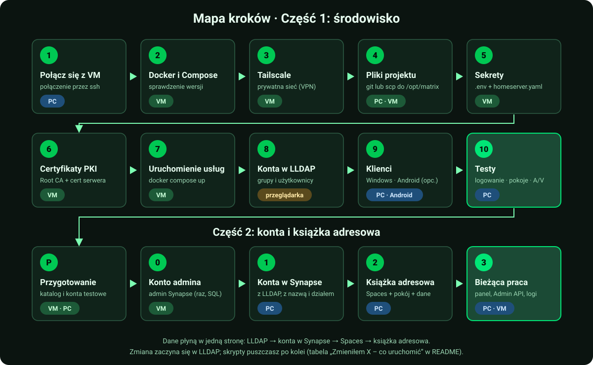
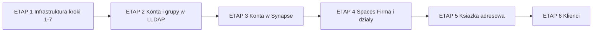
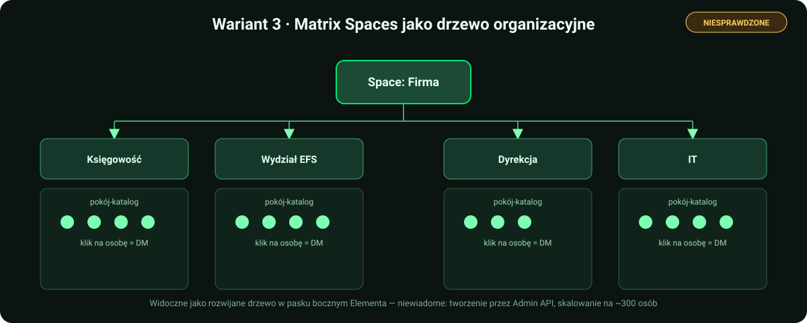

<p align="center">
  
</p>

# Matrix PoC – komunikator firmowy (matrix.local)

Proof of Concept zamkniętego komunikatora firmowego opartego na Matrix:

- **Synapse** – serwer Matrix (federacja wyłączona),
- **LLDAP** – lekki serwer katalogowy symulujący Active Directory; logowanie kontami z LDAP,
- **Coturn** – STUN/TURN dla rozmów audio/wideo 1:1 (WebRTC),
- **Nginx** – reverse proxy z SSL,
- **PostgreSQL** – baza Synapse,
- **Synapse Admin** – webowy panel administracyjny (konta, pokoje, przestrzenie), dostępny tylko z VM / przez tunel SSH
  (patrz [Synapse Admin](#synapse-admin--panel-www-do-administrowania-serwerem)),
- **Matrix Spaces** – struktura firmy w Elemencie: przestrzeń „Firma” (wszyscy pracownicy) i podprzestrzenie-działy
  (budowane skryptem z grup LLDAP; patrz [Książka adresowa dla całej firmy](#książka-adresowa-dla-całej-firmy)),
- **Pokój „Książka adresowa”** – lista pracowników z działami jako wiadomości w pokoju tylko do odczytu, podpiętym pod
  przestrzeń „Firma” (⚠️ w budowie, nieprzetestowane; patrz [Etap G](#etap-g--książka-adresowa-jako-pokój-z-wiadomościami)),
- **Tailscale** – prywatna sieć, która symuluje izolowaną sieć firmową między lokalizacjami.

Instrukcja jest napisana tak, żeby dało się ją odtworzyć od zera – krok po kroku, z komendami do wklejenia.
Domena testowa to `matrix.local`, reverse proxy to Nginx.

> **Status:** to środowisko testowe (PoC), nie produkcyjne. Przed wdrożeniem przejdź listę kontrolną
> w sekcji [Przed wdrożeniem produkcyjnym](#przed-wdrożeniem-produkcyjnym).
>
> Zwijane ramki **🏭 Produkcja** (w całym dokumencie) zbierają, co trzeba zmienić przy wdrożeniu
> produkcyjnym – na PoC możesz je pominąć. Szukaj po 🏭.
>
> Oznaczenia: ✅ = sprawdzone w praktyce na PoC, ⚠️ = niesprawdzone albo sprawdzone tylko częściowo.

---

## Architektura

<p align="center">
  
</p>

Jak wygląda logowanie (uproszczony schemat):



---

## Spis treści

**Mapa etapów: [od zera do działającego systemu i co uruchomić po zmianie](#mapa-etapów-i-co-uruchomić-po-zmianie)**

0. [Oznaczenia i zasady](#0-oznaczenia-i-zasady)
1. [Połącz się z VM](#krok-1--połącz-się-z-vm)
2. [Docker i Docker Compose](#krok-2--docker-i-docker-compose)
3. [Tailscale na serwerze](#krok-3--tailscale-na-serwerze)
4. [Pliki projektu na serwerze](#krok-4--pliki-projektu-na-serwerze)
5. [Sekrety i pliki lokalne](#krok-5--sekrety-i-pliki-lokalne)
6. [Certyfikaty (PKI)](#krok-6--certyfikaty-pki)
7. [Uruchomienie usług](#krok-7--uruchomienie-usług)
8. [Konta w LLDAP](#krok-8--konta-w-lldap)
9. [Klienci: Windows i Android](#krok-9--klienci)
    - [Komputer w innej lokalizacji (u kolegi)](#93-komputer-w-innej-lokalizacji-u-kolegi)
10. [Testy](#krok-10--testy)
    - [Drugie konto w Elemencie bez zamykania pierwszego](#drugie-konto-w-elemencie-bez-zamykania-pierwszego-przydatne-w-testach)
11. [Książka adresowa dla całej firmy](#książka-adresowa-dla-całej-firmy) (Etapy A, B0, B+C, E – Spaces, G – pokój z wiadomościami, D)
12. [Administrowanie Synapse](#administrowanie-synapse)
13. [🤖 Skrypty automatyzujące](#-skrypty-automatyzujące)
14. [Przydatne komendy](#przydatne-komendy)
15. [Przed wdrożeniem produkcyjnym](#przed-wdrożeniem-produkcyjnym)
16. [Rozwiązywanie problemów](#rozwiązywanie-problemów)
17. [Znane ograniczenia](#znane-ograniczenia-poc)

<p align="center">
  
</p>

---

## Mapa etapów i co uruchomić po zmianie

Dane płyną **w jedną stronę**: LLDAP (w firmie: Active Directory) → konta w Synapse → przestrzenie Spaces → książka adresowa.
Zmiany robisz **zawsze na początku łańcucha** i uruchamiasz skrypty po kolei od tego miejsca do końca. Ręczne poprawki
w Elemencie albo w panelu Synapse Admin (nazwy, członkostwo) nadpisze następne uruchomienie skryptu.



| Etap | Co | Czym | Gdzie w README |
|---|---|---|---|
| **1** | Infrastruktura: VM, Docker, Tailscale, certyfikaty, 6 kontenerów | kroki 1–7 (ręcznie) | [Krok 1–7](#krok-1--połącz-się-z-vm) |
| **2** | Źródło prawdy: konta i grupy-działy w LLDAP (w firmie: AD) | panel LLDAP; testowa masa: `seed_test_employees.py` (B0) | [Krok 8](#krok-8--konta-w-lldap), [Etap B0](#etap-b0--testowa-struktura-firmy-w-lldap) |
| **3** | Konta w Synapse z nazwą „Imię Nazwisko – Dział” (dział = grupa z LLDAP) | `provision_synapse_users.py` (B+C) | [Etap B + C](#etap-b--c--zakładanie-kont-w-synapse-z-działem-w-nazwie) |
| **4** | Przestrzeń „Firma” i działy, członkowie z grup LLDAP | `setup_spaces.py` (E) | [Etap E](#etap-e--drzewo-spaces-firma--działy) |
| **5** | Pokój „Książka adresowa” (wiadomości z listą osób) | `setup_directory.py` (G) + `scripts/directory_extra.csv` | [Etap G](#etap-g--książka-adresowa-jako-pokój-z-wiadomościami) |
| **6** | Klienci: Element, hosts/DNS, rootCA | krok 9, [Etap D](#etap-d--klienci-do-sprawdzenia-przy-produkcji) | [Krok 9](#krok-9--klienci) |

### Zmieniłem X – co uruchomić

Wszystkie skrypty: 🪟 **PC**, `cd scripts`, `venv\Scripts\activate`, najpierw `--dry-run`. Każdy loguje administratora Synapse,
więc **nie puszczaj ich pod rząd bez przerw** (HTTP 429, ok. 4 min – [Rozwiązywanie problemów](#rozwiązywanie-problemów), pkt 4).

| Co zmieniasz | Gdzie | Uruchom po kolei |
|---|---|---|
| **Nowy pracownik** | LLDAP: konto + grupa-dział | `provision_synapse_users.py` → `setup_spaces.py` → `setup_directory.py` |
| **Konto bez działu** (np. `a.nowak`, `j.kowalski`) albo zła nazwa/dział | LLDAP: dodaj do grupy-działu (lub popraw imię i nazwisko) | `provision_synapse_users.py` → `setup_spaces.py` → `setup_directory.py` |
| **Przeniesienie do innego działu** | LLDAP: zmień grupę | `provision_synapse_users.py` → `setup_spaces.py --prune` → `setup_directory.py` |
| **Odejście pracownika** | LLDAP: usuń/zablokuj; Synapse: dezaktywuj konto (panel lub Admin API) | `setup_spaces.py --prune` → `setup_directory.py` (nieaktywne konta znikają z listy) |
| **Nowy dział** | LLDAP: nowa grupa; `SPACE_TREE` w `setup_spaces.py` (nowe stałe `id`) | `provision_synapse_users.py` → `setup_spaces.py` → `setup_directory.py --rebuild` (kolejność alfabetyczna) |
| **Telefon, pokój, piętro, stanowisko** | `scripts/directory_extra.csv` (nowe osoby: `setup_directory.py --write-extra-template`) | tylko `setup_directory.py` |
| **Ukryć konto techniczne w książce** | `DIRECTORY_EXCLUDE` w `.env` albo `--exclude login1,login2` | tylko `setup_directory.py` |
| **Nazwa lub temat pokoju książki** | `DIRECTORY_ROOM_NAME`, `DIRECTORY_ROOM_TOPIC` w `.env` | tylko `setup_directory.py` |
| **Nazwa przestrzeni „Firma”** | `SPACES_ROOT_NAME` w `.env` | tylko `setup_spaces.py` |
| **Hasło użytkownika** | tylko LLDAP (logowanie idzie przez LDAP) | nic z powyższych |

Zasada kciuka: zmiana **kto i w jakim dziale** zaczyna się w LLDAP i przechodzi przez wszystkie skrypty; zmiana **danych
kontaktowych** dotyczy tylko `setup_directory.py`.

---

## Zawartość repozytorium

```
docker-compose.yml                  6 usług: proxy, synapse, postgres, coturn, lldap, synapse-admin
.env.example                        wzór sekretów i ustawień (skopiuj do .env i ustaw własne wartości)
docker/synapse/Dockerfile           Synapse + moduł matrix-synapse-ldap3
synapse/homeserver.yaml.example     wzór konfiguracji Synapse (federacja wyłączona, Postgres, LDAP, Coturn)
synapse/matrix.local.log.config     konfiguracja logowania Synapse
nginx/conf.d/matrix.conf.example    wzór konfiguracji reverse proxy z SSL (+ blok panelu Synapse Admin na porcie 8080)
pki/generate-pki.sh, pki/v3.ext     Root CA + certyfikat serwera dla matrix.local
scripts/seed_test_employees.py      Etap B0: testowe konta i grupy-działy w LLDAP (też --reassign)
scripts/provision_synapse_users.py  Etap B+C: zakładanie kont w Synapse z nazwą „Imię Nazwisko – Dział”
scripts/setup_spaces.py             Etap E: drzewo Spaces (Firma + działy) z grup LLDAP, tylko do odczytu
scripts/setup_directory.py          Etap G: książka adresowa jako wiadomości w pokoju tylko do odczytu (⚠️ nieprzetestowany)
scripts/test_directory_message.py   eksperyment z układem wiadomości (zwijane <details> vs nagłówki; --measure = rozmiar)
scripts/directory_extra.csv         (tworzony lokalnie, w repo go nie ma) stanowisko/telefon/pokój/piętro dla książki adresowej
scripts/setup_main_room.py          biblioteka wspólna (klasa Synapse itd.) używana przez setup_spaces.py i setup_directory.py;
                                    NIE uruchamiać jako skryptu (pokoje wycofane)
scripts/requirements.txt            zależności Pythona dla skryptów (requests)
Matrix.md                           pierwotny plan testów
docs/img/*.svg                      grafiki do README (baner, architektura, mapa kroków, warianty książki adresowej)
```

Prawdziwe pliki z hasłami, certyfikaty i klucze tworzysz u siebie na podstawie wzorów `*.example` (krok 5 i 6).

---

## 0. Oznaczenia i zasady

**Gdzie wpisujesz komendy** (przy każdym bloku jest znacznik):

| Znacznik | Gdzie | Jak wygląda |
|---|---|---|
| 🪟 **PC** | PowerShell na komputerze z Windows | `PS C:\Users\...>` |
| 🐧 **VM** | terminal na serwerze Ubuntu (przez SSH) | `uzytkownik@serwer:/opt/matrix$` |

**Wartości do podstawienia** (w komendach występują w nawiasach ostrych `<...>`):

| Placeholder | Co wpisać |
|---|---|
| `<IP_VM>` | adres VM w sieci lokalnej |
| `<UZYTKOWNIK>` | użytkownik Linuksa na VM |
| `<IP_TAILSCALE>` | adres Tailscale serwera (`tailscale ip -4` na VM) |
| `<PELNA-NAZWA-TS>` | pełna nazwa serwera w Tailscale, np. `matrix-test.nazwa-tailnetu.ts.net` (panel Tailscale albo `tailscale status`) |

**Najważniejsze zasady:**

1. **Nigdy nie wpisuj znaku `$` na początku komendy.** W dokumentacji `$` oznacza tylko „tu jest wiersz poleceń".
   Wpisanie `$bash ...` kończy się błędem `Permission denied`.
2. Komendy wklejaj **po jednej** i czytaj wynik, zanim pójdziesz dalej.
3. Wielkość liter ma znaczenie na Linuksie (`Matrix` ≠ `matrix`).
4. Jak coś nie działa – **nie kombinuj dalej**, zajrzyj do [Rozwiązywania problemów](#rozwiązywanie-problemów)
   i do logów (`docker compose logs`).
5. Domena testowa to `matrix.local`. Nie jest nigdzie zarejestrowana – komputery rozwiązują ją przez wpis
   w pliku `hosts` (krok 9).

**Wymagania:** VM z Debianem 12 lub Ubuntu 24.04 (min. 4 GB RAM, 2 vCPU – dla testu wystarczy; dla ok. 300
użytkowników rozmiar niesprawdzony), konto w Tailscale, komputery klienckie z Windows lub telefon z Androidem.

---

## Krok 1 – Połącz się z VM

🪟 **PC**, PowerShell:

```powershell
ssh <UZYTKOWNIK>@<IP_VM>
```

Wpisz hasło (przy wpisywaniu nic się nie wyświetla – to normalne). Gotowe, gdy widzisz znak zachęty
na serwerze. Od teraz wszystko oznaczone 🐧 robisz w tym oknie.

---

## Krok 2 – Docker i Docker Compose

🐧 **VM**:

```bash
docker --version
docker compose version
```

Oba polecenia muszą pokazać numer wersji.

- Jeśli `docker compose` nie działa: `sudo apt install docker-compose-plugin`
- Jeśli `docker ps` pisze `permission denied`: `sudo usermod -aG docker <UZYTKOWNIK>`
  i **wyloguj się oraz zaloguj ponownie**.

---

## Krok 3 – Tailscale na serwerze

Tailscale to prywatna sieć VPN. Dzięki niej komputery klienckie „widzą" serwer, jakby były w jednej sieci.

🐧 **VM**:

```bash
curl -fsSL https://tailscale.com/install.sh | sh
sudo tailscale up
```

Komenda `tailscale up` wypisze **link** – otwórz go w przeglądarce i zaloguj się kontem Tailscale. Potem:

```bash
tailscale ip -4
```

Wynik (np. `100.64.12.34`) to **`<IP_TAILSCALE>`**. Zapisz go – wpiszesz go w pliku `.env` i na klientach.

Pozostałe komputery (i telefon) muszą być w **tym samym tailnecie** (zaproś użytkownika albo udostępnij
mu maszynę w panelu Tailscale).

---

## Krok 4 – Pliki projektu na serwerze

Projekt ma trafić do `/opt/matrix` na VM. Wybierz jedną drogę.

**A. Przez git** (🐧 **VM**; repozytorium prywatne wymaga uwierzytelnienia):

```bash
sudo mkdir -p /opt/matrix && sudo chown <UZYTKOWNIK>:<UZYTKOWNIK> /opt/matrix
git clone <ADRES_REPOZYTORIUM> /opt/matrix
```

**B. Przez scp z komputera, na którym masz katalog projektu** (🪟 **PC**; najpierw na VM:
`sudo mkdir -p /opt/matrix && sudo chown <UZYTKOWNIK>:<UZYTKOWNIK> /opt/matrix`):

```powershell
scp -r "<KATALOG_PROJEKTU>\*" <UZYTKOWNIK>@<IP_VM>:/opt/matrix/
```

Sprawdzenie (🐧 **VM**):

```bash
cd /opt/matrix
ls -a
```

Musisz widzieć m.in. `docker-compose.yml`, `.env.example`, `docker`, `nginx`, `pki`, `synapse`.
(Plik `.env.example` jest ukryty – dlatego `ls -a`.)

---

## Krok 5 – Sekrety i pliki lokalne

W repozytorium są wzory z placeholderami `CHANGE_ME_...`. Tworzysz z nich prawdziwe pliki
**na serwerze**:

🐧 **VM**:

```bash
cd /opt/matrix
cp .env.example .env
cp synapse/homeserver.yaml.example synapse/homeserver.yaml
cp nginx/conf.d/matrix.conf.example nginx/conf.d/matrix.conf
```

### 5.1 Hasła

Wygeneruj osobne, losowe wartości (bez znaków specjalnych, bezpieczne dla `.env` i YAML) – po jednej dla
każdego z pięciu sekretów:

```bash
openssl rand -hex 24
```

Wpisz je w `.env` (`nano .env`; w `nano`: `Ctrl+O`, `Enter` – zapis, `Ctrl+X` – wyjście):

```
TS_IP=<IP_TAILSCALE>
POSTGRES_PASSWORD=...
TURN_SECRET=...
LLDAP_ADMIN_PASSWORD=...
LLDAP_JWT_SECRET=...
LLDAP_KEY_SEED=...
```

> ### ⚠️ Trzy hasła muszą być w DWÓCH plikach: `.env` ORAZ `synapse/homeserver.yaml`
>
> Synapse **nie czyta zmiennych z `.env`** w swoim pliku konfiguracyjnym, więc trzy wartości są wpisane
> na sztywno w `homeserver.yaml` i muszą być **identyczne** jak w `.env`. Zmiana w jednym pliku bez drugiego
> = Synapse nie połączy się z bazą / LDAP / Coturn.
>
> | Wartość | W `.env` | W `synapse/homeserver.yaml` | Do czego służy |
> |---|---|---|---|
> | Hasło PostgreSQL | `POSTGRES_PASSWORD` | `database.args.password` | Synapse → baza |
> | Sekret TURN | `TURN_SECRET` | `turn_shared_secret` | Synapse ↔ Coturn (rozmowy A/V) |
> | Hasło admina LLDAP | `LLDAP_ADMIN_PASSWORD` | `modules[].config.bind_password` | Synapse → LDAP (logowanie) |
>
> Tylko w `.env`: `LLDAP_JWT_SECRET`, `LLDAP_KEY_SEED`, `TS_IP`.

**Hasła używane przez skrypty (od 2026-10-17, ⚠️ zmiana nieprzetestowana):** skrypty z `scripts/` nie mają haseł
w kodzie. Dopisz do `.env`:

- na **PC** (skąd uruchamiasz skrypty): `SYNAPSE_ADMIN_PASSWORD` – hasło konta administratora Synapse (w PoC
  `s.lewandowski`, czyli jego hasło z LLDAP),
- na **VM**: `TEST_PASSWORD` – wspólne hasło kont testowych z Etapu B0; czyta je `set_test_passwords.sh`.

Brak wartości albo placeholder `CHANGE_ME...` kończy skrypt czytelnym komunikatem. Wzór: `.env.example`.

Edytuj `synapse/homeserver.yaml` (`nano synapse/homeserver.yaml`) i podmień trzy wartości `CHANGE_ME_...`.

**Ustaw hasła przed pierwszym uruchomieniem.** Postgres i LLDAP zapisują je w wolumenie przy pierwszym
starcie, więc późniejsza zmiana samego `.env` może ich nie zmienić (patrz
[Przed wdrożeniem produkcyjnym](#przed-wdrożeniem-produkcyjnym)).

### 5.2 Adresy dla dostępu z telefonu (opcjonalnie)

Jeśli **nie** będziesz łączyć się z telefonu, usuń z `nginx/conf.d/matrix.conf` dwa ostatnie bloki `server`
(te z nazwą `matrix-test.TWOJ-TAILNET.ts.net`) i zostaw w `homeserver.yaml` wartość
`public_baseurl: "https://matrix.local/"`.

Jeśli będziesz – robisz to w kroku 9.2 (potrzebna jest `<PELNA-NAZWA-TS>`).

---

## Krok 6 – Certyfikaty (PKI)

Skrypt tworzy własny „urząd certyfikacji" (Root CA) i certyfikat dla `matrix.local`, dzięki czemu
komputery łączą się przez HTTPS bez ostrzeżeń (po zainstalowaniu Root CA).

🐧 **VM**:

```bash
cd /opt/matrix
bash pki/generate-pki.sh
ls certs
```

> ⚠️ Pisz `bash pki/...`, nie `$bash` i nie samo `pki/generate-pki.sh` (patrz „Rozwiązywanie problemów").

W `certs/` muszą być: `matrix.crt`, `matrix.key`, `rootCA.pem`. Klucz Root CA (`pki/rootCA.key`) zostaje
na serwerze i **nigdy nie może trafić do repozytorium ani na inne komputery** – na klienty rozdajesz tylko
`rootCA.pem`.

Jeśli skrypt wypisze błędy ze znakiem `\r` (`$'\r': command not found`), pliki mają windowsowe końce linii:

```bash
sed -i 's/\r$//' pki/generate-pki.sh pki/v3.ext
bash pki/generate-pki.sh
```

---

## Krok 7 – Uruchomienie usług

🐧 **VM**:

```bash
cd /opt/matrix
docker compose up -d --build
docker compose ps
```

Pierwszy raz trwa kilka minut (pobieranie obrazów, budowa Synapse). **Cel:** 6 kontenerów ze statusem
`running`/`Up` (Postgres może mieć `healthy`): `matrix-proxy`, `matrix-synapse`, `matrix-postgres`,
`matrix-coturn`, `matrix-lldap`, `matrix-synapse-admin`.

Jak któryś się restartuje lub ma status `exited`:

```bash
docker compose logs --tail=50 synapse
```

(zamiast `synapse` wstaw nazwę usługi: `proxy`, `postgres`, `coturn`, `lldap`). Przy kontenerze,
który ciągle się restartuje, czytaj **początek** logu (`docker compose logs NAZWA | head -15`) – przyczyna jest
na samym początku, końcówka to zwykle tylko wydruk pomocy.

---

## Krok 8 – Konta w LLDAP

1. Przeglądarka: `http://<IP_TAILSCALE>:17170` (albo `<IP_VM>`, jeśli jesteś w sieci lokalnej).
2. Logowanie: użytkownik `admin`, hasło = `LLDAP_ADMIN_PASSWORD` z `.env`.
3. **Groups → Create group:** utwórz `Zarzad` i `IT`.
4. **Users → Create user:**
   - `j.kowalski` (Display name: Jan Kowalski, e-mail `j.kowalski@matrix.local`, hasło min. 8 znaków) → grupa `Zarzad`,
   - `a.nowak` (Anna Nowak, e-mail `a.nowak@matrix.local`, hasło) → grupa `IT`.

> Dla większej liczby kont (testy na realnej skali) użyj skryptu `seed_test_employees.py` – patrz
> [Etap B0](#etap-b0--testowa-struktura-firmy-w-lldap). Struktura firmy
> w Elemencie (Spaces) powstaje z **grup** LLDAP – patrz [Etap E](#etap-e--drzewo-spaces-firma--działy).

---

## Krok 9 – Klienci

### 9.1 Windows (Element Desktop)

Robisz **na każdym komputerze** testowym.

**Tailscale:** zainstaluj (tailscale.com/download) i zaloguj się do tego samego tailnetu co serwer.

**Plik hosts:**

1. Menu Start → `Notatnik` → prawy przycisk → **Uruchom jako administrator**.
2. Plik → Otwórz → `C:\Windows\System32\drivers\etc\hosts` (filtr: „Wszystkie pliki").
3. Dopisz na końcu (z adresem Tailscale serwera; w sieci lokalnej możesz użyć `<IP_VM>`):
   ```
   <IP_TAILSCALE>   matrix.local
   ```
4. **Zapisz plik (Ctrl+S)** – niezapisany plik to najczęstsza przyczyna, że `matrix.local` się nie rozwiązuje.

**Certyfikat `rootCA.pem`** – pobierz go z serwera (🪟 **PC**):

```powershell
scp <UZYTKOWNIK>@<IP_VM>:/opt/matrix/certs/rootCA.pem .
```

Instalacja w systemie:

> ⚠️ U nas dwuklik na pliku `.pem` **nie działał** (Windows nie zna tego rozszerzenia). Obejście: skopiuj
> plik jako `rootCA.crt` (`Copy-Item rootCA.pem rootCA.crt`) i dwuklikaj ten, albo w PowerShellu uruchomionym
> jako administrator: `certutil -addstore -f "Root" rootCA.pem`. Firefox ma własny magazyn certyfikatów
> i wymaga osobnego importu; Chrome, Edge i Element korzystają z magazynu Windows.

1. Dwuklik na `rootCA.crt` → **Zainstaluj certyfikat**.
2. Wybierz **Komputer lokalny** → Dalej.
3. **Umieść wszystkie certyfikaty w następującym magazynie** → Przeglądaj → **Zaufane główne urzędy certyfikacji**.
4. Dalej → Zakończ → potwierdź ostrzeżenie „Tak".

Test: w przeglądarce otwórz `https://matrix.local/_matrix/client/versions` – ma pokazać tekst JSON
**bez** ostrzeżenia o certyfikacie.

**Element Desktop:** zainstaluj (element.io/download), przy logowaniu kliknij **Edytuj** przy serwerze
domowym i wpisz `https://matrix.local`. Zaloguj się loginem i hasłem z LLDAP (np. `j.kowalski`).

### 9.2 Android (Element przez nazwę z Tailscale)

**Dlaczego inaczej niż na Windows:** telefon nie ma pliku `hosts`, więc nie rozwiąże `matrix.local`.
Zamiast tego łączymy się przez nazwę MagicDNS z Tailscale (`<PELNA-NAZWA-TS>`) i prawdziwy certyfikat
z Tailscale – **na telefonie nie instalujesz żadnego Root CA**.

> Sprawdzone na: Android 16, Element Classic 1.6.66. Telefon musi mieć włączone Tailscale i być w tym samym
> tailnecie co serwer.

**1. Panel Tailscale** (login.tailscale.com → zakładka **DNS**): włącz **MagicDNS** i **HTTPS Certificates**.

**2. Certyfikat z Tailscale** – 🐧 **VM**:

```bash
cd /opt/matrix/certs
sudo tailscale cert <PELNA-NAZWA-TS>
```

Wynik: `Wrote public cert to ...crt` i `Wrote private key to ...key`. Nazwy plików muszą być takie same
jak w `nginx/conf.d/matrix.conf` (krok 3).

**3. Nginx** – w `nginx/conf.d/matrix.conf` zamień wszystkie wystąpienia `matrix-test.TWOJ-TAILNET.ts.net`
na `<PELNA-NAZWA-TS>` (pięć miejsc: dwa `server_name`, dwie ścieżki certyfikatu i adres w
`.well-known`). Drugi blok `server` ma **własny** `/.well-known/matrix/client` wskazujący na tę nazwę – to
ważne, bo ten z `matrix.local` jest dla telefonu nieosiągalny.

**4. Synapse (kluczowe!)** – w `synapse/homeserver.yaml` ustaw:

```yaml
public_baseurl: "https://<PELNA-NAZWA-TS>/"
```

Synapse dokleja ten adres do odpowiedzi na logowanie, a Element na telefonie przełącza się na niego.
Przy `https://matrix.local/` telefon loguje się, ale potem wisi na „Wstępna synchronizacja – czekanie
na odpowiedź serwera" (patrz „Rozwiązywanie problemów"). Skutek uboczny: Element na Windowsie przy **nowym**
logowaniu też przełączy się na tę nazwę (wymaga włączonego Tailscale); zalogowane sesje się nie zmieniają.

**5. Sprawdzenie i restart** – 🐧 **VM**:

```bash
cd /opt/matrix
docker compose exec proxy nginx -t
docker compose restart proxy
docker compose restart synapse
```

`nginx -t` musi pokazać `syntax is ok` i `test is successful`. Nginx nie wstanie, jeśli plików z kroku 2
nie ma w `certs/`.

**6. Test w przeglądarce telefonu** (przed Elementem): otwórz
`https://<PELNA-NAZWA-TS>/_matrix/client/versions` – ma pokazać JSON, **bez** ostrzeżenia o certyfikacie.

**7. Element na telefonie:** zmień serwer domowy na `https://<PELNA-NAZWA-TS>` i zaloguj się loginem
z LLDAP (np. `j.kowalski`, bez `@` i bez domeny). Jeśli wcześniej logowałeś się z błędnym `public_baseurl`,
najpierw wyloguj się albo w ustawieniach Androida wyczyść dane Elementa – inaczej aplikacja zapamięta
stary adres.

**Jeszcze niesprawdzone:**

- weryfikacja nowego urządzenia w Elemencie (klucz odzyskiwania lub emotikony z drugiej sesji),
- rozmowy audio/wideo z telefonu – `turn_uris` w `homeserver.yaml` wskazują `matrix.local`, którego telefon
  nie rozwiąże; trzeba je zmienić na `<PELNA-NAZWA-TS>` (szkic: [docs/szkic-coturn-webrtc.md](docs/szkic-coturn-webrtc.md)),
- odnawianie certyfikatu z Tailscale (ważny ok. 90 dni) – trzeba powtórzyć `tailscale cert` i zrestartować
  proxy, najlepiej w cronie.

### 9.3 Komputer w innej lokalizacji (u kolegi)

> ⚠️ **Status: opisane, ale NIESPRAWDZONE w praktyce.** To jest plan krok po kroku na test „co widzi osoba
> w zupełnie innej sieci, u siebie w domu/biurze” – symulacja drugiej lokalizacji firmy. Dopisz tu wynik,
> gdy kolega faktycznie to przetestuje.

**Dlaczego to inny przypadek niż Krok 9.1 (Windows w tej samej sieci):** tam komputer łączył się po
`matrix.local`, co wymagało ręcznego wpisu w pliku `hosts` i zainstalowania **własnego** Root CA (`rootCA.pem`)
jako zaufanego urzędu – to ma sens na firmowym komputerze, ale instalowanie prywatnego CA na komputerze
osoby z zewnątrz to niepotrzebne namieszanie w zaufaniu cudzego systemu. Zamiast tego używamy **tej samej
drogi co telefon w kroku 9.2** – adresu `<PELNA-NAZWA-TS>` z certyfikatem wydanym przez Tailscale (publicznie
zaufanym, przez Let's Encrypt) – **kolega NIE instaluje żadnego certyfikatu ani CA**, dzięki czemu ryzyko
i kłopot po jego stronie są minimalne.

**Co kolega musi zrobić u siebie, krok po kroku:**

1. **Założyć konto w Tailscale** (tailscale.com, może być darmowe konto osobiste – np. logowanie przez
   Google/Microsoft), jeśli jeszcze nie ma.
2. **Dostać zaproszenie do sieci (tailnetu)** – to robi administrator (Ty), nie kolega:
   - Panel Tailscale (login.tailscale.com) → **Access controls** albo wprost przy maszynie VM na liście
     **Machines** → opcja **Share** → podajesz e-mail kolegi. Kolega dostaje e-mail z linkiem, klika
     **Accept** – to udostępnia mu **tylko tę jedną maszynę** (VM), bez dołączania do reszty Twojej sieci.
   - **Niesprawdzone:** czy udostępniona w ten sposób maszyna działa identycznie jak pełne członkostwo
     w tailnecie (np. czy adres `100.x.x.x` VM wygląda tak samo po stronie kolegi), czy ruch jest
     rzeczywiście jednokierunkowy (kolega widzi VM, ale czy VM/inni mogliby zobaczyć jego komputer).
     Jeśli **Share** nie zadziała jak trzeba, alternatywa to zaproszenie kolegi jako pełnego członka
     Twojego tailnetu (ten sam ekran, zakładka **Users** → **Invite**).
3. **Zainstalować Tailscale** na swoim komputerze (tailscale.com/download) i zalogować się kontem
   z punktu 1 – zaakceptuje zaproszenie automatycznie.
4. **Sprawdzić połączenie** – w terminalu/PowerShellu kolegi:
   ```powershell
   tailscale ping <PELNA-NAZWA-TS>
   ```
   Powinno pokazać odpowiedzi (czas w ms), a nie `no response`. Jeśli nie działa – sprawdź w panelu
   Tailscale, czy maszyna kolegi faktycznie jest połączona (status **Connected**).
5. **Test w przeglądarce** (przed Elementem, tak jak w kroku 9.2.6): otwórz
   `https://<PELNA-NAZWA-TS>/_matrix/client/versions` – ma pokazać JSON, **bez żadnego ostrzeżenia
   o certyfikacie** (to jest ten test, który potwierdza, że certyfikat jest publicznie zaufany i kolega
   nie musi niczego instalować).
6. **Zainstalować Element Desktop** (element.io/download).
7. **Przy logowaniu** kliknij **Edytuj** przy serwerze domowym i wpisz `https://<PELNA-NAZWA-TS>`
   (NIE `matrix.local` – tego kolega nie rozwiąże, bo nie ma takiego wpisu w swoim pliku `hosts`).
8. **Zalogować się** loginem i hasłem z LLDAP. **Zalecane: użyj jednego z testowych kont z Etapu B0**
   (patrz [Książka adresowa dla całej firmy](#książka-adresowa-dla-całej-firmy), ok. 200
   fikcyjnych kont, wspólne hasło testowe) zamiast prawdziwego konta pracownika – to dane niezwiązane
   z żadną realną tożsamością, bezpieczniejsze do testu z kimś spoza zaufanego środowiska.

**Co przetestować po zalogowaniu:**

- **Wiadomości:** pokój `Firma-Ogolny` albo nowy DM z kolegi do Ciebie – podstawowy test, czy w ogóle
  wszystko działa przez prawdziwą sieć (nie LAN).
- **Rozmowa audio/wideo 1:1** – to jest kluczowy test tego scenariusza (symulacja 2. lokalizacji firmy).
  **Niesprawdzone, do zweryfikowania:**
  - czy połączenie A/V w ogóle przechodzi między dwiema różnymi sieciami przez Coturn (u nas testowane
    tylko w jednej sieci lokalnej),
  - jeśli u kolegi jest zawężony firewall/ACL (np. sieć firmowa, router korporacyjny) – Coturn
    potrzebuje portu **3478** oraz zakresu **49160–49200** na adresie Tailscale serwera (`TS_IP`), poza
    standardowym **443** dla samego Elementa. Jeśli połączenie głosowe/wideo nie działa, to pierwsze
    podejrzane miejsce.
- Kolejność zalecana: najpierw zwykłe wiadomości, dopiero potem A/V – łatwiej odróżnić, czy problem jest
  w samym połączeniu Tailscale, czy specyficznie w Coturn/WebRTC.

---

## Krok 10 – Testy

1. **Logowanie** – kontem z LLDAP w Elemencie.
2. **Pokój i wiadomości** – utwórz pokój `Firma-Ogolny`, zaproś drugie konto z drugiego komputera,
   wymieńcie wiadomości.
3. **Wyszukiwanie osoby** – w Elemencie: **+ → Rozpocznij czat** i wpisz fragment imienia, nazwiska albo
   nazwy działu (np. `Sprzedaż`). Kliknięcie znalezionej osoby otwiera rozmowę 1:1 ✅ (patrz Etap A).
   Test struktury firmy (przestrzeń „Firma” i działy) – patrz
   [Etap E](#etap-e--drzewo-spaces-firma--działy), punkt „Co sprawdzić po uruchomieniu”.
4. **Rozmowa audio/wideo 1:1** – w czacie bezpośrednim kliknij ikonę słuchawki / kamery. Wymaga, żeby klient
   był w Tailscale (adres zewnętrzny Coturn to `TS_IP`). Jeśli nie ma dźwięku lub obrazu, zajrzyj w logi:
   `docker compose logs --tail=50 coturn`. Porty: 3478 oraz 49160–49200 na IP Tailscale. Test A/V
   **niepotwierdzony**.

Kolejność testów: najpierw w sieci lokalnej, potem przez Tailscale.

### Drugie konto w Elemencie bez zamykania pierwszego (przydatne w testach)

Do testów (np. rozmowa 1:1, test widoku zwykłego pracownika w przestrzeni „Firma”) czasem wygodniej jest mieć
na **jednym komputerze** dwie niezależne, równocześnie zalogowane sesje Elementa, zamiast wylogowywać się
i logując ponownie za każdym razem. Element Desktop domyślnie trzyma dane jednej sesji w jednym profilu,
więc zwykłe ponowne uruchomienie otworzy to samo, już zalogowane okno.

🪟 **PC**, PowerShell – uruchom drugą, niezależną instancję z osobnym profilem (Electron, na którym
działa Element, wspiera to natywnie przez flagę `--profile`):

```powershell
& "C:\Users\Admin\AppData\Local\element-desktop\Element.exe" --profile testowy2
```

Ścieżka do `Element.exe` zależy od instalacji – powyższa pasuje do instalacji per-użytkownik w
`AppData\Local\element-desktop\`. Jeśli u Ciebie nie działa (np. `Nie można znaleźć ścieżki`), namierz
ją samemu: kliknij prawym na skrócie do Elementa (pulpit albo menu Start) → **Właściwości** → pole
**Element docelowy** pokaże pełną ścieżkę do `Element.exe` na Twoim komputerze.

Druga instancja startuje jako zupełnie nowa, pusta aplikacja (własny katalog danych wyznaczony nazwą po
`--profile`) – logujesz się w niej drugim kontem z LLDAP, a pierwsze okno zostaje zalogowane bez zmian.
Można mieć otwarte oba naraz i np. wysyłać wiadomości między nimi bez drugiego komputera. Chcesz trzeci
instancję – inna nazwa profilu (`--profile testowy3`). ✅ (użyte w testach Spaces)

> ⚠️ **Alternatywa, NIEPOTWIERDZONA:** zalogowanie się przez `app.element.io` w przeglądarce, z serwerem
> domowym ustawionym na `matrix.local` – to również daje niezależną sesję bez instalowania czegokolwiek.

---

## Książka adresowa dla całej firmy

**Wymagania** (docelowo ok. 300 pracowników w 3 lokalizacjach):

- pracownik loguje się i od razu może znaleźć każdego kolegę,
- bez klikania zgód i bez pośredników (`matrix.to`),
- kliknięcie osoby otwiera rozmowę 1:1,
- nowi pracownicy z LLDAP pojawiają się automatycznie,
- w wynikach widać dział,
- nikt nie pisze we wspólnych przestrzeniach (tylko do odczytu); rozmowy 1:1 są dozwolone.

### Rozwiązanie

<p align="center">
  
</p>

Książka adresowa to **trzy elementy**:

1. **Wbudowany katalog użytkowników Synapse** – wyszukiwanie po imieniu, nazwisku albo dziale
   (nazwa wyświetlana ma format `Imię Nazwisko – Dział`). Znalezioną osobę klika się i od razu jest rozmowa 1:1.
2. **Matrix Spaces** (skrypt `setup_spaces.py`):

```
Firma                          ← WSZYSCY (ok. 204 konta); lista osób do przeglądania i szukania po nazwie
 ├─ Księgowość                 ← tylko członkowie grupy LLDAP „Księgowość”
 ├─ Wydział EFS
 ├─ Dyrekcja
 ├─ IT
 ├─ Sprzedaż
 ├─ Bydgoszcz Poradnictwo      ← zwykłe grupy-działy na tym samym poziomie co Księgowość
 └─ Włocławek Poradnictwo
```

- Każdy pracownik jest w przestrzeni **Firma** (widzi w niej wszystkich) i w **swoim** dziale, który rozwija się
  w pasku bocznym pod „Firma”. Cudzych działów w pasku bocznym nie widzi – szuka ludzi po nazwie (dział jest
  w nazwie wyświetlanej).
- Przestrzenie są **tylko do odczytu** (nikt poza administratorem i osobami z `SPACES_WRITERS` nie pisze).
- Każde konto LLDAP ma **dokładnie jedną** grupę-dział (7 grup). Bydgoszcz i Włocławek mają tylko dział
  „Poradnictwo”, Toruń ma pozostałe działy – to odzwierciedla nazwy grup, osobnych przestrzeni lokalizacji nie ma.
- Partnerzy (20 współpracujących firm) **nie są podłączeni**. Konfiguracja drzewa w skrypcie jest rekurencyjna,
  więc partnerzy mogą później dojść jako poddrzewa bez przebudowy. Sposób ich importu (np. z pliku CSV) nie jest
  zaprojektowany.

3. **Pokój „Książka adresowa”** (skrypt `setup_directory.py`, patrz [Etap G](#etap-g--książka-adresowa-jako-pokój-z-wiadomościami)) –
   lista pracowników pogrupowana po działach, do przeglądania bez wyszukiwania, z opcjonalnymi danymi kontaktowymi (stanowisko,
   telefon, pokój, piętro). Pokój jest tylko do odczytu i podpięty pod przestrzeń „Firma”.

| Etap | Co | Status |
|---|---|---|
| **A** | Katalog użytkowników wyszukuje **wszystkich** (nie tylko osoby ze wspólnych pokoi) | ✅ |
| **B0** | Testowa struktura firmy w LLDAP (skrypt, ok. 200 kont, 7 grup-działów) | ✅ |
| **B** | Automatyczne zakładanie kont w **Synapse** na podstawie LLDAP (skrypt) | ✅ |
| **C** | Dział w nazwie wyświetlanej (`Imię Nazwisko – Dział`) | ⚠️ format zmieniony 2026-10-14 (bez lokalizacji); ponowny przebieg skryptu niepotwierdzony |
| **E** | Drzewo Spaces: „Firma” + 7 działów, tylko do odczytu | ✅ utworzone; widok admina i pracownika sprawdzony na zrzutach z Elementa; ⚠️ pozostałe testy w sekcji Etap E |
| **G** | Pokój „Książka adresowa” z wiadomościami (jedna na dział, osoby jako pigułki Elementa) | ⚠️ skrypt napisany 2026-10-16, nieuruchomiony na pełnych danych |
| **D** | Wdrożenie klientów na stanowiskach (Element Desktop z domyślnym serwerem) | ⚠️ do sprawdzenia przy produkcji |

### Etap A – wyszukiwanie wszystkich użytkowników ✅

W `synapse/homeserver.yaml` dopisz:

```yaml
user_directory:
  search_all_users: true
```

Według dokumentacji Synapse bez tej opcji katalog pokazuje tylko osoby, które mają z Tobą wspólny pokój albo
są w pokojach publicznych. Po zmianie (🐧 **VM**, w `/opt/matrix`): `docker compose restart synapse`.

Nazwa wyświetlana z LLDAP przechodzi w całości, razem z działem, więc wyszukiwanie działa po dziale.

Podgląd katalogu w bazie (🐧 **VM**):

```bash
docker compose exec postgres psql -U synapse -d synapse -c "select user_id, display_name from user_directory;"
```

**Ważne:** konto trafia do katalogu dopiero po **pierwszym logowaniu** (przed nim w tabeli go nie ma,
więc wyszukiwarka go nie znajdzie). Dla całej firmy rozwiązuje to Etap B.

Kliknięcie znalezionej osoby otwiera od razu rozmowę 1:1 (sprawdzone 2026-10-10, bez `matrix.to` i bez dodatkowych zgód).

### Etap B0 – testowa struktura firmy w LLDAP

✅ *Sprawdzone na PoC (2026-10-11); struktura grup zmieniona 2026-10-14.*

Żeby mieć co testować w skali, potrzebna jest realna liczba kont w LLDAP – kilka ręcznie wpisanych użytkowników
nie pokazuje, jak zachowa się katalog przy setkach osób. Etap B0 to skrypt, który generuje testową strukturę
**w samym LLDAP** (nie w Synapse – to Etap B niżej).

**Pliki:** `scripts/seed_test_employees.py` (uruchamiany na PC), `scripts/requirements.txt`.

**Co robi:** tworzy ok. 200 fikcyjnych pracowników w LLDAP (imię + nazwisko, login w formacie `i.nazwisko`
jak u istniejących kont) i przypisuje każdego do **jednej z 7 grup-działów**: Księgowość, Wydział EFS, Dyrekcja,
IT, Sprzedaż, Bydgoszcz Poradnictwo, Włocławek Poradnictwo. Wszystkie konta mają **jedno wspólne hasło testowe**.
Wyłącznie do testów PoC – nigdy tak na produkcji z prawdziwymi ludźmi.

Istniejące konta przepina do aktualnych grup tryb `--reassign` (bez kasowania kont i bez ruszania haseł).

**Dwa etapy:** konta i grupy tworzy się przez GraphQL API LLDAP (zwykłe zapytania HTTP, można z PC), a **hasła**
ustawia oficjalny plik binarny **`lldap_set_password`** wewnątrz kontenera LLDAP (`/app/lldap_set_password`, nie jest
w `$PATH` – trzeba pełnej ścieżki). Działa tylko na **VM** (`docker compose exec`), nie zdalnie przez HTTP z PC.

**Krok 1 – konta i grupy (PC):**

🪟 **PC**, PowerShell:

```powershell
cd "<KATALOG_PROJEKTU>\scripts"
python -m venv venv
venv\Scripts\activate
pip install -r requirements.txt
python seed_test_employees.py
```

Skrypt sam czyta adres serwera (`TS_IP`) i hasło admina (`LLDAP_ADMIN_PASSWORD`) z Twojego `.env` –
nic nie trzeba wpisywać ręcznie ani commitować. Na górze pliku jest `LIMIT` – **zacznij od małej
wartości (np. 3)**, sprawdź czy działa, dopiero potem ustaw `LIMIT = None` (wszyscy, do `TOTAL_TARGET`).
Skrypt jest idempotentny – można go puszczać wielokrotnie, pomija już istniejące konta.

Opcje dla istniejących kont:

```powershell
python seed_test_employees.py --reassign --dry-run   # pokaż, kogo przepięto by do nowych grup
python seed_test_employees.py --reassign             # przepnij istniejące konta (bez kasowania, bez haseł)
```

Po zakończeniu w katalogu `scripts/` pojawi się plik `set_test_passwords.sh` (generowany, w
`.gitignore` – nie trafia do repo).

**Krok 2 – hasła (VM):**

🪟 **PC**:

```powershell
scp "<KATALOG_PROJEKTU>\scripts\set_test_passwords.sh" <UZYTKOWNIK>@<IP_VM>:/opt/matrix/scripts/
```

(jeśli `scp` zwraca `dest open ... Failure` – katalog `scripts/` prawdopodobnie jeszcze nie istnieje
na VM; załóż go: 🐧 **VM** `mkdir -p /opt/matrix/scripts`).

🐧 **VM**:

```bash
cd /opt/matrix
bash scripts/set_test_passwords.sh
```

Ten skrypt czyta `LLDAP_ADMIN_PASSWORD` i `TEST_PASSWORD` wprost z `.env` na VM (⚠️ od 2026-10-17 `TEST_PASSWORD`
nie jest już w kodzie ani w wygenerowanym skrypcie – dopisz je do `.env` na VM przed uruchomieniem; dotychczasowa
wartość to `TestHaslo123!`) i dla każdego konta woła `docker compose exec lldap /app/lldap_set_password`.
Po zakończeniu spróbuj zalogować się do Elementa jednym z testowych kont (login z listy, hasło = `TEST_PASSWORD`).

> ⚠️ Jeśli przy logowaniu zobaczysz `M_LIMIT_EXCEEDED` – to limiter prób logowania w Synapse (ochrona
> przed brute-force), nie błąd hasła. Rozwiązanie: 🐧 **VM** `docker compose restart synapse` (czyści licznik),
> potem spróbuj **raz**, nie wielokrotnie pod rząd.

### Etap B + C – zakładanie kont w Synapse (z działem w nazwie)

✅ *Zakładanie kont (B) sprawdzone 2026-10-11; format nazwy wyświetlanej (C) zmieniony 2026-10-14.*

Inny temat niż Etap B0 (ten dotyczył LLDAP, ten dotyczy **Synapse**). Konto w Synapse (i wpis
w katalogu `user_directory`, z którego korzysta wyszukiwarka w Elemencie) powstaje domyślnie dopiero
przy **pierwszym logowaniu** przez LDAP. Ten skrypt zakłada konta z wyprzedzeniem, przez Admin API
Synapse, bez potrzeby logowania każdej osoby osobno – i przy okazji ustawia nazwę wyświetlaną (Etap C).

**Format nazwy wyświetlanej:** `Imię Nazwisko – Dział`; konta bez grupy-działu dostają samo imię i nazwisko.
Skrypt aktualizuje też nazwy istniejących kont, więc po zmianie działu w LLDAP wystarczy uruchomić go ponownie.

**Plik:** `scripts/provision_synapse_users.py` (uruchamiany na PC).

**Wymagania wstępne (jednorazowe):**

**1. Konto administratora Synapse.** Zamiast zakładać nowe (co wymagałoby ustawienia
`registration_shared_secret`, którego nie mamy skonfigurowanego), podnosimy uprawnienia jednemu
z już istniejących, działających kont testowych z Etapu B0 (tu użyte: `s.lewandowski`) –
bezpośrednim wpisem w bazie:

🐧 **VM**, w `/opt/matrix` (koniecznie w tym katalogu – inaczej `docker compose` nie znajdzie
`docker-compose.yml` i zwróci `no configuration file provided`):

```bash
docker compose exec postgres psql -U synapse -d synapse -c "UPDATE users SET admin = 1 WHERE name = '@s.lewandowski:matrix.local';"
```

Powinno pokazać `UPDATE 1`. To NIE zmienia hasła ani nic innego w LLDAP – tylko flagę admina w Synapse.

**2. Admin API musi być przepuszczone przez reverse proxy.** Wzór `nginx/conf.d/matrix.conf.example` ma już regułę
z `/_synapse/admin`. Jeśli Twój `matrix.conf` jej nie ma, wywołania Admin API kończą się `404` od samego nginx
i trzeba dodać ją ręcznie:

🐧 **VM**, w `/opt/matrix`:

```bash
sed -i 's#\^(/_matrix|/_synapse/client)#^(/_matrix|/_synapse/client|/_synapse/admin)#' nginx/conf.d/matrix.conf
```

> Jeśli `grep -A1 "API Matrix" nginx/conf.d/matrix.conf` nie pokaże zmiany – edytuj plik ręcznie
> (`nano nginx/conf.d/matrix.conf`), dopisz `|/_synapse/admin` do regexu w linii
> `location ~ ^(/_matrix|/_synapse/client) {`.

Potem przeładuj nginx:

```bash
docker compose exec proxy nginx -s reload
```

> Admin API jest w ten sposób wystawione publicznie przez to samo proxy co klienci – wciąż chronione
> tokenem administratora, ale na produkcji warto rozważyć dodatkowe ograniczenie (np. po adresie IP).

**Uruchomienie (PC):**

🪟 **PC**, PowerShell (ten sam `venv` co Etap B0):

```powershell
cd "<KATALOG_PROJEKTU>\scripts"
python provision_synapse_users.py
```

Skrypt: (1) czyta wszystkich użytkowników z LLDAP razem z ich grupami (dział) przez GraphQL, (2) loguje się do
Synapse jako administrator (`s.lewandowski`, hasło z `SYNAPSE_ADMIN_PASSWORD` w `.env` – w PoC to to samo hasło testowe co reszta kont z Etapu B0) przez zwykłe
`/login`, (3) dla każdego usera woła `PUT /_synapse/admin/v2/users/@login:matrix.local` z `displayname`
(bez pola `password` – nie jest wymagane, bo logowanie i tak idzie przez LDAP). Jak w Etapie B0: **`LIMIT`** na
górze pliku – zacznij od małej wartości, sprawdź, dopiero potem `LIMIT = None`.

**Jak sprawdzić, czy zadziałało:** w Elemencie (kontem, którym normalnie pracujesz) wyszukaj jedną
z przetworzonych osób po dziale – **bez logowania się na jej konto**. Jeśli się znajdzie,
konto istnieje w katalogu mimo braku logowania.

> ⚠️ **Zaobserwowany efekt uboczny (nie błąd):** DM do konta założonego przez Admin API (nigdy
> niezalogowanego) otwiera się jako **nieszyfrowany**, z ostrzeżeniem Elementa o braku E2E. To logiczne –
> takie konto nie ma jeszcze żadnego urządzenia ani kluczy szyfrowania (powstają dopiero przy pierwszym
> prawdziwym logowaniu tej osoby). Czy po jej zalogowaniu ten sam pokój automatycznie staje się
> szyfrowany, czy trzeba nowego pokoju/weryfikacji – **niesprawdzone**.

### Etap E – drzewo Spaces („Firma” + działy)

**Plik:** `scripts/setup_spaces.py` (uruchamiany na PC, to samo środowisko `venv` co pozostałe skrypty).

**Co robi** (każdy krok idempotentny – skrypt można puszczać wielokrotnie):

1. Loguje się do LLDAP i do Synapse (konto administratora, jak `provision_synapse_users.py`).
2. Sprawdza, czy wszystkie grupy z drzewa istnieją w LLDAP. Jeśli nie – kończy błędem, nic nie zmieniając.
3. Dla każdego węzła drzewa znajduje przestrzeń po aliasie (`#space-<id>:matrix.local`) albo ją tworzy, ustawia
   nazwę, temat, uprawnienia (tylko do odczytu) i regułę dołączania (`invite`).
4. Łączy hierarchię (`m.space.child` w rodzicu i `m.space.parent` w dziecku).
5. Dołącza członków bez zaproszeń (Admin API): do „Firma” wszystkie lokalne konta Synapse, do działu – członków
   jego grupy LLDAP. Szanuje osoby, które same wyszły (chyba że `--rejoin`).

Drzewo jest zapisane w skrypcie jako rekurencyjna struktura `SPACE_TREE` (węzeł = `id`, `name`, `topic`, `groups`,
`children`). `id` węzłów są **stałe** (z nich powstają aliasy; zmiana `id` utworzy nową przestrzeń); nazwę
wyświetlaną można zmieniać dowolnie (nazwa głównej: `SPACES_ROOT_NAME` w `.env`, domyślnie „Firma”).

**Uruchomienie:**

```powershell
cd "<KATALOG_PROJEKTU>\scripts"
venv\Scripts\activate
python setup_spaces.py --dry-run     # tylko pokaż, co by zrobił
python setup_spaces.py               # wykonaj
```

| Opcja | Co robi |
|---|---|
| `--dry-run` | tylko pokazuje plan, bez zapisu |
| `--prune` | wyrzuca z przestrzeni osoby spoza jego grup (np. po przeniesieniu do innego działu) |
| `--skip-join` | tylko struktura, bez dołączania ludzi |
| `--rejoin` | dołącza też osoby, które same wyszły |

Ustawienia w `.env` (wszystkie opcjonalne; wzór w `.env.example`): `SPACES_ROOT_NAME`, `SPACES_WRITERS` (loginy
osób, które mogą pisać w przestrzeniach, po przecinku) i `SPACES_SUBSPACE_JOIN_RULE` (`invite` – domyślnie, zalecane;
`knock` nie pokazuje osób z działu).

Każde uruchomienie loguje konto administratora – nie uruchamiaj skryptów wielokrotnie pod rząd (patrz
[Rozwiązywanie problemów](#rozwiązywanie-problemów), punkt 4).

**Kolejność przy pierwszym wdrożeniu:** `seed_test_employees.py` (konta i grupy w LLDAP, hasła na VM) →
`provision_synapse_users.py` (konta w Synapse) → `setup_spaces.py` (przestrzenie).

**Wynik testu w Elemencie (2026-10-14):**

- ✅ **Administrator** widzi w pasku bocznym „Firma” i 7 działów rozwiniętych; w każdym dziale inną listę osób,
  w „Firma” wszystkich.
- ✅ **Zwykły pracownik z działu** (Sprzedaż) widzi „Firma” i swój dział rozwijany pod nią; strona główna „Firma”
  pokazuje 204 członków.
- ⚠️ **Konto bez grupy-działu** (Jan Kowalski) widzi tylko „Firma”, bez strzałki rozwijania – prawdopodobnie dlatego, że
  nie ma grupy-działu (4 takie konta w LLDAP: `j.kowalski`, `a.nowak`, `t.perlik`, `p.wisniewski`); **niepotwierdzone**
  w LLDAP.
- ⚠️ **Niesprawdzone:** czy zwykły użytkownik nie może pisać w przestrzeni ani podpiąć do niej własnego pokoju
  (`m.space.child` na poziomie 100), czy klik osoby na liście członków „Firma” otwiera rozmowę 1:1, czy wyszukiwanie
  w liście członków „Firma” po nazwie działu działa po odświeżeniu nazw (Etap C).

**Co sprawdzić po uruchomieniu** (najlepiej na koncie zwykłego pracownika, np. `--profile`, patrz Krok 10):

1. Czy w pasku bocznym jest „Firma” i własny dział?
2. Czy w „Firma” (lista osób) szukanie po nazwie działu znajduje właściwe osoby?
3. Czy klik osoby otwiera rozmowę 1:1?
4. Czy zwykły użytkownik nie może pisać w przestrzeni ani dodać do niej swojego pokoju?

#### Pokój ogłoszeń albo inny pokój wspólny – ręcznie, bez skryptu ⚠️ *(niesprawdzone)*

Skrypt nie tworzy pokoi (decyzja: bez pokoi dyskusyjnych w przestrzeniach). Gdyby admin chciał mieć np. tablicę
ogłoszeń dla wszystkich, można ją założyć w Elemencie, **bez skryptu i bez Admin API**:

1. Zaloguj się jako administrator, utwórz pokój i dodaj go do przestrzeni „Firma”.
2. W ustawieniach pokoju → **Bezpieczeństwo i prywatność** → dostęp: **Członkowie przestrzeni „Firma”**
   (reguła `restricted`). Każdy pracownik zobaczy pokój w „Firma” i dołączy jednym kliknięciem – nie trzeba
   nikogo zapraszać ani dołączać siłą.
3. W ustawieniach pokoju → **Role i uprawnienia** → „Wysyłanie wiadomości” ustaw na Moderator/Administrator, żeby
   pokój był tylko do odczytu.

Jeśli pokój ma być *obowiązkowy* (wszyscy w nim od razu, nawet bez klikania), pozostaje dołączenie na siłę przez
Admin API (`POST /_synapse/admin/v1/join/<pokój>` osobno dla każdego konta) – do tego trzeba skryptu.

<details>
<summary>🏭 <b>Produkcja:</b> przestrzenie z grup LLDAP</summary>

- **Licencja ESS Pro (AIM).** Płatny moduł Advanced Identity Management robi dokładnie to samo (drzewo Spaces
  z grup katalogu, ciągła synchronizacja co ok. 60 s, wycofywanie dostępu, uprawnienia z grup). Przy
  produkcji porównaj koszt licencji z utrzymaniem własnego skryptu.
- **Synchronizacja.** `setup_spaces.py` działa na żądanie. Nowy pracownik, przeniesienie między działami albo
  odejście wymaga ponownego uruchomienia (po `provision_synapse_users.py`); na produkcji uruchamiaj je cyklicznie
  (cron na serwerze) albo po zmianie w LLDAP. Przeniesienie do innego działu: `--prune` wyrzuca ze starego.
- **Domena i `server_name`.** `server_name` (`matrix.local`) jest wpisany w każdy identyfikator użytkownika
  (`@login:matrix.local`) i Synapse nie pozwala go zmienić po fakcie. Docelową domenę wybierz **przed** założeniem
  kont produkcyjnych. `matrix.local` odpada (`.local` jest zarezerwowane dla mDNS, na PoC wymaga wpisu w `hosts`
  i ręcznie zainstalowanego rootCA); na produkcji prawdziwa domena i certyfikat zaufany bez ręcznej instalacji.
- **Konto administratora.** W PoC: konto testowe `s.lewandowski`, hasło w `.env` (`SYNAPSE_ADMIN_PASSWORD`) i flaga `admin` ustawiona
  `UPDATE`-em w bazie. Na produkcji: osobne konto serwisowe (nie osoba z działu), założone przez
  `register_new_matrix_user -a` (wymaga `registration_shared_secret`), z hasłem lub tokenem poza kodem
  (`.env` albo menedżer sekretów).
- **Admin API.** `/_synapse/admin` jest w PoC wystawione przez to samo proxy co klienci. Na produkcji ogranicz je
  po adresie IP albo uruchamiaj skrypty na serwerze przez localhost.
- **Limit logowania (`rc_login`).** Każde uruchomienie skryptu loguje konto administratora, a Synapse ogranicza
  liczbę prób. Na produkcji uruchamiaj skrypt rzadko albo użyj tokenu zamiast logowania hasłem; limit można też
  poluzować w `homeserver.yaml` dla konta serwisowego.
- **Wyjście z przestrzeni.** Matrix nie pozwala zablokować wyjścia – kto sam wyjdzie z „Firma”, traci strukturę.
  Skrypt nie wciąga takich osób z powrotem (chyba że `--rejoin`).
- **Kto może pisać.** `SPACES_WRITERS` w `.env` jest najprostsze na PoC; na produkcji lepiej wyprowadzić listę
  z grupy w LLDAP.
- **Partnerzy (20 firm).** Każda ma własną strukturę. Konfiguracja drzewa jest rekurencyjna (poddrzewa), ale
  sposób importu kont partnerów (np. CSV) i to, czy ich pracownicy mają widzieć całą „Firma”, nie jest zdecydowane.
- **Nowi pracownicy.** `auto_join_rooms` w `homeserver.yaml` nie dotyczy przestrzeni i jest niesprawdzone dla kont
  z Admin API/LDAP – dołączanie do „Firma” robi skrypt.

</details>

### Etap G – książka adresowa jako pokój z wiadomościami

> ⚠️ **Status:** skrypt sprawdzony 2026-10-18 w Element Desktop: `--dry-run` na 204 kontach i pokój próbny (`--fake-extra --alias
> test-ksiazka-pelna --limit 20`) działają poprawnie. **Niesprawdzone:** wygląd na telefonie, prawdziwe dane z `directory_extra.csv`
> i właściwy przebieg bez `--alias`.

**Po co:** samo wyszukiwanie w katalogu wymaga znajomości
nazwiska albo działu. Pokój z wiadomościami daje listę ludzi pogrupowaną po działach, do przeglądania bez wyszukiwania,
z opcjonalnymi danymi kontaktowymi.

**Jak wygląda wynik:** pokój `#ksiazka-adresowa:matrix.local` (alias domyślny `ksiazka-adresowa`), tylko do odczytu
(piszą administrator i osoby z `SPACES_WRITERS`), podpięty pod przestrzeń „Firma”. W pokoju jest jedna wiadomość
wstępna i po jednej wiadomości na dział. Dział rozwija się kliknięciem (znacznik `<details>`), osoby są „pigułkami”
Elementa, a obok nazwiska stoją opcjonalnie: stanowisko, telefon, pokój, piętro.

**Skąd dane:**

- kto, jaki dział, jaka lokalizacja – konta Synapse i ich nazwa wyświetlana (`Imię Nazwisko – Dział[, Lokalizacja]`,
  ustawia ją `provision_synapse_users.py` z LLDAP),
- stanowisko / telefon / pokój / piętro – plik `scripts/directory_extra.csv` (edytowany w Excelu; kolumny:
  `login`, `imie_nazwisko`, `dzial`, `stanowisko`, `telefon`, `pokoj`, `pietro`; separator `;`, UTF-8 z BOM).
  Szablon z wszystkimi loginami tworzy `--write-extra-template`; nie nadpisuje wpisanych wartości, dopisuje tylko
  nowe osoby. W repozytorium pliku nie ma (dane osobowe).

**Co robi** (każdy krok idempotentny – można puszczać wielokrotnie, np. po dodaniu pracownika):

1. Loguje się do Synapse jako administrator i pobiera wszystkie aktywne konta lokalne.
2. Buduje wiadomości: wstęp + po jednej na dział (zbyt duży dział jest dzielony na części).
3. Znajduje pokój po aliasie albo go tworzy; ustawia nazwę, temat i uprawnienia „tylko do odczytu”; podpina pod
   „Firma” (`m.space.child` / `m.space.parent`).
4. Dołącza do pokoju wszystkich z listy **przed** wysłaniem wiadomości (inaczej pigułki mogłyby pokazać sam
   identyfikator zamiast nazwy).
5. Wysyła nowe wiadomości, **edytuje** te, których treść się zmieniła, nie rusza niezmienionych i usuwa wiadomości
   działów, których już nie ma. Stan (id wiadomości i skrót treści) trzyma w pokoju, w zdarzeniu stanu
   `local.matrix.directory` – dzięki temu skrypt działa z dowolnego komputera i konta, bez plików lokalnych.
6. Domyślnie **nie** przypina wiadomości (pasek przypiętych skleja tekst) i zdejmuje stare przypięcia; `--pin` przypina wiadomość wstępną.

| Opcja | Co robi |
|---|---|
| `--dry-run` | pokazuje, co by zrobił, i rozmiary wiadomości; bez zapisu |
| `--write-extra-template` | tworzy/uzupełnia `directory_extra.csv` |
| `--extra-file ŚCIEŻKA` | inny plik CSV niż domyślny |
| `--fake-extra` | sztuczne dane (stanowisko, telefon…) do oglądania układu; wiadomość dostaje dopisek „dane demonstracyjne”; **wymaga `--alias`** (poza `--dry-run`) |
| `--alias NAZWA` | inny alias pokoju (do prób; pokój próbny **nie** jest podpinany pod „Firma”) |
| `--limit N` | tylko N osób (próbka rozrzucona po działach); **wymaga `--alias`** (poza `--dry-run`), żeby nie zmienić właściwego pokoju |
| `--exclude login1,login2` | pomija wskazane loginy (stałe pomijanie: `DIRECTORY_EXCLUDE` w `.env`) |
| `--skip-join` / `--rejoin` | bez dołączania osób do pokoju / dołączanie także tych, którzy sami wyszli (jak w `setup_spaces.py`) |
| `--rebuild` | usuwa stare wiadomości i wysyła wszystko od nowa w porządku alfabetycznym |
| `--pin` | przypina wiadomość wstępną (domyślnie bez przypięć) |

Ustawienia w `.env` (opcjonalne): `DIRECTORY_ROOM_ALIAS`, `DIRECTORY_ROOM_NAME`, `DIRECTORY_ROOM_TOPIC`,
`DIRECTORY_EXCLUDE`, `SPACES_WRITERS`.

**Kolejność pierwszego użycia** (⚠️ nie przećwiczona; nie puszczaj skryptów logujących administratora wiele razy
pod rząd – HTTP 429, patrz [Rozwiązywanie problemów](#rozwiązywanie-problemów), punkt 4):

```powershell
cd "<KATALOG_PROJEKTU>\scripts"
venv\Scripts\activate
python setup_directory.py --write-extra-template      # szablon CSV
python setup_directory.py --dry-run                   # rozmiary wiadomości, podział na działy
python setup_directory.py --fake-extra --alias test-ksiazka-pelna --limit 20   # próba na pokoju próbnym
# obejrzyj pokój próbny kontem zwykłego pracownika (Element Desktop z --profile, patrz Krok 10) ORAZ na telefonie
python setup_directory.py                             # dopiero potem właściwy przebieg
```

**Znane ograniczenia i otwarte pytania:**

- Zwijane działy (`<details>`) działają w Element Desktop, **nie działają na telefonie** (świadoma decyzja: układ zostaje).
- Wyszukiwanie w treści pokoju nie działa (stwierdzone w teście); osoby szuka się przez „Rozpocznij rozmowę”
  (patrz Etap A).
- ⚠️ Pigułka osoby otwiera jej profil. Czy z profilu da się wygodnie zacząć rozmowę 1:1 bez dodatkowych zgód
  (wymaganie z początku sekcji) – niesprawdzone.
- Nowy dział ląduje na **dole** osi czasu (nie alfabetycznie); kolejność naprawia `--rebuild`.
- Limit zdarzenia Matrix to ok. 64 KB, a edycja zawiera treść dwa razy – dlatego jedna wiadomość ma maks. ok. 28 KB
  i większy dział jest dzielony na części.
- Dane kontaktowe (telefon, pokój, piętro) są widoczne dla wszystkich członków pokoju.

<details>
<summary>🏭 <b>Produkcja:</b> książka adresowa w pokoju</summary>

- **Źródło danych: AD zamiast CSV.** W wersji produkcyjnej stanowisko, telefon, pokój i piętro mogą pochodzić
  z Active Directory (atrybuty `title`, `telephoneNumber`, `physicalDeliveryOfficeName`) – odczyt z AD zastąpi
  plik `directory_extra.csv`. Na PoC LLDAP symuluje AD i tych atrybutów nie ma, stąd CSV.
- **Aktualizacja.** Skrypt działa na żądanie. Po zmianach w AD/LLDAP uruchamiaj go po `provision_synapse_users.py`
  i `setup_spaces.py`, najlepiej cyklicznie (cron na serwerze).
- **Nowy dział.** Pojawi się na dole listy; do uporządkowania kolejności potrzebny jest `--rebuild`.
- **Dane osobowe w pokoju.** Telefony i lokalizacje są widoczne dla każdego członka pokoju (i zostają w historii
  zdarzeń Synapse po edycji) – zdecyduj, które pola publikować.
- **Hasła i konto administratora** – jak w pozostałych skryptach (ramka 🏭 przy Etapie E).

</details>

### Etap D – klienci *(do sprawdzenia przy produkcji)*

- `config.json` Element Desktop z domyślnym serwerem `matrix.local`, żeby pracownik nie wpisywał adresu,
- `rootCA.pem` na stanowiskach (docelowo przez GPO),
- DNS zamiast wpisów w pliku `hosts`,
- dołączanie do wspólnej przestrzeni „Firma” robi dziś `setup_spaces.py`; czy zadziała `auto_join_rooms` dla
  kont zakładanych przez LDAP / Admin API – **niesprawdzone**.

### Decyzja: jeden serwer dla całej firmy

Na produkcji działa **jeden serwer Synapse dla wszystkich trzech lokalizacji**. Dzięki temu wbudowany katalog
użytkowników wystarcza (jedna lista wszystkich pracowników) i nie jest potrzebna osobna, centralna książka
adresowa. Opcja „osobny serwer na każdą lokalizację z federacją” odpada – tam katalog obejmowałby tylko
użytkowników własnego serwera.

Skutek: federacja pozostaje wyłączona (`federation_domain_whitelist: []`), a rozmiar jednej maszyny
(obecnie 4 GB / 2 vCPU) trzeba oceniać pod ok. 300 użytkowników naraz – niesprawdzone.

---

## Administrowanie Synapse

Synapse nie ma wbudowanego panelu administracyjnego. Zarządzanie odbywa się przez **Admin API** (HTTP),
bezpośrednio w **bazie PostgreSQL** i przez **dokumentację/logi**. Poniżej wszystko, co potrzebne na co dzień.

Do pracy z przeglądarki (konta, pokoje, przestrzenie) jest dodatkowo panel
[Synapse Admin](#synapse-admin--panel-www-do-administrowania-serwerem) (Etap F) – działa na tym samym Admin API,
więc skrypty i wywołania z PowerShella nadal działają równolegle.

> Oznaczenia: ✅ = użyte w naszych skryptach albo sprawdzone u nas; ⚠️ = przykład z dokumentacji Synapse,
> niesprawdzony na tym PoC. Przy ⚠️ najpierw spróbuj na koncie testowym.

### Konto administratora ✅

Administrator to zwykłe konto Matrix z flagą `admin`. W PoC jest to `s.lewandowski` (konto testowe z LLDAP,
flaga ustawiona w bazie – patrz [Etap B + C](#etap-b--c--zakładanie-kont-w-synapse-z-działem-w-nazwie)).
Lista administratorów w bazie (🐧 **VM**, `/opt/matrix`):

```bash
docker compose exec postgres psql -U synapse -d synapse -c "select name, admin, deactivated from users where admin = 1;"
```

⚠️ Na produkcji załóż osobne konto serwisowe (patrz ramka 🏭 w Etapie E).

### Token administratora i wywołania Admin API

Admin API wymaga tokenu (`access_token`) konta z flagą `admin`. Token dostajesz przez zwykłe logowanie
(`POST /_matrix/client/v3/login`) – tak robią nasze skrypty ✅. Przykład z PowerShell (⚠️ składnia nieprzetestowana
w całości; `matrix.local` musi być rozwiązywalne i rootCA zaufane, jak dla Elementa):

🪟 **PC**, PowerShell:

```powershell
$base = "https://matrix.local"
$login = @{
  type = "m.login.password"
  identifier = @{ type = "m.id.user"; user = "s.lewandowski" }
  password = (Read-Host "Hasło administratora")
} | ConvertTo-Json
$token = (Invoke-RestMethod -Method Post -Uri "$base/_matrix/client/v3/login" -ContentType "application/json" -Body $login).access_token
$h = @{ Authorization = "Bearer $token" }
```

Token działa jak hasło – nie zapisuj go w plikach ani w repozytorium. Każde logowanie administratora wlicza się
do limitu prób (HTTP 429 – patrz [Rozwiązywanie problemów](#rozwiązywanie-problemów), punkt 4).

> `/_synapse/admin` musi być przepuszczone przez nginx – patrz Etap B + C (wymaganie 2). Bez tego każde wywołanie
> kończy się `404` od nginx.

### Typowe operacje

Wszystkie przykłady zakładają zmienne `$base` i `$h` z poprzedniego bloku.

| Co zrobić | Jak | Status |
|---|---|---|
| **Utworzyć/zaktualizować konto i nazwę wyświetlaną** | `PUT /_synapse/admin/v2/users/@login:matrix.local` z `displayname` (robi to `provision_synapse_users.py`) | ✅ |
| **Dołączyć użytkownika do pokoju bez zaproszenia** | `POST /_synapse/admin/v1/join/<pokój>` z ciałem `{"user_id": "@login:matrix.local"}` (robi to `setup_spaces.py`; pokój podajesz jako identyfikator `!abc:matrix.local`) | ✅ |
| **Lista użytkowników** | `Invoke-RestMethod -Headers $h -Uri "$base/_synapse/admin/v2/users?limit=50&name=kowal"` | ⚠️ |
| **Dezaktywować konto** (np. odejście pracownika) | `POST /_synapse/admin/v1/deactivate/@login:matrix.local`; osobno usuń/zablokuj konto w LLDAP, bo inaczej logowanie przez LDAP założy je znowu | ⚠️ |
| **Lista pokoi i przestrzeni** | `Invoke-RestMethod -Headers $h -Uri "$base/_synapse/admin/v1/rooms?limit=100&search_term=Firma"` – w wyniku `room_id`, `name`, `canonical_alias`, `joined_members` | ⚠️ |
| **Usunąć pokój** (wszyscy lokalni użytkownicy zostaną usunięci, dane skasowane) | patrz niżej albo panel Synapse Admin (✅ usunięcie z `purge` przez panel – test F4 pkt 6; ⚠️ wywołanie z PowerShella) | ✅/⚠️ |
| **Wyczyścić licznik prób logowania** (po HTTP 429 / `M_LIMIT_EXCEEDED`) | 🐧 **VM** `docker compose restart synapse` | ✅ |
| **Podejrzeć katalog użytkowników** | zapytanie SQL z Etapu A | ✅ |

**Usunięcie pokoju** (⚠️ nieodwracalne; zrób najpierw na pokoju testowym):

```powershell
# 1) znajdź identyfikator pokoju po nazwie
(Invoke-RestMethod -Headers $h -Uri "$base/_synapse/admin/v1/rooms?search_term=Struktura").rooms |
  Select-Object room_id, name, canonical_alias, joined_members

# 2) usuń (purge = skasuj też dane pokoju z bazy); identyfikator ma w adresie wykrzyknik i dwukropek -> koduj
$room = [uri]::EscapeDataString('!abcDEF:matrix.local')
Invoke-RestMethod -Method Delete -Headers $h -Uri "$base/_synapse/admin/v2/rooms/$room" `
  -ContentType "application/json" -Body '{"purge": true}'

# 3) wynik zawiera delete_id; status usuwania:
Invoke-RestMethod -Headers $h -Uri "$base/_synapse/admin/v2/rooms/delete_status/<delete_id>"
```

Przy usuwaniu przestrzeni (nie pokoju) pamiętaj, że jej podprzestrzenie są **osobnymi** pokojami – usuwasz każdą
osobno. Skrypt `setup_spaces.py` odtworzy usuniętą przestrzeń przy następnym uruchomieniu (po aliasie).

### Baza danych (PostgreSQL) ✅

Tylko do odczytu i diagnostyki – zmiany w tabelach Synapse rób ostrożnie (jedyna zmiana, którą robimy u siebie:
`UPDATE users SET admin = 1 ...`):

```bash
docker compose exec postgres psql -U synapse -d synapse -c "select count(*) from users;"
docker compose exec postgres psql -U synapse -d synapse -c "select user_id, display_name from user_directory limit 20;"
```

### Logi, restart, kontrola ✅

```bash
docker compose ps                         # co działa
docker compose logs --tail=100 synapse    # ostatnie logi Synapse
docker compose logs -f --tail=0 proxy     # zapytania przechodzące przez nginx na żywo
docker compose restart synapse            # restart (czyści też limity prób logowania)
```

### Kopie zapasowe ⚠️ *(niesprawdzone, do zrobienia przed produkcją)*

Dane do zabezpieczenia: baza Postgres (`pg_dump`), wolumen `lldap_data`, katalog `synapse/` (w tym klucz
podpisu i plik `homeserver.yaml`), pliki mediów Synapse oraz `.env` i `certs/` (poza repozytorium). Przywracanie
nie było testowane.

### Synapse Admin – panel WWW do administrowania serwerem

**Status (Etap F):** ✅ wdrożony na VM 2026-10-15 (kontener działa, izolacja do loopbacku potwierdzona);
✅ wszystkie 9 testów funkcjonalnych panelu (checklista F4 poniżej) przeszły.

[Synapse Admin](https://github.com/Awesome-Technologies/synapse-admin) (Awesome-Technologies, osobny projekt
społecznościowy) to webowe GUI, które łączy się z serwerem przez to samo Admin API (`/_synapse/admin`) i pozwala
z przeglądarki: przeglądać i dezaktywować konta, oglądać urządzenia, zarządzać pokojami i przestrzeniami
(w tym usuwać z `purge`), media i limity. Wymaga Synapse ≥ 1.52.0 (u nas ✅ 1.162.0).

**Jak jest wpięty (decyzje projektowe):**

- Usługa `synapse-admin` w `docker-compose.yml`: obraz `awesometechnologies/synapse-admin` z **przypiętym tagiem**
  (`0.11.4`, nie `latest`), **bez publikowanych portów**. ✅ Sprawdzone 2026-10-17: `0.11.4` jest oznaczone jako najnowsze wydanie („Latest”) na stronie wydań projektu i jest
  najwyższym numerowanym tagiem w zewnętrznym zestawieniu tagów obrazu z Docker Huba; przypięty tag zmieniasz świadomie, nie przy `up -d`.
- Nginx dostał osobny blok `server { listen 8080; }` (w `matrix.conf.example`): `/` → panel, a
  `/_matrix` i `/_synapse/admin` → Synapse. Panel i API są pod **tym samym adresem**, więc nie ma problemu z CORS ani
  z certyfikatem (certyfikat serwera ma tylko `matrix.local`). Zwykły HTTP jest tu celowy – ruch idzie po loopbacku
  i tunelu SSH.
- Port 8080 jest publikowany przez Docker **wyłącznie na `127.0.0.1` VM** (`127.0.0.1:8080:8080` w usłudze `proxy`).
  Dostęp „tylko z VM” zapewnia więc sam bind na loopback, a nie reguła `allow/deny` po adresie IP (która w Dockerze
  bywa zawodna: połączenia przez loopback lub tunel mogą być widziane jako adres bramy mostu Dockera).
- Panel **nie** jest w blokach 80/443 ani w bloku Tailscale.

**Adres VM w konfiguracji:** w plikach konfiguracyjnych panelu **nie ma żadnego adresu VM**. W dokumentacji pojawia się
tylko jako placeholder `<IP_VM>` w komendzie tunelu. Przy przepięciu serwerów do innej sieci zmieniasz więc tylko
to, co i tak zależy od adresu: wpis w `hosts` na PC (`<IP_VM>   matrix.local`) i polecenie tunelu SSH.

#### Wdrożenie na istniejącej VM

🐧 **VM**, w `/opt/matrix` – kopie zapasowe (rollback) i sprawdzenie, że port 8080 jest wolny:

```bash
cp docker-compose.yml docker-compose.yml.bak
cp nginx/conf.d/matrix.conf nginx/conf.d/matrix.conf.bak
ss -tlnp | grep 8080          # nic nie powinno być wypisane
```

🪟 **PC** – wyślij dwa zmienione pliki (VM dostaje pliki przez `scp`, nie przez `git pull`; `matrix.conf` jest w
`.gitignore`, więc to **Twój** lokalny plik, wyrównany z tym z VM, nie wzór z repozytorium):

```powershell
scp "<KATALOG_PROJEKTU>\docker-compose.yml" <UZYTKOWNIK>@<IP_VM>:/opt/matrix/
scp "<KATALOG_PROJEKTU>\nginx\conf.d\matrix.conf" <UZYTKOWNIK>@<IP_VM>:/opt/matrix/nginx/conf.d/
```

🐧 **VM** – porównaj z kopią (powinny być tylko oczekiwane zmiany: port 8080, `depends_on`, usługa panelu, blok
`listen 8080`), potem **jedno** uruchomienie:

```bash
diff docker-compose.yml.bak docker-compose.yml
diff nginx/conf.d/matrix.conf.bak nginx/conf.d/matrix.conf
docker compose up -d
docker compose ps                                   # cel: 6 kontenerów Up
docker compose logs --tail=50 proxy synapse-admin   # bez błędów
```

> `nginx -t` uruchomiony **przed** startem zgłosi `host not found in upstream "synapse-admin"` (kontener jeszcze nie
> istnieje) – testuj dopiero po `up`. Dlatego `proxy` ma w `docker-compose.yml` `depends_on: synapse-admin`.

✅ **Sprawdzone 2026-10-15:** `diff` względem kopii pokazał wyłącznie oczekiwane zmiany; `docker compose up -d` OK,
6 kontenerów `Up` (coturn, lldap, postgres, proxy, synapse, synapse-admin), logi `proxy` i `synapse-admin` bez
błędów; `ss -tlnp | grep 8080` pokazuje wyłącznie `127.0.0.1:8080`.

#### Użycie

🪟 **PC** – tunel SSH (okno z tunelem zostaw otwarte):

```powershell
ssh -L 8080:127.0.0.1:8080 <UZYTKOWNIK>@<IP_VM>
```

Przeglądarka na PC: `http://localhost:8080`. W polu serwera wpisz **`http://localhost:8080`**, zaloguj się kontem
administratora (w PoC `s.lewandowski`, hasło z LLDAP). Konto bez flagi `admin` nie wejdzie do panelu.

> ⚠️ Logowanie administratora wlicza się do limitu prób Synapse (HTTP 429 – Rozwiązywanie problemów pkt 4), więc nie
> loguj się w panelu i skryptach pod rząd wiele razy.

#### Zasady pracy z panelem (LLDAP + Spaces)

1. **Konta zakłada i hasła zmienia LLDAP, nie panel.** Konto założone w panelu to lokalne konto Synapse z hasłem poza
   LDAP; reset hasła użytkownikowi z LDAP nic nie daje (logowanie i tak idzie przez LLDAP).
2. **Nazwy wyświetlane** edytowane ręcznie w panelu nadpisze następne uruchomienie `provision_synapse_users.py`.
3. **Przestrzenie** usunięte w panelu odtworzy `setup_spaces.py` (po aliasie) – więc usunięcie „na stałe” wymaga też
   zmiany drzewa w skrypcie.
4. **Odejście pracownika:** dezaktywacja konta w panelu **oraz** usunięcie/zablokowanie w LLDAP (inaczej logowanie
   przez LDAP założy konto znowu).
5. **Operacje destrukcyjne** (usunięcie pokoju z `purge`, dezaktywacja) najpierw na koncie/pokoju **testowym**.
6. `/_synapse/admin` w bloku 443 pozostaje osiągalne z LAN jak dotąd (chronione tokenem; potrzebne skryptom z PC).
   Panel tego nie zmienia – ewentualne ograniczenie to osobna decyzja (produkcja).

#### Checklista testów panelu (F4)

| # | Test | Status |
|---|---|---|
| 1 | Tunel SSH, `http://localhost:8080` ładuje panel | ✅ |
| 2 | Logowanie `s.lewandowski` (pole serwera `http://localhost:8080`) | ✅ |
| 3 | Lista użytkowników (ok. 204), wyszukiwanie, szczegóły konta, urządzenia | ✅ |
| 4 | Lista pokoi: „Firma” + 7 działów, członkowie | ✅ |
| 5 | Konto bez flagi `admin` (np. `a.nowak`) nie wejdzie do panelu | ✅ |
| 6 | Zapis na koncie/pokoju **testowym**: dezaktywacja konta, usunięcie pokoju z `purge` (zamyka też niesprawdzony punkt w tabeli „Typowe operacje” wyżej) | ✅ |
| 7 | Regresja: logowanie w Elemencie oraz `provision_synapse_users.py --dry-run` i `setup_spaces.py --dry-run` (nie pod rząd – HTTP 429) | ✅ |
| 8 | Bez tunelu: `Test-NetConnection <IP_VM> -Port 8080` z PC → `TcpTestSucceeded : False` | ✅ |
| 9 | Zapora na VM (`ufw`): port 8080 nie jest otwarty | ✅ |

**Rollback:** przywróć `docker-compose.yml.bak` i `nginx/conf.d/matrix.conf.bak` na VM, potem
`docker compose up -d --remove-orphans` (usuwa kontener panelu; dane Synapse i LLDAP nie są ruszane).

<details>
<summary>🏭 <b>Produkcja:</b> Synapse Admin</summary>

- **Dostęp.** Albo nadal tylko loopback + tunel SSH/VPN (najprostsze), albo panel pod własną nazwą (np.
  `admin.<domena>`) z prawdziwym certyfikatem i ograniczeniem po adresie IP / VPN. Nie wystawiaj panelu publicznie.
- **Osobne konto administratora** (`register_new_matrix_user -a`, wymaga `registration_shared_secret`) zamiast konta
  testowego `s.lewandowski`; hasło poza kodem.
- **Aktualizacje.** Tag obrazu jest przypięty – ustal, kto i jak często go podnosi, oraz sprawdzaj zgodność panelu
  z wersją Synapse.
- **Kopia zapasowa** (baza, wolumen LLDAP, `synapse/`, media) **przed** operacjami destrukcyjnymi.
- **Admin API w bloku 443.** Rozważ ograniczenie `/_synapse/admin` (po IP albo skrypty uruchamiane na serwerze przez
  localhost); panel działa na osobnym porcie i go nie potrzebuje.

</details>

---

## 🤖 Skrypty automatyzujące

Przegląd skryptów Python w `scripts/` – co robią, kiedy ich użyć, jak uruchomić. Wszystkie czytają adres serwera
i hasła automatycznie z `.env` (nic nie trzeba wpisywać na sztywno ani commitować; hasło administratora Synapse to
`SYNAPSE_ADMIN_PASSWORD`, patrz krok 5.1).

**Wspólne środowisko** (raz, przy pierwszym użyciu któregokolwiek ze skryptów):

🪟 **PC**, PowerShell:

```powershell
cd "<KATALOG_PROJEKTU>\scripts"
python -m venv venv
venv\Scripts\activate
pip install -r requirements.txt
```

Kolejne razy – tylko `venv\Scripts\activate`, bez ponownego tworzenia środowiska i instalowania zależności.

| Skrypt | Co robi | Kiedy użyć |
|---|---|---|
| `seed_test_employees.py` | Tworzy testowe konta w LLDAP (7 grup-działów, wspólne hasło testowe); `--reassign` przepina istniejące konta do aktualnych grup | Potrzebujesz testowej masy pracowników do testów na realnej skali |
| `provision_synapse_users.py` | Zakłada/aktualizuje konta w **Synapse** przez Admin API, bez logowania każdego z osobna, z nazwą `Imię Nazwisko – Dział` | Żeby cała firma była od razu widoczna w katalogu Synapse; po zmianie działów w LLDAP |
| `setup_spaces.py` | Buduje drzewo Spaces (Firma + 7 działów) z grup LLDAP, tylko do odczytu, dołącza członków | Po provisioningu kont i po każdej zmianie przynależności do działów |
| `setup_directory.py` | Buduje pokój „Książka adresowa”: wiadomość wstępna + po jednej na dział, osoby jako pigułki, dane dodatkowe z `directory_extra.csv`; idempotentny (nowe / edycja / bez zmian / usunięcie) | ⚠️ Po przetestowaniu: po dodaniu pracownika lub zmianie działu (po `provision_synapse_users.py` i `setup_spaces.py`) |
| `test_directory_message.py` | Eksperyment układu wiadomości (zwijane `<details>` vs nagłówki), `--measure` sprawdza rozmiar | Tylko do prób układu; nie jest częścią normalnego przepływu |
| `setup_main_room.py` | **Biblioteka wspólna** (klasa `Synapse`, `cfg()`, stałe) importowana przez `setup_spaces.py` i `setup_directory.py` | **Nie uruchamiaj** – pokoje i widget wycofane; TODO: wydzielić bibliotekę do osobnego modułu |

Pełny opis, wymagania wstępne i wyniki testów:

- `seed_test_employees.py` i `provision_synapse_users.py` – w sekcji
  [Książka adresowa dla całej firmy](#książka-adresowa-dla-całej-firmy), podsekcje **Etap B0** i **Etap B + C**,
- `setup_spaces.py` – w tej samej sekcji, podsekcja [Etap E](#etap-e--drzewo-spaces-firma--działy).

### Typowe zadania administratora (kolejność skryptów)

⚠️ Poniższe sekwencje wynikają z opisu skryptów i z testów Etapów B/E; nie wszystkie były przećwiczone od początku
do końca.

| Zadanie | Kroki |
|---|---|
| **Nowy pracownik** | LLDAP: utwórz konto i wpisz do grupy-działu → `provision_synapse_users.py` → `setup_spaces.py` |
| **Przeniesienie do innego działu** | LLDAP: zmień grupę → `provision_synapse_users.py` (nowa nazwa wyświetlana) → `setup_spaces.py --prune` (wyrzuca ze starego działu, dołącza do nowego) |
| **Odejście pracownika** | LLDAP: usuń/zablokuj konto → dezaktywuj konto w Synapse (Admin API, patrz [Administrowanie Synapse](#administrowanie-synapse)) |
| **Zmiana nazwy przestrzeni „Firma”** | `SPACES_ROOT_NAME` w `.env` → `setup_spaces.py` (alias się nie zmienia) |
| **Nowy dział** | LLDAP: utwórz grupę → dopisz węzeł w `SPACE_TREE` w `setup_spaces.py` (z nowym, stałym `id`) → `provision_synapse_users.py` → `setup_spaces.py` |

---

## Przydatne komendy

🐧 **VM**, zawsze w `/opt/matrix`:

| Co chcę zrobić | Komenda |
|---|---|
| Zobaczyć, co działa | `docker compose ps` |
| Logi jednej usługi | `docker compose logs --tail=50 NAZWA` |
| Logi na żywo | `docker compose logs -f NAZWA` (wyjście: `Ctrl+C`) |
| Zrestartować usługę | `docker compose restart NAZWA` |
| Zatrzymać wszystko | `docker compose down` |
| Uruchomić po zmianach | `docker compose up -d --build` |
| ⚠️ Skasować wszystko razem z danymi | `docker compose down -v` *(usuwa bazę i konta LLDAP!)* |

---

## Przed wdrożeniem produkcyjnym

1. **Własne, losowe hasła** w `.env` i `synapse/homeserver.yaml` (`openssl rand -hex 24`) – nigdy wartości
   z przykładów ani z dokumentacji.
2. **Wpisz je w OBU plikach** (tabela w kroku 5): `POSTGRES_PASSWORD`, `TURN_SECRET`, `LLDAP_ADMIN_PASSWORD`.
3. **Ustaw hasła PRZED pierwszym uruchomieniem.** *(Niesprawdzone u nas, ale to typowe zachowanie
   kontenerów:)* PostgreSQL i LLDAP zapisują hasło w wolumenie przy pierwszym starcie, więc późniejsza
   zmiana samego `.env` może go nie zmienić. Jeśli trzeba zmienić po fakcie – zmień hasło w samej bazie /
   w panelu LLDAP albo odtwórz wolumeny (`docker compose down -v` **kasuje dane!**).
5. Panel LLDAP (port 17170) jest w `docker-compose.yml` otwarty na wszystkich interfejsach VM – rozważ
   ograniczenie go do adresu Tailscale (*niesprawdzone*).
6. Po zmianach przetestuj ponownie: logowanie kontem z LLDAP (Synapse → LDAP) i rozmowę A/V
   (Synapse ↔ Coturn).
7. Rozmiar VM (4 GB / 2 vCPU) dla ok. 300 użytkowników jest **niesprawdzony**.
8. **Domena i `server_name`:** wybierz docelową domenę przed założeniem kont – `server_name` jest wpisany
   w każdy identyfikator użytkownika i nie da się go zmienić (szczegóły: ramka 🏭 przy Etapie E).
9. **Konto administratora Synapse:** osobne konto serwisowe zamiast testowego, hasło poza kodem skryptów;
   `/_synapse/admin` ograniczone po IP.
10. **Słabe hasła PoC** w danych testowych i w historii gita (hasło administratora – od 2026-10-17 w `.env`, ale stara wartość jest w commitach; wspólne hasło testowe
    kont z Etapu B0) – zmień przed udostępnieniem środowiska komukolwiek. Checklista:
    [docs/rotacja-hasel-poc.md](docs/rotacja-hasel-poc.md) (⚠️ nieprzećwiczona).
11. **Kopie zapasowe** (baza, wolumen LLDAP, `synapse/`, media) – opisane, ale nieprzetestowane (patrz
    [Administrowanie Synapse](#administrowanie-synapse)).
12. **Spaces:** zdecyduj między własnym skryptem (cykliczne uruchamianie) a licencją ESS Pro (AIM) – ramka 🏭 w Etapie E.
13. **Synapse Admin (panel):** zostaw port 8080 tylko na loopbacku VM (nie otwieraj go w zaporze), użyj osobnego konta
    administratora zamiast testowego i ustal procedurę aktualizacji przypiętego obrazu (ramka 🏭 przy panelu).
14. Przejrzyj wszystkie zwijane ramki **🏭 Produkcja** w tym dokumencie (szukaj po 🏭).

---

## Rozwiązywanie problemów

### ✅ Zweryfikowane

**1. `-bash: pki/generate-pki.sh: Permission denied`**
- **Przyczyna:** komenda wpisana jako `$bash pki/generate-pki.sh`. Znak `$` na początku robi z `bash` pustą
  zmienną, więc system próbuje uruchomić sam plik, który nie ma prawa wykonywania.
- **Rozwiązanie:** wpisz bez `$`: `bash pki/generate-pki.sh`.

**2. `ping matrix.local` → „could not find host", przeglądarka nie otwiera strony**
- **Przyczyna:** wpis w pliku `hosts` nie został zapisany (Notatnik otwarty, ale bez Ctrl+S). Inne możliwe
  przyczyny: brak uprawnień administratora, plik zapisany jako `hosts.txt`.
- **Diagnoza:** `Get-Content C:\Windows\System32\drivers\etc\hosts` – czy jest tam linia z `matrix.local`.
- **Rozwiązanie:** zapisz plik albo dopisz z PowerShella jako administrator:
  `Add-Content C:\Windows\System32\drivers\etc\hosts "`n<IP_TAILSCALE>   matrix.local"`,
  potem `ipconfig /flushdns`.

**3. Element na telefonie loguje się, ale „Wstępna synchronizacja – czekanie na odpowiedź serwera" wisi bez końca**
- **Objawy:** w logu Nginx (`docker compose logs --tail=60 proxy | grep -E "sync|keys|login"`) są tylko
  dwa wpisy `GET` i `POST /_matrix/client/r0/login` z kodem 200, potem nic – ani `sync`, ani `keys`.
  Serwer jest bezczynny (`docker stats`), a przeglądarka telefonu ładuje `/_matrix/client/versions`.
- **Przyczyna:** w `homeserver.yaml` było `public_baseurl: "https://matrix.local/"`. Synapse dokleja ten adres
  do odpowiedzi na logowanie, więc Element po zalogowaniu przełączał się na `matrix.local`, którego telefon
  nie rozwiązuje – kolejne zapytania nie docierały do serwera.
- **Rozwiązanie:** `public_baseurl: "https://<PELNA-NAZWA-TS>/"`, `docker compose restart synapse`,
  wylogowanie (albo wyczyszczenie danych Elementa) i ponowne logowanie na `https://<PELNA-NAZWA-TS>`.
- **Wskazówka:** `sudo ss -tn | grep IP_TELEFONU` na VM **nic nie pokazuje**, bo Nginx działa w kontenerze –
  do podglądu zapytań użyj logów (`docker compose logs -f --tail=0 proxy`).

**4. Skrypt (`setup_spaces.py`, `provision_synapse_users.py`) kończy się `HTTP 429 M_LIMIT_EXCEEDED` przy logowaniu administratora**
- **Objawy:** `Logowanie admina 's.lewandowski' nie powiodło się: HTTP 429 ... retry_after_ms`.
- **Przyczyna:** limiter prób logowania w Synapse (to nie jest błąd hasła). Każde uruchomienie skryptu loguje
  to samo konto, a kilka uruchomień pod rząd wydłuża czas oczekiwania (2026-10-14: z kilkunastu sekund do ok.
  4 minut).
- **Rozwiązanie:** poczekaj. Skrypt sam czeka i ponawia logowanie (wypisuje `limit prób logowania, czekam Ns`) –
  nie przerywaj go i nie uruchamiaj drugiego równolegle, bo to wydłuża czekanie. Ewentualnie `docker compose
  restart synapse` czyści licznik (jak w uwadze przy Etapie B0).

**5. Admin API zwraca `404 Not Found` (od nginx, nie od Synapse)**
- **Przyczyna:** nginx nie przepuszcza `/_synapse/admin` (stary `matrix.conf` na VM).
- **Rozwiązanie:** patrz Etap B + C, wymaganie 2 (dopisać `|/_synapse/admin` do regexu i przeładować nginx).

### ⚠️ Możliwe, niesprawdzone (zajrzyj tu dopiero, jeśli zobaczysz taki objaw)

**6. Błędy `\r` przy uruchamianiu skryptu** – windowsowe końce linii; naprawa:
`sed -i 's/\r$//' pki/generate-pki.sh pki/v3.ext`.

**7. Synapse restartuje się, w logach brak klucza podpisu (`signing key`) lub brak uprawnień do `/data`**
Obraz Synapse nie zawsze sam tworzy klucz, a działa jako użytkownik `991`, który może nie mieć prawa zapisu
w zamontowanym katalogu. Rozwiązanie (do potwierdzenia po zobaczeniu logów):

```bash
cd /opt/matrix
sudo chown -R 991:991 synapse
docker compose run --rm --entrypoint python synapse -m synapse.app.homeserver --config-path /data/homeserver.yaml --generate-keys
docker compose up -d
```

**8. Nginx (`matrix-proxy`) nie startuje** – zwykle brakuje certyfikatów w `/opt/matrix/certs`. Sprawdź
`ls certs` i powtórz krok 6. Po dodaniu bloków dla Tailscale (krok 9.2) brakujące pliki
`<PELNA-NAZWA-TS>.crt` i `.key` też zatrzymają Nginx.

**9. Pracownik nie widzi swojego działu w pasku bocznym** – sprawdź w panelu LLDAP, czy konto ma grupę-dział
(4 konta testowe nie mają: `j.kowalski`, `a.nowak`, `t.perlik`, `p.wisniewski`); potem
`provision_synapse_users.py` i `setup_spaces.py`.

**10. Panel Synapse Admin nie otwiera się pod `http://localhost:8080`** – sprawdź po kolei: czy okno z tunelem SSH jest
otwarte, czy na VM `docker compose ps` pokazuje `matrix-proxy` i `matrix-synapse-admin` jako `Up`, czy
`ss -tlnp | grep 8080` pokazuje `127.0.0.1:8080`, oraz `docker compose logs --tail=50 proxy synapse-admin`.
Po błędzie `host not found in upstream "synapse-admin"` uruchom `docker compose up -d` (kontener panelu musi istnieć).

---

## Znane ograniczenia PoC

- Pracownik widzi w pasku bocznym tylko „Firma” i **swój** dział. Ludzi z innych działów znajduje po nazwie
  (wyszukiwarka, lista osób w „Firma”). Pokazanie wszystkich działów jako drzewa bez dołączania do nich nie jest
  możliwe w sposób, który pokazywałby też ludzi (próba z `knock` – patrz Etap E).
- Przestrzenie nie synchronizują się same – zmiany w LLDAP wymagają ponownego uruchomienia skryptów.
- Pokój „Książka adresowa” (Etap G) jest nieprzetestowany; zwijane działy nie działają na telefonie, a wyszukiwanie
  w treści pokoju nie działa (szczegóły w Etapie G).
- Kto sam wyjdzie z przestrzeni, nie wróci automatycznie (świadoma decyzja skryptu, `--rejoin` to zmienia).
- Konto trafia do katalogu wyszukiwania dopiero po założeniu w Synapse (`provision_synapse_users.py`) albo
  pierwszym logowaniu.
- Certyfikat serwera jest ważny 825 dni, Root CA 10 lat; certyfikat z Tailscale ok. 90 dni.
- Federacja jest wyłączona (`federation_domain_whitelist: []`) – serwer nie łączy się z innymi serwerami Matrix.
- Panel Synapse Admin jest dostępny tylko z VM albo przez tunel SSH z PC (świadoma decyzja – brak wygodnego adresu dla
  innych administratorów). Konta i hasła nadal prowadzi LLDAP, nie panel (patrz zasady przy panelu).
